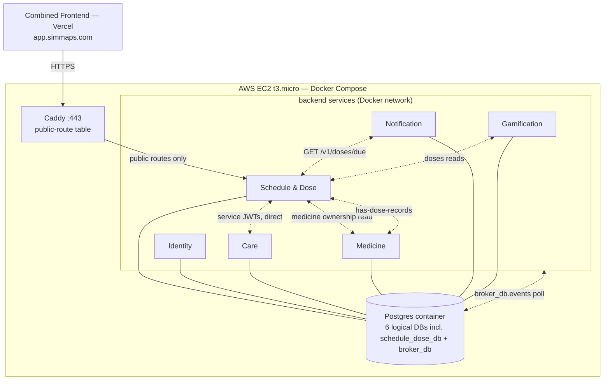
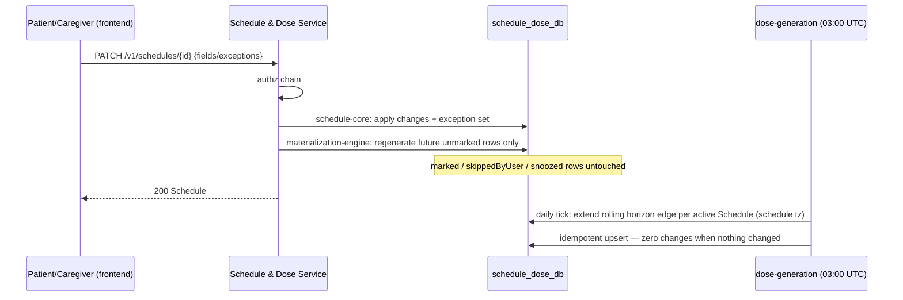
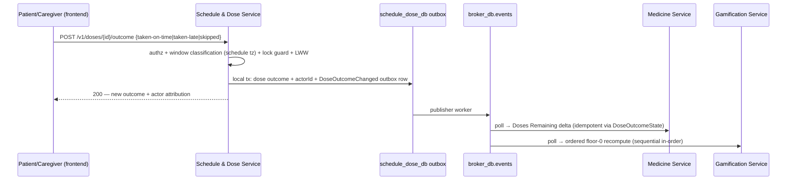
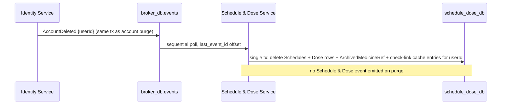

# HLD-MEDO-SCHEDULE-DOSE-001: Schedule & Dose Service — Schedules, materialized Dose rows, and outcome lifecycle

## 1. Document control header

Schedule & Dose | backend-microservice | PRD-MEDO-SCHEDULE-DOSE-001@1.0 | approved

## 2. Design context and scope

### 2.1 Upstream PRD consumed

`PRD-MEDO-SCHEDULE-DOSE-001@1.0` (status: approved). Sections consumed by reference: §2 goals G-1…G-6 and non-goals NG-1…NG-9; §3 actors; §4 user stories US-SD-01…08; §5 functional requirements FR-SD-001…022 grouped 5.1 schedule CRUD & recurrence contract, 5.2 dose materialization & generation jobs, 5.3 dose windows/outcomes/missed-lock, 5.4 pull read APIs, 5.5 events/deletion/authz; §6 NFRs NFR-SD-01…06; §8 edge cases; §9 data requirements; §10 contract inventory; §7.5 boundary statement; §7.4 open questions OQ-SD-02/03/04. No requirement text is restated here (cite-don't-copy, hld-standard §6.1).

### 2.2 Component place in system

The Schedule & Dose Service owns the **Schedule** aggregate (recurrence definition, dose times, schedule-owned timezone, resolved start/end, per-occurrence exceptions), the materialized **Dose** rows with their window/outcome lifecycle (`skippedByUser` flag, `snoozedUntil`, outcome + actor attribution), the two embedded jobs (`dose-generation`, `missed-lock-tick`), and the `DoseOutcomeChanged` event stream (`service-catalog.md#schedule-dose-service@2026-11-22`; PRD §7.5). It is Medo's volatile core: it turns a Schedule into persisted occurrences that three downstream services depend on — Medicine applies Doses Remaining deltas, Gamification recomputes Harmony Points/theme, Notification polls `GET /v1/doses/due` for reminders.

It does NOT own: medicine identity, stock, Doses Remaining arithmetic, or refill alerts (Medicine Service — this service references `medicineId` opaquely except the create-time ownership validation, HD-SCH-09); reminder composition/delivery, feed rows, push subscriptions, or reminder policy (Notification Service); Harmony Points/theme computation (Gamification Service); user accounts, profiles, or timezones (Identity Service — Schedule stores its own tz, never resolves profiles); Care Link state (Care Service — `check-link` consumed as caller only). It never resolves medicine display data for reads — the frontend composes display via Medicine's own routes (`frontend-map.md`).

### 2.3 Design goals

- DG-SCH-1: The Schedule-owned timezone is authoritative for every window classification, outcome derivation, missed-lock transition, and generation boundary — never the user's profile timezone or server UTC date. [`PRD-MEDO-SCHEDULE-DOSE-001@1.0#FR-SD-010`; Map 2 ticket 04 via `.scratch/medo-services/`]
- DG-SCH-2: Materialized Dose rows are the single dose truth — every read API, internal poll, and consumer sees rows, never recomputed occurrences; generation is idempotent upsert by occurrence identity and never overwrites rows carrying state. [`PRD-MEDO-SCHEDULE-DOSE-001@1.0#FR-SD-007`; Map 2 ticket 04]
- DG-SCH-3: Every outcome change commits the Dose-row write and its `DoseOutcomeChanged` outbox row in one `schedule_dose_db` transaction — no outcome without its event, no event without its outcome. [`PRD-MEDO-SCHEDULE-DOSE-001@1.0#FR-SD-020c`; `inherited:.scratch/medo-backend/issues/07-message-broker-event-transport.md@2026-11-21`]
- DG-SCH-4: Missed-lock precision ≤60 s after schedule-local midnight, deterministic and idempotent under tick overlap, restart, and concurrent marks — the lock transition is a guarded state change, not a timestamp scan side-effect. [`PRD-MEDO-SCHEDULE-DOSE-001@1.0#FR-SD-013`; `scheduled-jobs.md#schedule-dose-service@2026-11-21`]
- DG-SCH-5: All patient-scoped routes are authorized server-side per request — patient-self (`patientId` = session `sub`) or linked caregiver via Care `check-link`; internal routes require a Medo service JWT `aud=medo-schedule-dose` and reject user tokens. [`PRD-MEDO-SCHEDULE-DOSE-001@1.0#FR-SD-022`; `inherited:ticket-06/09`]
- DG-SCH-6: `MedicineArchived` suppression is a persisted, consumer-idempotent marker consulted by generation and the due-poll — it stops new rows AND hides unmarked future rows from reminders while retaining all rows as history (user-approved Option A). [`PRD-MEDO-SCHEDULE-DOSE-001@1.0#FR-SD-009/018`; `service-catalog.md` event catalog]
- DG-SCH-7: `AccountDeleted` purges all Schedules, Dose rows, and suppression markers for the user in one consumer transaction; redelivery is a no-op. [`PRD-MEDO-SCHEDULE-DOSE-001@1.0#FR-SD-021`]
- DG-SCH-8: The service is stateless at process level except `schedule_dose_db` + documented in-memory exceptions (rate-limit windows, check-link positive cache); restart/deploy loses nothing durable — both jobs are stateless ticks per `scheduled-jobs.md`. [`inherited:ticket-09@2026-11-21`; `scheduled-jobs.md#pattern@2026-11-21`]

### 2.4 Design non-goals

- RRULE expansion library choice, exact tz-library DST mechanics, `/v1/doses/due?window=` enum values + per-window DTO fields, DTO field lists, table/column shapes, queue internals → LLD.
- Guided-builder UI, calendar rendering, Today screen, Dexie schema/queue-cap/SW detail → Frontend HLD (`frontend-map.md` + `.scratch/medo-hld/issues/03-frontend-offline-architecture.md@2026-11-23`).
- Reminder timing/policy, email fallback, feed rows, push subscriptions → Notification Service HLD.
- Points/theme recompute → Gamification Service HLD.
- Medicine ownership/archive internals → Medicine Service HLD (this HLD consumes `MedicineArchived` and calls `GET /v1/medicines/{id}` only).
- Rate-limit numeric tuning beyond locked defaults → LLD config.

### 2.5 Inherited locked decisions

- Runtime/framework: Node.js + TypeScript + Fastify + Drizzle ORM (`inherited:.scratch/medo-backend/issues/01-backend-runtime-framework.md@2026-11-20`).
- Deployment/hosting: single AWS EC2 `t3.micro` + Docker Compose; frontend Vercel; `.env` local / SSM Parameter Store prod; Budget alert $25 (`inherited:…/02-deployment-model-hosting.md@2026-11-20`).
- Database: self-hosted Postgres container, six logical DBs with per-service users, `drizzle-kit` migrations; `schedule_dose_db` + own DB user (`inherited:…/03-database-technology.md@2026-11-21`).
- Object storage: Cloudflare R2 — **not used by this service** (no photo or file storage; stated for completeness — `inherited:…/04-object-storage-provider.md@2026-11-21`).
- API gateway: Caddy reverse proxy, explicit public-route table, per-service JWT verify, proxy-level CORS (`inherited:…/05-api-gateway-entry-point.md@2026-11-21`).
- Auth token mechanics: user JWTs verified locally via Identity JWKS/static config; internal service JWTs `iss=medo-<caller>`, `aud=medo-<target>`, 5-min, minted per call, static pubkey config (`inherited:…/06-auth-token-mechanics.md@2026-11-21`).
- Event transport: per-service transactional outbox → publisher → `broker_db.events`; sequential in-order per consumer, `last_event_id` offset, `eventId` dedupe, 5 attempts → `broker_db.dead_letters`; `@medo/eventing` shared package (`inherited:…/07-message-broker-event-transport.md@2026-11-21`).
- Observability: Pino JSON + `X-Request-Id`/`eventId`; per-service `/metrics`, `/health`, `/ready`; Sentry per service (`inherited:…/08-observability.md@2026-11-21`; `platform-observability.md@2026-11-21`).
- Rate limiting & caching: per-service Fastify plugin, in-memory sliding window; public 30/min/IP, auth'd writes 60/min/userId, auth'd reads 300/min/userId, internal exempt; 429 + `Retry-After`; caller-side caches this service depends on: Care check-link positive-only ~15 s TTL (`inherited:…/09-rate-limiting-caching.md@2026-11-21`).
- Notification prefs owned by Notification Service — Schedule & Dose holds no preference state (`inherited:…/10-notification-preferences-scope.md@2026-11-21`).
- Domain: `simmaps.com` — `app.simmaps.com` (Vercel), `api.simmaps.com` (Caddy→EC2), `photos.simmaps.com` (R2) (`inherited:.scratch/medo-hld/issues/01-domain-selection.md@2026-11-22`).
- Deploy mechanism: `medo-infra` repo (`compose.yml` + `Caddyfile` + `deploy.sh`); git-SHA images on GHCR; `deploy.sh` health-gates `/health`+`/ready` ~60 s with auto-rollback to `.last-good` (`inherited:.scratch/medo-hld/issues/02-cicd-deploy-mechanism.md@2026-11-23`).
- Quality/ops baselines: `platform-quality-baseline.md@2026-11-21`, `scheduled-jobs.md@2026-11-21`, `platform-observability.md@2026-11-21`.
- Service boundary + contract surface: `service-catalog.md#schedule-dose-service@2026-11-22` (Map 2 ticket 07; `MedicineArchived` consume added by Map 4 ticket 07 amendment, user-approved).
- Feature rules: guided builder → RRULE/date-list + optional start/end + EXDATE exceptions; fixed dose windows T−30/T+1hr/midnight; missed-lock; edit-until-midnight; snooze transient; plan-skip vs dose-skip distinction — `feature-list.md` + Map 1 tickets 05/06/10 via `.scratch/medo-features/`.
- Schedule-owned timezone (no profile-tz dependency), classification ownership, event-on-every-change, pull read model, snooze/plan-skip distinction — Map 2 ticket 04 via `.scratch/medo-services/`.

## 3. System context

FIG-SCH-01: system context diagram

```mermaid
flowchart LR
    subgraph Users
        P[Patient]
        C[Caregiver]
    end
    FE[Combined Frontend<br/>app.simmaps.com]
    SCH[Schedule & Dose Service]
    CARE[Care Service]
    MED[Medicine Service]
    NOT[Notification Service]
    GAM[Gamification Service]
    ID[Identity Service]
    CADDY[Caddy reverse proxy<br/>api.simmaps.com]
    BROKER[(broker_db.events<br/>+ dead_letters)]
    PG[(Postgres container<br/>schedule_dose_db + broker_db)]

    P --> FE
    C --> FE
    FE -->|public Schedule & Dose REST| CADDY
    CADDY --> SCH
    SCH -->|check-link<br/>service JWT aud=medo-care| CARE
    SCH -->|GET /v1/medicines/{id}<br/>service JWT aud=medo-medicine| MED
    NOT -->|GET /v1/doses/due<br/>service JWT aud=medo-schedule-dose| SCH
    MED -->|has-dose-records<br/>service JWT aud=medo-schedule-dose| SCH
    GAM -->|doses window/detail reads<br/>service JWT aud=medo-schedule-dose| SCH
    ID -->|AccountDeleted| BROKER
    MED -->|MedicineArchived| BROKER
    SCH -->|DoseOutcomeChanged| BROKER
    BROKER -->|poll| SCH
    SCH -->|outbox publish| BROKER
    BROKER -->|poll| MED
    BROKER -->|poll| GAM
    SCH --- PG
```

| Counterparty | Relationship (calls/consumes/publishes/is-called-by) | Contract(s) |
|---|---|---|
| Patient / Caregiver (via Combined Frontend) | is-called-by | All 9 public REST rows §7.1 (schedule CRUD + dose reads/writes) |
| Combined Frontend | calls through Caddy; never calls internal routes | §7.1 public rows; `frontend-map.md#per-screen-service-calls@2026-11-22` Today/dose-actions/scheduling rows |
| Caddy reverse proxy | pass-through entry; public-route table | `inherited:ticket-05@2026-11-21` |
| Care Service | calls `GET /v1/care/check-link` for caregiver authz on patient-scoped routes | §7.2; §10.4 cache binding |
| Medicine Service | Schedule & Dose calls `GET /v1/medicines/{id}` for schedule-create ownership validation (HD-SCH-09); Medicine calls `has-dose-records` here; Medicine publishes `MedicineArchived` consumed here; Medicine consumes `DoseOutcomeChanged` | §7.2; §8.1/§8.2/§8.4 |
| Notification Service | calls `GET /v1/doses/due?window=` per-minute poll (reminder + email-fallback input) | §7.1 internal row; §8.4 |
| Gamification Service | calls `GET /v1/patients/{id}/doses` + `GET /v1/doses/{id}` internal for pull-bootstrap; consumes `DoseOutcomeChanged` | §7.1 internal rows; §8.1 |
| Identity Service | publishes `AccountDeleted` consumed by Schedule & Dose | §8.2 |
| `broker_db` event fabric | publishes via own outbox; consumes `AccountDeleted` + `MedicineArchived` | §8.1/§8.2; `inherited:ticket-07@2026-11-21` |
| Resend / Web Push / Cloudflare R2 | no direct interaction — delivery owned by Notification; no file storage in this service | none (explicit none) |

## 4. Application topology and service boundaries

### 4.1 Deployable unit & entry path

Schedule & Dose runs as the `schedule-dose` container in the single Docker Compose stack on the AWS EC2 `t3.micro` (region ap-south-1 recommended, confirmed at deploy), alongside the other five services and the shared Postgres container (`inherited:ticket-02@2026-11-20`, `ticket-03@2026-11-21`, `.scratch/medo-hld/issues/02-cicd-deploy-mechanism.md@2026-11-23`). Public traffic enters via `api.simmaps.com` → Caddy → explicit public-route table → `schedule-dose` (`inherited:ticket-05@2026-11-21`, `.scratch/medo-hld/issues/01-domain-selection.md@2026-11-22`). Service-to-service calls go direct on the Docker network with per-service JWTs. Deploys are manual SSH via `medo-infra` (`deploy.sh` health-gates + rollback) pulling git-SHA images from GHCR. The two embedded `node-cron` jobs (`dose-generation`, `missed-lock-tick`) run inside this same process — no worker service (`scheduled-jobs.md#pattern@2026-11-21`).

### 4.2 Boundary statement

Mirroring `service-catalog.md#schedule-dose-service@2026-11-22` and PRD §7.5: Schedule & Dose solely owns the Schedule aggregate and the materialized Dose rows with their window/outcome lifecycle, plus the two embedded jobs and the `DoseOutcomeChanged` event stream.

Denied capabilities (explicit): no medicine identity, catalog, photos, Doses Remaining, or refill alerts (Medicine — `medicineId` is an opaque reference except the create-time ownership read, HD-SCH-09); no reminder composition/delivery, email fallback, feed rows, push subscriptions, or reminder policy (Notification — this service exposes dose *state* only); no Harmony Points/theme (Gamification); no accounts, sessions, profiles, or directory data (Identity — zero directory calls; Schedule stores its own tz); no Care Link state (Care — `check-link` consumed as caller only); no API-gateway logic (Caddy); no client-side scheduling UI or offline cache (frontend HLD).

### 4.3 Boundary invariants

- Own repository, own logical database `schedule_dose_db` in the shared Postgres container with own DB user; cross-DB access prohibited — peers are reached only via contracts/events (`inherited:ticket-03@2026-11-21`).
- No shared domain models or schemas with peer services; DTOs at every boundary (`service-catalog.md#conventions@2026-11-22`). `medicineId`/`patientId`/`actorId`/`doseId` are opaque foreign references — never resolved into peer schemas.
- Four logical layers `Infrastructure / Core / Application / WebAPI` per Architecture Standard; every §5 block carries exactly one primary layer (cross-layer justified inline).
- Read/write flow pattern: writes WebAPI → Application → Core → Infrastructure → `schedule_dose_db`; reads reverse; event-emitting writes additionally write the outbox row in the same transaction (`inherited:ticket-07@2026-11-21`). Deviations: schedule create performs a synchronous Medicine ownership read before the local tx (HD-SCH-09); schedule writes synchronously invoke `materialization-engine` before responding (FR-SD-008); `missed-lock-worker` and the daily job invoke the same Core/Application rules off-request. Peer I/O never inside the `schedule_dose_db` transaction.

FIG-SCH-02: topology position



## 5. Decomposition and internal structure

| Block | Responsibility | Layer | Contracts/events | HD-ref |
|---|---|---|---|---|
| `webapi-public` | HTTP presentation for all 9 public Schedule & Dose routes (5 schedule + 4 dose); user-JWT verification boundary; dual-authz entry for `GET /v1/patients/{id}/doses` + `GET /v1/doses/{id}` | WebAPI | §7.1 public rows | HD-SCH-01 |
| `webapi-internal` | HTTP presentation for internal-only routes (`GET /v1/doses/due`, `GET /v1/patients/{id}/has-dose-records`) + service-token variants of the two dual routes; service-JWT gate (`aud=medo-schedule-dose`) | WebAPI | §7.1 internal rows | HD-SCH-01 |
| `rate-limit` | Per-route sliding-window limiter plugin (auth'd classes) + 429/`Retry-After` | WebAPI | all §7.1 rows | — |
| `schedule-core` | Schedule aggregate rules: guided-builder payload validation, RRULE/date-list + exception storage, resolved start/end (incl. past-start clamp), edit→regeneration trigger, delete→history-retention rules, `medicineId` immutability | Core | schedule routes; invokes `materialization-engine` | HD-SCH-02/08 |
| `dose-core` | Dose row rules: schedule-tz window classification, outcome lifecycle (mark/edit until missed-lock, authoritative on-time/late derivation, `missed` system-set only), transient `snoozedUntil`, `skippedByUser` plan-skip semantics | Core | dose routes; publishes `DoseOutcomeChanged` | HD-SCH-03/04/07 |
| `materialization-engine` | Occurrence expansion + idempotent upsert by occurrence identity: synchronous path inside schedule writes + daily `dose-generation` job over the rolling horizon; honors the archived-medicine suppression registry | Application | schedule routes, `dose-generation` job | HD-SCH-02/05 |
| `missed-lock-worker` | Per-minute `missed-lock-tick`: schedule-local date-advance detection → guarded lock of prior-local-day unmarked doses + per-dose `DoseOutcomeChanged`; overlap/restart/idempotency guards | Application | `missed-lock-tick` job; invokes `dose-core` | HD-SCH-04 |
| `account-deletion-consumer` | `AccountDeleted` reaction: purge user's Schedules + Dose rows + suppression markers + check-link cache entries in one transaction | Application | consumes `AccountDeleted` | — |
| `medicine-archived-consumer` | `MedicineArchived` reaction: write the (medicineId, patientId) suppression marker read by `materialization-engine` + due-poll | Application | consumes `MedicineArchived` | HD-SCH-05 |
| `authz-client` | Care `check-link` calls + Medicine `GET /v1/medicines/{id}` ownership read; positive-only ~15 s caller-side cache on check-link answers + shared invalidation hook | Infrastructure | §7.2 consumed rows | HD-SCH-09 |
| `medicine-client` | Medicine `GET /v1/medicines/{id}` internal call for schedule-create ownership validation; fail closed, no cache | Infrastructure | §7.2 consumed row | HD-SCH-09 |
| `persistence` | `schedule_dose_db` repositories + transactional outbox writes for `DoseOutcomeChanged` | Infrastructure | §8.1 published event | — |
| `eventing` | Outbox publisher worker → `broker_db.events`; `AccountDeleted` + `MedicineArchived` consumer workers (offset + dedupe) via `@medo/eventing` | Infrastructure | §8.1/§8.2 | — |

Read/write flow: HTTP requests enter `webapi-*` (Zod DTO validation, rate-limit plugin, authz chain via `authz-client`), delegate to `schedule-core`/`dose-core` rules via `persistence` repositories; schedule writes additionally run `materialization-engine` synchronously before the response; `missed-lock-worker` and the daily `dose-generation` job invoke the same Core/Application rules off-request; `account-deletion-consumer` and `medicine-archived-consumer` orchestrate Application-level reactions off `broker_db`; `eventing` drains the outbox and polls `broker_db.events` independently. Cross-layer deviations: Medicine ownership read pre-tx on schedule create (HD-SCH-09) — peer I/O never inside the `schedule_dose_db` transaction.

## 6. Data architecture

### 6.1 Owned store & entity inventory

Owned store: `schedule_dose_db` — sole ownership; never shared, never read by peers (`PRD-MEDO-SCHEDULE-DOSE-001@1.0#9.1`; `inherited:ticket-03@2026-11-21`). Persistence approach: PostgreSQL + Drizzle ORM + `drizzle-kit` migrations at deploy (`inherited:ticket-01/03`). Shape classification at approach level: relational entity set (Schedule aggregate + materialized Dose rows + suppression markers) plus transactional outbox table (`inherited:ticket-07@2026-11-21`; uniform platform pattern, no `HD-` needed).

Entity inventory (ownership granularity, lifecycle per PRD §9.1 — cited, not re-derived):

| Entity | Lifecycle class | Notes |
|---|---|---|
| Schedule (patientId, medicineId, recurrence RRULE-or-date-list, doseTimes[], timezone, resolved start/end, exceptions, createdAt) | create → edit (fields + exceptions) → delete (dose history retained) | Schedule-owned tz captured at build time (Map 2 t04); references private Medicine record via opaque `medicineId`; exceptions = EXDATE-style skips + per-date time overrides stored inside the aggregate |
| Dose row (scheduleId, patientId, medicineId, scheduled local date+time, outcome ∈ unmarked/taken-on-time/taken-late/skipped/missed, `skippedByUser` flag, `snoozedUntil`, actorId attribution, timestamps) | materialize → mark/edit → missed-lock → retained as history (even after schedule delete) → purge on `AccountDeleted` | materialized occurrence identity enables idempotent regeneration (FR-SD-007; HD-SCH-02); `skippedByUser` rows are plan-level history — never outcomes, never events |
| ArchivedMedicineRef suppression marker (medicineId, patientId, archivedAt) | insert on `MedicineArchived` consume → consulted by generation + due-poll → purge on `AccountDeleted` | persisted suppression registry — HD-SCH-05; absorbing (Medicine archive is terminal, FR-MED-016) |
| Outbox rows (`DoseOutcomeChanged`) | insert same-tx → publish → delete | `@medo/eventing` pattern |
| Check-link cache entries (patientId+caregiverId → active) | request-time create → TTL expire → event-invalidate | caller-side obligation per ticket 09; in-process only |

### 6.2 Shared / consumed data

- **No shared/community data** — all owned data is patient-private (PRD §9.3). Medicine Catalog is shared but owned by Medicine Service; this service references private Medicine record ids only.
- Consumed (sync, internal REST): Care `GET /v1/care/check-link?patientId=&caregiverId=` — caregiver authz per patient-scoped request; positive-only ~15 s caller-side cache, negatives never cached (`inherited:ticket-09@2026-11-21`). Medicine `GET /v1/medicines/{id}` — schedule-create ownership validation only (HD-SCH-09); must be current, never cached, fail closed.
- Read-through data owned elsewhere: `patientId`/`medicineId`/`actorId`/`doseId` are opaque references resolved only through contracts — this service never replicates peer schemas and makes **no** Identity directory calls (PRD §11.1).

### 6.3 Consistency & coordination model

- Local transaction ownership: every `schedule_dose_db` write is one local transaction; event-emitting writes commit the domain change + outbox row atomically (`inherited:ticket-07@2026-11-21`). Peer I/O (check-link authz, Medicine ownership read) is always pre-transaction.
- Cross-service workflows (§8.4): schedule create verifies medicine ownership via sync Medicine read *before* the local create+materialize tx; `MedicineArchived`/`AccountDeleted` consumption applies reactions inside the consumer transaction. No compensating actions exist — all coordination is sync-call-then-local-tx or event-then-local-tx.
- Event consistency: outbox → publisher → `broker_db.events` → per-consumer sequential poll, `last_event_id` offset, at-least-once + `eventId` dedupe, 5 attempts → `dead_letters` (`inherited:ticket-07@2026-11-21`). Schedule & Dose publishes (1 event) and consumes (2 events).
- `DoseOutcomeChanged` ordering: publish order follows outcome-commit order per patient; Gamification's ordered floor-0 recompute relies on per-consumer sequential in-order delivery (ticket 07) — stated as a relied-upon assumption, not a new guarantee.
- Outcome concurrency: concurrent marks by Patient + Caregiver (or two caregivers) resolve last-write-wins per the platform idempotency rule (baseline "Idempotency" row); stored outcome, attribution, and emitted event reflect the final write (FR-SD-015; HD-SCH-03).
- Mark-vs-missed-lock race: the lock wins once schedule-local midnight has passed; a mark commits only while the dose is still unlocked — enforced by the guarded outcome transition inside the write tx, never by request timing (FR-SD-013c; HD-SCH-04).
- Materialization consistency: regeneration upserts by occurrence identity and touches only rows without outcome/mark/snooze/`skippedByUser` state — marked and plan-skipped rows are immutable to regeneration (FR-SD-004; HD-SCH-02).
- Suppression consistency: `medicine-archived-consumer` writes the marker in `schedule_dose_db`; `materialization-engine` and the due-poll read the same store — no cross-service read, no cache, so suppression is immediate and consistent (HD-SCH-05).
- Check-link cache consistency: positive answers cached ~15 s; `AccountDeleted` consumption purges entries involving the deleted userId via the shared invalidation hook; `CareLinkEnded` is **not** in this service's subscription set (catalog — Notification is the sole consumer) so ended-link answers remain possible for ≤15 s — the documented instant-revoke bound (§10.4, §18.3).

### 6.4 Retention & deletion

Per `platform-quality-baseline.md#data-retention@2026-11-21` + `scheduled-jobs.md#schedule-dose-service@2026-11-21`, Schedule & Dose-owned obligations:

- Schedules + Dose rows: account lifetime; purged on `AccountDeleted` consumption (FR-SD-021) — includes suppression markers and check-link cache entries for the user.
- Dose rows of deleted schedules: retained as patient history (FR-SD-005) — they age out only with the account.
- Dose rows of archived medicines: retained as history by design (FR-SD-009); generation stops and due-poll suppresses unmarked future rows.
- Missed-locked and final outcomes: immutable history — the audit trail for points/Doses Remaining correctness.
- `skippedByUser` rows: retained as plan history; never purged independently.
- No timed purge job exists beyond the two listed in `scheduled-jobs.md`; no backups in v1 — accepted risk (`platform-quality-baseline.md`).

## 7. External contracts

### 7.1 Exposed contracts

| Contract (verbatim) | Block | Sync/Async | Public/Internal | Authz binding | Idempotent? | Rate-limit class | Catalog ref |
|---|---|---|---|---|---|---|---|
| `GET /v1/patients/{id}/schedules` | `schedule-core` via `webapi-public` | REST sync | public | patient-self or linked caregiver (check-link) | n-a | auth'd read 300/min/userId | catalog §Schedule & Dose public REST |
| `POST /v1/patients/{id}/schedules` | `schedule-core` + `materialization-engine` via `webapi-public` + `medicine-client` | REST sync | public | patient-self or linked caregiver | client retry safe — distinct schedules (baseline rule) | auth'd write 60/min/userId | catalog §Schedule & Dose public REST |
| `GET /v1/schedules/{id}` | `schedule-core` via `webapi-public` | REST sync | public | patient-self or linked caregiver | n-a | auth'd read 300/min/userId | catalog §Schedule & Dose public REST |
| `PATCH /v1/schedules/{id}` | `schedule-core` + `materialization-engine` via `webapi-public` | REST sync | public | patient-self or linked caregiver | yes (regeneration converges to stored state) | auth'd write 60/min/userId | catalog §Schedule & Dose public REST |
| `DELETE /v1/schedules/{id}` | `schedule-core` via `webapi-public` | REST sync | public | patient-self or linked caregiver | yes (repeat → not-found) | auth'd write 60/min/userId | catalog §Schedule & Dose public REST |
| `GET /v1/patients/{id}/doses?from=&to=&outcome=` | `dose-core` via `webapi-public` | REST sync | public | patient-self or linked caregiver | n-a | auth'd read 300/min/userId | catalog §Schedule & Dose public REST |
| `GET /v1/doses/{id}` | `dose-core` via `webapi-public` | REST sync | public | patient-self or linked caregiver | n-a | auth'd read 300/min/userId | catalog §Schedule & Dose public REST |
| `POST /v1/doses/{id}/outcome` | `dose-core` via `webapi-public` | REST sync | public | patient-self or linked caregiver | yes — last-write-wins on outcomes (baseline idempotency) | auth'd write 60/min/userId | catalog §Schedule & Dose public REST |
| `POST /v1/doses/{id}/snooze` | `dose-core` via `webapi-public` | REST sync | public | patient-self or linked caregiver | yes (repeat snooze extends `snoozedUntil`) | auth'd write 60/min/userId | catalog §Schedule & Dose public REST |
| `GET /v1/doses/due?window=` | `dose-core` via `webapi-internal` | REST sync | internal | service JWT `aud=medo-schedule-dose` only | n-a (read-only poll) | internal exempt | catalog §Schedule & Dose internal REST |
| `GET /v1/patients/{id}/doses?from=&to&outcome=` | `dose-core` via `webapi-internal` | REST sync | internal | service JWT `aud=medo-schedule-dose` only | n-a | internal exempt | catalog §Schedule & Dose internal REST |
| `GET /v1/patients/{id}/has-dose-records` | `dose-core` via `webapi-internal` | REST sync | internal | service JWT `aud=medo-schedule-dose` only | n-a | internal exempt | catalog §Schedule & Dose internal REST |
| `GET /v1/doses/{id}` | `dose-core` via `webapi-internal` | REST sync | internal | service JWT `aud=medo-schedule-dose` only | n-a | internal exempt | catalog §Schedule & Dose internal REST |

Rate-limit classes per `inherited:ticket-09@2026-11-21` defaults. Schedule & Dose has **no unauthenticated route** — every public row requires a valid session, so the public-by-IP class does not apply; all mutations are auth'd-write class (catalog authz = patient-self or linked caregiver, no session-only routes). The two dose reads (`GET /v1/patients/{id}/doses`, `GET /v1/doses/{id}`) are dual-authz: the same path serves the public patient-scoped chain and the internal service-token chain — cross-token-class calls are rejected both directions (FR-SD-022c; HD-SCH-01).

### 7.2 Consumed contracts

| Contract (verbatim) | Provider | Sync/Async | Public/Internal | Cache/staleness binding | Failure ref (§14) | Catalog ref |
|---|---|---|---|---|---|---|
| `GET /v1/care/check-link?patientId=&caregiverId=` | Care Service | sync REST | internal | positive-only ~15 s caller-side TTL; negatives never cached; `AccountDeleted` purges entries for the user (`inherited:ticket-09`) | §14 row CARE-CHECKLINK | catalog §Care internal REST |
| `GET /v1/medicines/{id}` | Medicine Service | sync REST | internal | none — must be current; schedule-create validation only; fail closed | §14 row MED-OWNERSHIP | catalog §Medicine internal REST |

### 7.3 Contract realization notes (backend profile §4.3/§4.5)

- Route groups: `webapi-public` hosts all 9 public routes — schedule routes run the authz chain then `schedule-core` (with synchronous `materialization-engine` on create/patch); dose routes run the authz chain then `dose-core`. `webapi-internal` hosts the two internal-only routes plus the service-token variants of the two dual routes.
- Shared aggregates: one Schedule aggregate underlies all 5 schedule routes; one Dose-row read/write surface underlies the 4 dose routes + 2 internal-only reads — multiple route groups per aggregate.
- Thin proxies: none — every route executes Core rules against `schedule_dose_db`; `/v1/doses/due` and `has-dose-records` are direct indexed reads over materialized rows.
- Sync fan-out to peers: `authz-client` calls Care `check-link` per caregiver request on every patient-scoped route; `medicine-client` calls Medicine `GET /v1/medicines/{id}` once per schedule create (ownership validation, HD-SCH-09). Both are pre-transaction; timeout/retry/fail-mode per §14. No other peer calls exist — this service never resolves profiles, catalog data, or medicine display fields.
- Internal surface: 4 rows (`/v1/doses/due`, `/v1/patients/{id}/has-dose-records`, + internal variants of the two dual routes); callee-side expectation `iss=medo-<caller>`, `aud=medo-schedule-dose`, 5-min token (`inherited:ticket-06@2026-11-21`); unreachable via Caddy public table AND independently service-JWT gated (`inherited:ticket-05@2026-11-21`). Callers: Notification (`/doses/due` per-minute poll), Medicine (`has-dose-records` delete guard), Gamification (doses window/detail pull-bootstrap).
- Caller-side caching obligations: Schedule & Dose *is* a consumer of the check-link positive-only ~15 s cache contract — the cache lives in `authz-client` and is invalidated via the shared hook on `AccountDeleted` (purges entries involving the deleted userId); `CareLinkEnded` is not subscribed (catalog — Notification is the sole consumer) so link-end staleness is TTL-bounded only (§10.4). `has-dose-records` must be current — never cached (Medicine delete-guard contract, FR-SD-019).
- Dual-authz routes: `GET /v1/patients/{id}/doses` + `GET /v1/doses/{id}` accept either a user JWT satisfying patient-self/linked-caregiver authz (public path) or a service JWT `aud=medo-schedule-dose` (internal path); the two token classes never satisfy each other's routes (FR-SD-022c).
- `actorId` exposure: dose DTOs carry `actorId` (opaque userId of the last outcome actor) so the frontend can render the "marked by" indicator by comparing against the session `sub` — resolves frontend OQ-FE-05 at HLD level (HD-SCH-06); displayName resolution is not provided (no directory dependency, PRD §11.1).

## 8. Integration events and workflows

### 8.1 Published events

`DoseOutcomeChanged` is produced by `persistence` outbox writes inside the same transaction as every outcome transition (client mark, outcome edit, missed-lock); `eventing` publishes via `@medo/eventing`. Ordering within Schedule & Dose's stream: publish order follows outcome-commit order; per-patient ordering is relied upon by Gamification's ordered recompute — guaranteed by per-consumer sequential in-order delivery (`inherited:ticket-07`), not by publisher sequencing. Dedup: at-least-once delivery; consumers dedupe on `eventId`.

| Event (verbatim) | Block | Trigger | Consumers | Ordering/dedup notes |
|---|---|---|---|---|
| `DoseOutcomeChanged` | `dose-core`/`missed-lock-worker`/`persistence` | EVERY outcome change — client marks, outcome edits until missed-lock, missed-lock transitions; payload `{doseId, medicineId, patientId, outcome, actorId?, occurredAt}`, outcome ∈ `taken-on-time \| taken-late \| skipped \| missed` | Medicine, Gamification | independent events; per-patient publish order relied on by Gamification recompute; `actorId` present on client marks, absent on system `missed` |

### 8.2 Consumed events

| Event (verbatim) | Producer | Required reaction | Idempotent-consumer statement | Failure path |
|---|---|---|---|---|
| `AccountDeleted` | Identity | Purge all Schedules + Dose rows + suppression markers for `userId`; purge check-link cache entries involving userId; emit no further events for them | Terminal-state idempotent — redelivery finds nothing to purge (FR-SD-021b) | 5 attempts → `broker_db.dead_letters`; manual replay |
| `MedicineArchived` | Medicine | Write (medicineId, patientId) suppression marker — stops generation for that medicine's schedules (incl. future ones) and excludes unmarked future Dose rows from `/v1/doses/due`; existing rows retained | Marker insert is set-idempotent — redelivery rewrites the same marker, no-op (FR-SD-009c/d) | 5 attempts → `broker_db.dead_letters`; manual replay |

### 8.3 Explicit none-statements

- Publishes exactly one event: `DoseOutcomeChanged`. Snooze writes and `skippedByUser` plan-skips emit **no** event (FR-SD-006a/014); schedule CRUD emits no event — consumers read state via contracts.
- Consumes exactly two events: `AccountDeleted` + `MedicineArchived`. `CareLinkEnded`, `ProfileChanged`, `DoseOutcomeChanged` (self-produced — never looped back), and all other catalog events are **not** subscribed.
- `AccountDeleted` purge emits **no** Schedule & Dose event — no consumer needs a "schedules purged" signal (each service consumes `AccountDeleted` for its own scope).
- No reminder/due events are published — Notification pulls `GET /v1/doses/due` (Map 2 ticket 05 pull model; no `DoseReminderDue` events exist).

### 8.4 Cross-service workflows

| Workflow | FIG | Coordination model per hop | Failure semantics |
|---|---|---|---|
| Schedule create → synchronous materialization | FIG-SCH-04-1 | `POST /v1/patients/{id}/schedules` → authz (self or check-link) → sync `GET /v1/medicines/{id}` ownership read → local tx (Schedule + outbox-free create) → `materialization-engine` upserts Dose rows → response | Medicine unreachable ⇒ fail-closed reject, retryable (HD-SCH-09); check-link down ⇒ caregiver denied, patient-self unaffected; materialization is idempotent — partial failure rolls back the whole create |
| Schedule edit → regeneration (+ daily job) | FIG-SCH-04-2 | `PATCH /v1/schedules/{id}` → authz → `schedule-core` applies fields/exceptions → `materialization-engine` regenerates future unmarked rows (sync) → daily `dose-generation` job extends rolling edge `03:00 UTC` | marked/`skippedByUser`/snoozed rows untouched by regeneration (HD-SCH-02); job failure = stateless tick retry next run; idempotent upsert prevents partial-state corruption |
| Dose outcome mark/edit → event fan-out | FIG-SCH-04-3 | `POST /v1/doses/{id}/outcome` → authz → `dose-core` guarded transition (window + lock checks, LWW) → local tx {dose row + `DoseOutcomeChanged` outbox} → `broker_db.events` → Medicine delta + Gamification recompute | outcome write and event are atomic — no outcome without event; concurrent marks LWW (HD-SCH-03); post-lock edits rejected; consumers own idempotency |
| Missed-lock tick | FIG-SCH-04-4 | `missed-lock-tick` every minute → scan active Schedules → per-schedule local-date advance in stored tz → guarded lock of prior-local-day unmarked doses → per-dose `DoseOutcomeChanged` outbox rows → publish | ≤60 s precision bound; locked rows excluded from re-scan → no double-emit; tick overlap impossible on single instance + job guard; crash mid-tick retries next tick, already-locked rows skipped (HD-SCH-04) |
| `MedicineArchived` consume → suppression | FIG-SCH-04-5 | Medicine archive tx → `MedicineArchived` outbox → `broker_db.events` → Schedule & Dose consumer → suppression marker write → generation engine skips + due-poll excludes | consumer retry → `dead_letters` after 5; marker idempotent; already-materialized rows unaffected (retained as history); late-created schedules auto-suppressed via marker lookup (HD-SCH-05) |
| `AccountDeleted` consume → purge | FIG-SCH-04-6 | Identity `AccountDeleted` → Schedule & Dose consumer → single tx purge (Schedules + Dose rows + markers + check-link cache entries) | consumer retry → `dead_letters`; idempotent re-run; late writes for deleted patient rejected (no session) or no-op |

FIG-SCH-04-1: schedule create → synchronous materialization

```mermaid
sequenceDiagram
    participant U as Patient/Caregiver (frontend)
    participant SCH as Schedule & Dose Service
    participant CARE as Care Service
    participant MED as Medicine Service
    participant DB as schedule_dose_db
    U->>SCH: POST /v1/patients/{id}/schedules {guided-builder payload}
    SCH->>SCH: authz — patient-self (sub match) or caregiver → check-link
    opt caregiver session
        SCH->>CARE: GET /v1/care/check-link (service JWT aud=medo-care; ≤15s positive cache)
        CARE-->>SCH: active | inactive
    end
    SCH->>MED: GET /v1/medicines/{id} (service JWT aud=medo-medicine; ownership check)
    MED-->>SCH: medicine record | not-found/error
    SCH->>DB: local tx: Schedule create (resolved start/end, exceptions)
    SCH->>DB: materialization-engine: idempotent upsert of Dose rows today→+90d
    SCH-->>U: 201 Schedule — dose rows queryable immediately
```

FIG-SCH-04-2: schedule edit → regeneration (+ daily job)



FIG-SCH-04-3: dose outcome mark/edit → event fan-out



FIG-SCH-04-4: missed-lock tick

```mermaid
sequenceDiagram
    participant JOB as missed-lock-tick (every minute)
    participant SCH as Schedule & Dose Service
    participant DB as schedule_dose_db
    participant BR as broker_db.events
    JOB->>SCH: tick fires (embedded node-cron)
    SCH->>DB: scan active Schedules
    loop per Schedule
        SCH->>SCH: compute schedule-local date in stored tz — advanced?
        SCH->>DB: guarded lock: prior-local-day unmarked doses → outcome missed
        SCH->>DB: one DoseOutcomeChanged outbox row per locked dose (same tx)
    end
    SCH->>BR: publisher worker drains outbox
    Note over SCH,DB: ≤60s after schedule-local midnight; locked rows never re-scanned
```

FIG-SCH-04-5: `MedicineArchived` consume → suppression

```mermaid
sequenceDiagram
    participant MED as Medicine Service
    participant BR as broker_db.events
    participant SCH as Schedule & Dose Service
    participant DB as schedule_dose_db
    participant N as Notification Service
    MED->>BR: MedicineArchived {medicineId, patientId} (same tx as archive)
    BR->>SCH: sequential poll, last_event_id offset
    SCH->>DB: write ArchivedMedicineRef marker (idempotent)
    Note over SCH,DB: generation engine skips marker-matched schedules;<br/>/v1/doses/due excludes unmarked future rows of marker-matched medicines
    N->>SCH: GET /v1/doses/due?window= (per-minute poll)
    SCH-->>N: due doses — archived-medicine unmarked future rows absent
```

FIG-SCH-04-6: `AccountDeleted` consume → purge



## 9. Frontend contract surface

| frontend-map row | Screen/module | Contract IDs used | Sync pattern | Offline classification |
|---|---|---|---|---|
| Today (dose list + theme + points + notifications) | Today screen | `GET /v1/patients/{id}/doses?from=today&to=today` | parallel fan-out leg alongside Gamification/Notification/Medicine calls | dose window Dexie-cached (7-day window per ticket 03); refresh on open/reconnect/post-mutation/~15 min interval |
| Dose actions (taken/skipped/snooze) | Dose action flow | `POST /v1/doses/{id}/outcome`, `POST /v1/doses/{id}/snooze` | user-driven actions; FIFO write-queue replay offline | **write-queue** — the only Schedule & Dose writes queued offline; server LWW resolves conflicts |
| Scheduling builder + exceptions | Schedule builder screen | `GET/POST /v1/patients/{id}/schedules`, `GET/PATCH/DELETE /v1/schedules/{id}` | user-driven sequential CRUD + list refresh | schedules Dexie-cached (all schedules per ticket 03); mutations API-only online |

`patientId` rule binding: for Patient accounts `patientId` = Identity `userId`; for Caregiver accounts the frontend passes the selected Care Link's `patientId` (from `GET /v1/care/links`) — Schedule & Dose treats `patientId` as an opaque reference and authorizes via patient-self `sub` match or Care `check-link` per request; it never resolves profiles. Offline implications: dose window reads and schedule reads are Dexie-cached per `frontend-map.md#dexie-offline-sync-contract` + ticket 03 scope; outcome/snooze writes enqueue to the global FIFO write-queue and replay to the public outcome/snooze routes; all Schedule CRUD is online-only (not write-queued); internal routes are never called by the frontend.

## 10. Cross-cutting concerns

### 10.1 Authentication & authorization summary

Two trust domains (`inherited:ticket-06@2026-11-21`):

- **User JWTs** — issued by Identity, verified locally via JWKS/static config. All 9 public routes require a valid access JWT. Patient-scoped routes authorize per request: patient-self when `patientId` = session `sub`, else linked caregiver via Care `check-link` (FR-SD-022); caregiver gets full parity incl. outcome marks with `actorId` attribution (Map 1 ticket 03).
- **Service JWTs** — internal routes (`/v1/doses/due`, `/v1/patients/{id}/has-dose-records`, internal variants of the two dual routes) require `aud=medo-schedule-dose`, 5-min token minted per call; user tokens rejected. Outbound calls mint `aud=medo-care` (check-link) and `aud=medo-medicine` (ownership read) per call.

Authz level per contract is stated in §7.1; the distinctive Schedule & Dose rules: `missed` outcome is system-set only and rejected from clients (FR-SD-011c); outcome classification (on-time vs late) is derived server-side from mark timestamp in schedule tz — client-supplied class contradicting the window is rejected (FR-SD-011); `has-dose-records` returns the current answer with no cache (FR-SD-019); check-link denial or Care-unreachable ⇒ deny, fail closed (FR-SD-022b).

### 10.2 Observability binding

Per `platform-observability.md@2026-11-21` with Schedule & Dose deltas:

- Logs: Pino JSON, `service=schedule-dose`, `requestId`/`eventId` correlation; never log dose outcome payloads beyond request-scoped need or `actorId` values outside attribution context.
- `GET /metrics` (service-JWT gated, internal): fixed RED set + Schedule & Dose counters — schedules created/edited/deleted, dose rows generated/locked, outcome marks/edits, snoozes, `DoseOutcomeChanged` published, `MedicineArchived`/`AccountDeleted` consumed + failed, `/v1/doses/due` poll count+latency, job run success/fail for both jobs (PRD NFR-SD-06).
- Sentry project: `medo-schedule-dose` (DSN via env/SSM).
- `GET /health` public liveness; `GET /ready` internal readiness — dependency checks: own `schedule_dose_db` ping + `broker_db` ping (publisher + two consumers). Deps named: `schedule_dose_db`, `broker_db`.

### 10.3 Resilience binding

Schedule & Dose's dependency rows from `platform-quality-baseline.md#resilience-defaults@2026-11-21`:

| Dependency | Binding |
|---|---|
| Own Postgres (`schedule_dose_db`) | 5 s fast-fail → 503; cited, no delta |
| Care `check-link` (internal REST row) | 3 s timeout + 1 retry/200 ms → fail closed deny on patient-scoped caregiver calls; patient-self routes unaffected; ~15 s positive caller cache absorbs blips (`inherited:ticket-09`); cited |
| Medicine `GET /v1/medicines/{id}` (internal REST row) | 3 s timeout + 1 retry/200 ms → **fail closed**: schedule create refused retryable (HD-SCH-09); only the create path is affected — reads, edits, dose actions, jobs unaffected; cited |
| `broker_db` event transport (publisher + 2 consumers) | outbox retry built into `@medo/eventing`; 5 attempts → `dead_letters`; cited |
| Resend / Web Push / Cloudflare R2 | N/A — Schedule & Dose has no direct external provider calls (delivery owned by Notification; no file storage; stated PRD §11.1) |

Inbound callers (Notification `/doses/due`, Medicine `has-dose-records`, Gamification doses reads) are not dependencies — their failure modes are §14 rows on the read contracts.

### 10.4 Rate limiting & caching

Per `inherited:ticket-09@2026-11-21`: per-service Fastify plugin, in-memory sliding window; internal service-JWT routes exempt; 429 + `Retry-After`. Schedule & Dose deltas: **no public-by-IP exposure** — every route requires a session or service JWT, so auth'd classes apply throughout: reads 300/min/userId, writes 60/min/userId. Caches: Schedule & Dose owns the **Care check-link caller-side cache** in `authz-client` — positive-only ~15 s TTL, negatives never cached, shared-hook invalidation on `AccountDeleted` (purges entries involving the deleted userId); `CareLinkEnded` is not subscribed so ended-link answers remain possible for ≤15 s — the documented instant-revoke bound. No other caches — dose-window reads are indexed queries over materialized rows; `/v1/doses/due` is a bounded per-minute poll needing no cache (NFR-SD-01 internal class).

### 10.5 Error handling & input protection

Standard JSON error body platform-wide; `Retry-After` on 429; fail-cleanly rule (clear 4xx/5xx, never crash/hang; degrade where cheap; no silent data loss) per `platform-quality-baseline.md#availability`. DTO-at-boundary with Zod validation at `webapi-*` (`inherited:ticket-01@2026-11-20` libs). Response posture: invalid guided-builder payloads → 4xx with field-level rejection (FR-SD-001c); other-patient/nonexistent `medicineId` → reject (FR-SD-001b); unknown ids → not-found; post-lock outcome edits → reject; client-submitted `missed` or contradictory taken-class → reject; `/v1/doses/due` with empty window → empty result, not error (FR-SD-018 — Notification polls blindly).

### 10.6 Sensitive-data handling

PII: dose scheduled times, outcomes, snooze state, `medicineId`/`patientId` linkage, and `actorId` attribution = health-adjacent PII revealing medication adherence (PRD §9.5); `actorId` identifies which caregiver acted — kept per Map 1 ticket 03 and exposed in dose DTOs as an opaque id only (HD-SCH-06). `patientId`/`medicineId`/`doseId` are opaque references. No credentials, tokens, or secrets stored by this service. Event payloads carry minimal fields only per catalog conventions — the minimal-change rule doubles as data minimization. No secrets beyond service private key + DB credentials + Sentry DSN (SSM/`.env`).

## 11. Security architecture

### 11.1 Trust boundaries

| Boundary | Mechanism | Binding |
|---|---|---|
| Internet → Caddy → Schedule & Dose (public routes) | explicit public-route table only; unlisted = 404; user JWT verified per-service | `inherited:ticket-05@2026-11-21` |
| Internal routes → Schedule & Dose | service JWT `aud=medo-schedule-dose`, independently gated (defense in depth behind route table); unreachable publicly | `inherited:ticket-05/06` |
| Service → Schedule & Dose internal routes | per-service JWTs minted per call by Notification/Medicine/Gamification | `inherited:ticket-06@2026-11-21` |
| Schedule & Dose → Care / Medicine | service JWT `aud=medo-care` / `aud=medo-medicine`, minted per call | `inherited:ticket-06@2026-11-21` |
| Frontend → API | `Authorization: Bearer` access JWT; refresh cookie `HttpOnly; Secure; SameSite=Lax; Path=/v1/auth`, host-only on `api.simmaps.com`, set by Identity via proxy | `inherited:ticket-05@2026-11-21`; domain ticket 01 |
| CORS | terminated once at Caddy; exact-origin allowlist + `Allow-Credentials`; no wildcard+credentials | `inherited:ticket-05@2026-11-21` |

### 11.2 Token lifecycle binding

Schedule & Dose is stateless-verify only — it owns no session store (`inherited:ticket-06@2026-11-21`):

- User access JWTs: 25-min stateless, verified via Identity JWKS/static config; revocation lag ≤25 min accepted platform-wide.
- Refresh/session lifecycle: entirely Identity-owned — Schedule & Dose has no obligation beyond rejecting expired/invalid access JWTs.
- Service JWTs: 5-min aud-scoped, minted per call for `check-link` (`aud=medo-care`), medicine ownership read (`aud=medo-medicine`), and inbound `aud=medo-schedule-dose` verification — no caching of minted tokens.
- `actorId` attribution is recorded from the verified session `sub` — never from client-supplied identity fields (FR-SD-011).

### 11.3 Data exposure analysis

- Schedule DTOs: patient-scoped only — list is `patientId`-filtered under authz; detail exposes the stored recurrence/times/exceptions sufficient to render the guided builder (FR-SD-003) — no internal fields (DTO rule).
- Dose DTOs: patient-scoped public + internal service reads share the same boundary DTO — scheduled time, window state, outcome, `skippedByUser`, `snoozedUntil`, `actorId` (opaque), medicine linkage (FR-SD-016/017). `actorId` exposure decided by HD-SCH-06 — opaque id only, no displayName.
- Internal DTOs: `/v1/doses/due` returns the fields Notification needs to compose reminders (doseId, medicineId, patientId, scheduled time, current state — FR-SD-018); `has-dose-records` returns a boolean — minimal by design.
- PII classes: health-adjacent dose/schedule data at rest in `schedule_dose_db`; `userId`-shaped references only; no photo/media content exists in this service.

### 11.4 Abuse controls

| Control | Binding |
|---|---|
| Auth'd read 300/min/userId on all GET routes | `inherited:ticket-09@2026-11-21` |
| Auth'd write 60/min/userId on all mutations (schedule CRUD, outcome, snooze) | `inherited:ticket-09@2026-11-21` |
| Internal routes exempt from rate limits, service-JWT gated | `inherited:ticket-09` + `ticket-05` |
| `/v1/doses/due` reachable only by service JWT — user tokens rejected | FR-SD-018a; §10.1 |
| `missed` outcome rejected from clients — system-set only | FR-SD-011c |
| Contradictory taken-class rejected — server derives classification | FR-SD-011b |
| Outcome/snooze writes on locked or out-of-window doses rejected | FR-SD-010b/012b/014b |
| Patient-scoped authz server-side per request; check-link fail-closed | FR-SD-022; §10.1 |
| Medicine ownership validation on schedule create — cross-patient `medicineId` rejected | FR-SD-001b; HD-SCH-09 |

No new security choice beyond HD records — nothing flagged for approval.

## 12. Deployment topology and assumptions

### 12.1 Runtime & platform binding

Node.js + TypeScript + Fastify + Drizzle (`inherited:ticket-01@2026-11-20`); `schedule-dose` container in the shared Docker Compose stack on AWS EC2 `t3.micro` (ap-south-1 recommended) with five peer services + one Postgres container hosting `schedule_dose_db` among six logical DBs (`inherited:ticket-02/03@2026-11-20/21`). Frontend on Vercel at `app.simmaps.com` (`inherited:.scratch/medo-hld/issues/01-domain-selection.md@2026-11-22`).

### 12.2 Entry path & network position

`app.simmaps.com` (browser) → `api.simmaps.com` → Caddy public-route table → `schedule-dose` container for all 9 public routes. Internal routes are unreachable via the public table AND independently service-JWT gated inside the service. Peers reach Schedule & Dose directly on the Docker network (`/v1/doses/due` caller, `has-dose-records` caller, dual-route service variants); Schedule & Dose reaches Care + Medicine directly for sync calls; events flow via `broker_db` tables in the same Postgres container (`inherited:ticket-05/07`).

### 12.3 Environments & secrets

Local Docker Compose dev + single AWS prod; no staging (`inherited:ticket-02@2026-11-20`). Secrets: `.env` local / SSM Parameter Store prod via instance IAM role — Schedule & Dose's secrets: service private key (verify inbound `aud=medo-schedule-dose` callers against static pubkey config; mint `aud=medo-care`/`aud=medo-medicine` calls), DB credentials, Sentry DSN (`inherited:ticket-02/06/08`).

### 12.4 Resource & scaling assumptions

Single instance per service; RAM footprint class small-to-moderate (Fastify service + two embedded `node-cron` jobs + two event consumers; no media processing). In-memory rate-limit windows and the check-link positive cache valid because single-instance (`inherited:ticket-09@2026-11-21`) — documented exceptions; stores swappable if horizontal scaling arrives. The per-minute `missed-lock-tick` scans active Schedules (small set at <50 users) and the nightly `dose-generation` batch is bounded by schedules × 90-day horizon — tens of thousands of rows worst case, single-table scans acceptable (NFR-SD-03). `/v1/doses/due` is the hottest route — one call/minute per Notification instance plus frontend dose-window reads; indexed lookups over materialized rows.

### 12.5 Health, jobs hooks & deploy checks

- `GET /health` — public liveness (UptimeRobot target via gateway).
- `GET /ready` — internal readiness; checks `schedule_dose_db` ping + `broker_db` ping.
- Deploy: `medo-infra` `deploy.sh` health-gates `/health`+`/ready` ~60 s, auto-rollback to `.last-good` (`inherited:.scratch/medo-hld/issues/02-cicd-deploy-mechanism.md@2026-11-23` — identical binding across all HLDs).
- Jobs hooks: two embedded `node-cron` jobs run inside the service process per `scheduled-jobs.md#schedule-dose-service@2026-11-21` — `dose-generation` daily `03:00 UTC` (horizon extension) and `missed-lock-tick` every minute (missed-lock). Both stateless ticks: failure = log + Sentry + next-tick retry; each exposes a job success/fail counter on `/metrics`.

### 12.6 Assumptions register

| Assumption | Owner | Revisit trigger |
|---|---|---|
| Region ap-south-1 confirmed at AWS deploy | user | EC2 provisioning |
| Elastic IP reserved for stable `api.simmaps.com` A-record | user | DNS cutover (`inherited:ticket-01` carried note) |
| Cloudflare free-tier front layer deferred to V2 | user | V2 planning |
| Vercel preview deploys have no login in v1 | user | first preview needing auth |
| Single instance per service holds for Schedule & Dose's deploy lifetime — required for missed-lock tick exclusivity and in-memory caches | user/ops | first horizontal-scaling need (job leader-election + cache/limit store swap per ticket 09) |
| `schedule_dose_db` logical DB + dedicated DB user provisioned by compose/migration tooling | LLD | LLD persistence design |
| SSM Parameter Store reachable from EC2 instance role for secrets | user/ops | AWS deploy (`inherited:ticket-02`) |
| Care + Medicine reachable on Docker network for sync calls | ops | compose topology change |
| `has-dose-records`, `/v1/doses/due`, and dual-route contract shapes stable for callers | consuming-service HLDs | contract change (additive-only rule protects them) |

## 13. Scalability, performance and capacity

Cited envelope (`platform-quality-baseline.md#load-envelope@2026-11-21`): <50 concurrent users, <5k dose events/day, <10k catalog entries, single `t3.micro` sizing. Latency classes (`#latency-targets`): public reads <300 ms p95 (schedules list/detail, doses window/detail), public writes <500 ms p95 (schedule CRUD, outcome, snooze), internal <200 ms p95 (`/v1/doses/due`, `has-dose-records`, internal doses reads — `/v1/doses/due` polled every minute must stay cheap, NFR-SD-01).

Schedule & Dose's position in the envelope — the platform's temporal-correctness core:

- `/v1/doses/due` is the hottest route — one call/minute from Notification's `reminder-email-tick` plus frontend dose-window reads; both are indexed lookups over materialized rows bounded by the 7-day frontend window and reminder horizons.
- `missed-lock-tick` scans active Schedules once/minute — small set (<50 users × few schedules); per-schedule work is a local-date comparison + guarded update of that day's unmarked rows.
- `dose-generation` is a nightly batch over the rolling horizon edge — idempotent upsert over tens of thousands of rows worst case; stateless retry on partial failure.
- Materialized rows bounded by schedules × 90-day horizon × dose-times-per-day — single-table scans acceptable at envelope scale (NFR-SD-03).
- Stress point: none beyond envelope; the binding constraint is temporal correctness (per-schedule tz math, ≤60 s missed-lock precision, edit-until-midnight), not throughput (PRD §1).

Scaling model: scale-up-then-horizontally-per-service — single instance now; design must not preclude horizontal scaling. Statelessness holds: all durable state in `schedule_dose_db`; the only non-scalable components are the in-memory rate-limit window and check-link positive cache (documented exceptions, swappable stores — `inherited:ticket-09`). Horizontal scaling would additionally require job leader-election for the two `node-cron` jobs and per-consumer-group offset partitioning — noted as the documented exception path, not built in v1.

## 14. Failure, recovery and degraded operation

| Dependency/Contract/Event | Failure mode | Required behavior | Mechanism class | HD-ref |
|---|---|---|---|---|
| `schedule_dose_db` | timeout/unavailable | 503 JSON; all routes + both jobs + both consumers pause (offset not advanced) | fast-fail per baseline | — |
| Care `check-link` | timeout/error on caregiver call | deny — patient-scoped caregiver routes fail closed; patient-self (`sub` match, no peer call) unaffected | fail-closed deny per baseline | — |
| Care `check-link` | stale positive ≤15 s after link end | bounded by positive-only TTL — documented instant-revoke bound; `CareLinkEnded` not subscribed | TTL-bounded cache | §10.4 |
| Medicine `GET /v1/medicines/{id}` | timeout/error during schedule create | refuse create, retryable error — never fail open; all other routes + jobs unaffected | fail-closed deny per baseline | HD-SCH-09 |
| Medicine `GET /v1/medicines/{id}` | `not-found` / other-patient record | reject create — cross-patient or nonexistent `medicineId` refused (FR-SD-001b) | business guard | HD-SCH-09 |
| Outbox → `broker_db.events` | broker_db unavailable | outcome write still commits; outbox row persists; publisher retries | retryable via outbox republish; 5 attempts → `dead_letters` | — |
| `missed-lock-tick` | tick overlap / crash mid-tick / restart | stateless retry next tick; already-locked rows excluded from re-scan → no double-emit; ≤60 s precision bound holds | guarded transition + idempotent scan | HD-SCH-04 |
| `dose-generation` | partial failure mid-batch | failed rows retried next run; idempotent upsert prevents partial-state corruption; synchronous create path rolls back whole create on failure | stateless tick + atomic upsert | HD-SCH-02 |
| `POST /v1/doses/{id}/outcome` | concurrent marks (Patient + Caregiver) | last-write-wins; final stored outcome + emitted event reflect last actor | natural LWW per baseline idempotency | HD-SCH-03 |
| `POST /v1/doses/{id}/outcome` | mark racing missed-lock at local midnight | lock wins after schedule-local midnight; mark commits only while dose unlocked — guarded transition in tx | guarded state transition | HD-SCH-04 |
| `POST /v1/doses/{id}/outcome` | edit after missed-lock / client `missed` / contradictory taken-class | rejected — outcome immutable post-lock; `missed` system-set only | business guard | FR-SD-012b/011 |
| `POST /v1/doses/{id}/snooze` | snooze on locked/marked dose; repeat snooze | rejected on locked/marked; repeat extends `snoozedUntil`; never blocks missed-lock | business guard + transient field | FR-SD-014 |
| `MedicineArchived` | duplicate/redelivered event; unknown medicineId/patientId | marker rewrite = no-op; unknown refs = no-op not error | idempotent consumer | HD-SCH-05 |
| `AccountDeleted` | duplicate/redelivered event | already-purged rows → nothing to delete; cache entries already gone | idempotent consumer | — |
| Schedule create/edit | `medicineId` of another patient or nonexistent | rejected at create via ownership read; `medicineId` immutable post-create | business guard | HD-SCH-09 |
| `GET /v1/doses/due?window=` | no doses in window | empty result, not error — Notification polls blindly every minute | natural empty-read | FR-SD-018 |
| Any route | malformed input/DTO violation | 4xx JSON; never crash | Zod validation at WebAPI | — |

### 14.1 Degraded modes & user-visible behavior

- `schedule_dose_db` down: all routes + both jobs + both consumers return clean 503/pause — Today screen loses dose data and schedules; frontend degrades per its own contract (frontend-map degraded states; frontend HLD owns UX detail).
- Care down: patient-self routes keep working (no `check-link` needed); caregiver patient-scoped routes deny — partial degrade is real and safe; the ≤15 s positive cache absorbs brief blips.
- Medicine down: only schedule **create** is affected — refused retryable; schedule reads/edits/deletes, all dose actions, both jobs, and all internal reads unaffected (the sole hard synchronous peer dependency on the write path, HD-SCH-09).
- `broker_db` down: outcome writes still commit (outbox rows persist); `DoseOutcomeChanged` delivers late — Medicine Doses Remaining and Gamification recompute lag by outbox delay + ~10 s poll; documented bound. `MedicineArchived`/`AccountDeleted` reactions likewise lag — suppression/purge delayed but never lost.
- Missed-lock degradation: if the service is down across a schedule-local midnight, unmarked doses lock on the next tick after restart — precision bound degrades to downtime + ≤60 s, never silent skip (locked rows are derived from schedule-local date, not tick count).
- No cheap degrade for authz: `check-link` answers are never defaulted — correctness over availability (FR-SD-022).

### 14.2 Recovery semantics

- Restart/deploy: fully safe — all durable state in `schedule_dose_db`; sessions are Identity-owned and unaffected; in-memory rate-limit windows + check-link cache reset (self-heal within TTL — accepted, ticket 09); both jobs resume on next tick.
- Event redelivery: outbox rows survive restarts; publisher resumes; both consumers advance `last_event_id` only after success → at-least-once (`inherited:ticket-07`).
- Dead letters: manual replay per `@medo/eventing`; watchdog + 30-day purge owned by Notification `broker-watchdog` — Schedule & Dose owns none of that machinery.
- Missed-lock catch-up: doses whose scheduled local date passed during downtime lock on the first tick after restart — no separate catch-up job needed because lock eligibility is derived from stored schedule-local dates (HD-SCH-04).
- Generation catch-up: the daily job's idempotent full-horizon pass heals any drift from missed synchronous runs — no separate reconciliation job.

### 14.3 Idempotency bindings per retryable command group

| Command group | Idempotency mechanism class |
|---|---|
| `POST /v1/patients/{id}/schedules` | client retry safe — distinct schedules (baseline rule); materialization upsert is naturally idempotent so a retried create cannot duplicate dose rows for the same schedule |
| `PATCH /v1/schedules/{id}` | natural — regeneration converges to stored recurrence/exceptions; protected rows untouched |
| `DELETE /v1/schedules/{id}` | natural — repeat → not-found, no partial state; history rows retained by design |
| `POST /v1/doses/{id}/outcome` | natural — last-write-wins on outcomes (baseline idempotency); every accepted write emits its event atomically |
| `POST /v1/doses/{id}/snooze` | natural — repeat snooze extends `snoozedUntil`; transient field, no event |
| `dose-generation` job | natural — occurrence-identity upsert; re-run produces zero changes when nothing changed (AC-SD-007a) |
| `missed-lock-tick` job | natural — locked rows excluded from re-scan; exactly one event per locked dose |
| `MedicineArchived` consumer | natural — suppression marker set-idempotent; redelivery no-op |
| `AccountDeleted` consumer | natural — purge is set-deletion; redelivery finds nothing |
| `DoseOutcomeChanged` emission | natural — same-tx outbox; exactly one event per committed outcome transition |

## 15. Operations: scheduled jobs, health and maintenance

| Job | Cadence | Purpose | Failure behavior |
|---|---|---|---|
| `dose-generation` | Daily `03:00 UTC` | Extend materialized Dose rows to rolling today+90d horizon per Schedule tz; picks up edits/regeneration | stateless tick — log + Sentry + next-run retry; idempotent upsert |
| `missed-lock-tick` | Every minute | Per active Schedule, detect schedule-local date advance → lock prior day's unmarked doses as `missed` + emit `DoseOutcomeChanged` per dose | stateless tick — log + Sentry + next-tick retry; guarded transition prevents double-emit |

Both rows verbatim from `scheduled-jobs.md#schedule-dose-service@2026-11-21` — zero jobs invented, zero omitted. Initial materialization is synchronous on schedule writes (FR-SD-008) — the daily job only maintains the rolling edge.

### 15.1 Health surface & readiness deps

`GET /health` public liveness; `GET /ready` internal readiness checking `schedule_dose_db` ping + `broker_db` ping (§12.5, §10.2). Metrics deltas listed in §10.2.

### 15.2 Retention & maintenance duties owned

- `AccountDeleted` purge: Schedules + Dose rows + `ArchivedMedicineRef` markers + check-link cache entries for the user (consumer tx).
- Schedule delete: removes the Schedule; future unmarked Dose rows removed; marked/`skippedByUser`/snoozed rows retained as patient history.
- `MedicineArchived` consumption: writes suppression marker; generation stops; existing rows retained.
- Missed-lock: transitions unmarked → `missed` (immutable); emits events.
- Outbox row deletion after publish: inline publisher hygiene via `@medo/eventing` — not a cron job (`scheduled-jobs.md#platform-level`).
- Dead-letter purge (>30 d): NOT owned — Notification `broker-watchdog` is sole writer.
- Backups: none in v1 — accepted risk, stated.

## 16. Design decisions register

### HD-SCH-01: Internal block decomposition + dual-authz route realization

- Status: accepted
- Context: §5 requires logical building blocks at responsibility granularity before LLD can place code (hld-standard §3.5; Architecture Standard layer model); `GET /v1/patients/{id}/doses` + `GET /v1/doses/{id}` are dual-authz routes (public patient-scoped + internal service-token on the same path, FR-SD-022c/016).
- Options: (a) single "schedule-dose module" block — rejected: mixes two aggregates, two jobs, two consumers, peer clients; LLD would re-derive boundaries; (b) per-route blocks — rejected: fragments shared aggregates; (c) responsibility blocks aligned to the two Core aggregates + Application orchestrators + WebAPI/Infrastructure shells — chosen.
- Decision: thirteen blocks per §5 table — WebAPI surfaces (`webapi-public`, `webapi-internal`, `rate-limit`), Core aggregates (`schedule-core`, `dose-core`), Application orchestrators (`materialization-engine`, `missed-lock-worker`, `account-deletion-consumer`, `medicine-archived-consumer`), Infrastructure (`authz-client`, `medicine-client`, `persistence`, `eventing`). The dual-authz dose reads are realized as one Core read behind two WebAPI authz chains — public chain (session + patient authz) and internal chain (service JWT `aud=medo-schedule-dose`) — sharing `dose-core`.
- Rationale: mirrors Architecture Standard four-layer responsibilities; every contract/event traces to exactly one primary block; the Schedule/Dose split maps cleanly to two Core blocks; peer I/O isolated in Infrastructure clients keeps Core transaction-free of network calls.
- Consequences: LLD maps blocks to modules/folders; adding a block later = HLD revision.
- Inherited: no
- Links: §4.3, §5, §7.3, FR-SD-016/022, Architecture Standard layer responsibilities

### HD-SCH-02: Materialization occurrence identity & protected-row rule

- Status: accepted
- Context: FR-SD-007/008 require idempotent materialization — re-running generation upserts by occurrence identity and never duplicates or overwrites rows carrying state; FR-SD-004 forbids regeneration from altering rows with outcome, snooze, or mark; AC-SD-004b requires skip exceptions to mark matching occurrences `skippedByUser`.
- Options: (a) delete-and-recreate future rows on every regeneration — rejected: destroys marked/history rows and breaks doseId stability for consumers; (b) upsert keyed by occurrence identity with a protected-state predicate — chosen: occurrence identity = (scheduleId, scheduled local date, dose-time slot); regeneration inserts missing occurrences and updates only unprotected rows (no outcome, no `snoozedUntil`, no `skippedByUser`); exceptions write `skippedByUser` through the same path.
- Decision: `materialization-engine` performs idempotent upsert by occurrence identity; the protected-state predicate is evaluated per row inside the write tx; `medicineId` is immutable after schedule create so occurrence identity never needs re-keying.
- Rationale: makes regeneration convergent by construction — synchronous writes, PATCH edits, and the nightly job all run the same pass; doseId stability preserved for `DoseOutcomeChanged` consumers and the frontend write-queue; aligns with the platform LWW/idempotency rule.
- Consequences: LLD defines the occurrence-identity encoding and upsert mechanics; `skippedByUser` rows are produced by exception application, not by a separate path.
- Inherited: partial — materialized-rows + idempotent-upsert requirement `inherited:PRD@1.0#FR-SD-007/008` + Map 2 t04; identity encoding is new.
- Links: FR-SD-004/006/007/008, AC-SD-004a/b, AC-SD-007a/b, §14.2

### HD-SCH-03: Outcome-write transaction boundary & concurrency rule

- Status: accepted
- Context: FR-SD-011/012/020 require every outcome change to record outcome + `actorId` + emit `DoseOutcomeChanged`; FR-SD-015 requires concurrent marks to resolve last-write-wins with attribution of the last actor; AC-SD-020c requires the event write to share the outcome-write transaction.
- Options: (a) outcome write and event publish as separate steps — rejected: violates the same-tx invariant and can lose events; (b) single local tx {guarded dose transition + outbox row} with LWW row semantics — chosen.
- Decision: every accepted outcome transition (mark, edit-until-lock) is one `schedule_dose_db` transaction: guarded state check (unmarked-or-editable, window open, not locked) → row update with `actorId` → `DoseOutcomeChanged` outbox insert. Concurrent writers serialize on the row; the last committed write wins and its event reflects the final state — no merge, no rejection of the second writer (baseline LWW).
- Rationale: satisfies AC-SD-020c structurally; LWW is the platform's mandated idempotency class for outcomes (`platform-quality-baseline.md` "Idempotency" row); consumers (Medicine delta, Gamification recompute) already own idempotent handling of the resulting event stream.
- Consequences: LLD implements the guarded transition + outbox insert; rejected writes (post-lock, bad class, `missed` from client) produce no row change and no event.
- Inherited: partial — same-tx outbox `inherited:ticket-07`; LWW-on-outcomes `inherited:platform-quality-baseline.md#idempotency`; guarded-transition detail is new.
- Links: FR-SD-011/012/015/020, AC-SD-020a/c, §14.3

### HD-SCH-04: Missed-lock correctness mechanism

- Status: accepted
- Context: FR-SD-013/AC-SD-013a-c require the per-minute tick to lock prior-schedule-local-day unmarked doses as `missed` with ≤60 s precision, exactly one event per dose, no double-emit under re-run/overlap, and a deterministic winner in the mark-vs-lock race at local midnight.
- Options: (a) timestamp comparison at read time with no persisted transition — rejected: outcomes must be immutable history and consumers need events; (b) per-schedule "last processed local date" cursor — rejected: extra mutable state that can drift on partial failure; (c) derive lock eligibility from stored schedule-local dates + guarded transition — chosen: a dose is lock-eligible iff its scheduled local date < the Schedule's current local date (computed in stored tz); the tick performs a guarded update (unmarked → `missed`) + per-dose outbox rows in one tx per schedule; already-`missed`/marked rows are excluded by the guard.
- Decision: lock eligibility is a pure function of stored data (scheduled local date vs schedule-local today) — no cursor state; the guarded transition makes re-runs, overlaps, and restarts naturally idempotent; the same guard rejects late marks once the local date has advanced, giving the race a deterministic winner (lock after local midnight; mark only before).
- Rationale: stateless-tick pattern per `scheduled-jobs.md`; correctness survives downtime (catch-up on first tick after restart, §14.1); single-instance deployment makes tick overlap impossible in v1 (documented scaling exception §13).
- Consequences: LLD implements the local-date computation + guarded update; DST edge behavior follows HD-SCH-07.
- Inherited: partial — job cadence/purpose `inherited:scheduled-jobs.md#schedule-dose-service`; mechanism is new.
- Links: FR-SD-013, AC-SD-013a/b/c, §14 rows, §15

### HD-SCH-05: `MedicineArchived` suppression realization (Option A)

- Status: accepted
- Context: FR-SD-009/018 (user-approved Option A, PRD OQ-SD-01 resolved) require `MedicineArchived` consumption to (a) stop dose generation for every Schedule of that patient referencing the medicine — including schedules created later — and (b) exclude that medicine's unmarked future Dose rows from `/v1/doses/due`, while retaining all rows as history. The service never reads Medicine state synchronously on reads, and the due-poll must stay cheap (NFR-SD-01).
- Options: (a) per-schedule archived flag — rejected: misses schedules created after the event was consumed (the common case going forward); (b) synchronous Medicine archived-check per due-poll/generation — rejected: adds a peer call to the hottest route and a new failure mode; (c) persisted suppression registry keyed (medicineId, patientId) — chosen: `ArchivedMedicineRef` marker written once by the consumer; `materialization-engine` skips marker-matched schedules at generation time; the due-poll excludes unmarked non-locked rows whose (medicineId, patientId) matches a marker.
- Decision: suppression is data, not a call — the marker lives in `schedule_dose_db`, is written idempotently by `medicine-archived-consumer`, is consulted by both generation and the due-poll query, and purges with the account. Because the key is (medicineId, patientId) rather than per-schedule, schedules created after consumption are suppressed automatically — closing the ordering gap without any Medicine read on the hot path.
- Rationale: Option A semantics with zero added latency on `/v1/doses/due`; absorbing because Medicine archive is terminal (FR-MED-016); redelivery-safe by construction; consistent with the service's "never resolves medicines" boundary (PRD §11.1) — the only Medicine read remains the create-time ownership check (HD-SCH-09).
- Consequences: LLD defines marker shape + query integration; if a future feature un-archives medicines, the marker needs a reversal path (flagged as assumption §18.2).
- Inherited: partial — Option A semantics `inherited:PRD@1.0#FR-SD-009/018` + `service-catalog.md` amendment; registry mechanism is new.
- Links: FR-SD-009/018, AC-SD-009a-d, OQ-SD-01 → resolved-by PRD, §8.4 FIG-SCH-04-5, §14

### HD-SCH-06: Dose DTO actor-attribution exposure (resolves OQ-FE-05)

- Status: accepted
- Context: Frontend OQ-FE-05 asks whether dose DTOs expose `actorId`/actor displayName for the "marked by" indicator (FR-FE-103); attribution is a first-class requirement (FR-SD-011d, Map 1 t03) but the service has no Identity directory dependency (PRD §11.1).
- Options: (a) expose `actorId` + resolved displayName — rejected: requires an Identity directory call this service is forbidden to make, or denormalized names that go stale; (b) expose `actorId` only — chosen: the opaque userId lets the frontend distinguish self-marks from other-actor marks by comparing to the session `sub` (Patient `patientId` = userId; Caregiver session `sub` likewise), covering the "marked by me / marked by caregiver" indicator without any directory lookup; (c) expose nothing — rejected: hides required attribution.
- Decision: dose DTOs (window rows + detail, public and internal variants) carry `actorId` as an opaque userId reference — present on outcome-bearing rows, absent on unmarked/`skippedByUser` rows. No displayName, no role field.
- Rationale: satisfies attribution at the contract level with zero new dependencies; the frontend's self-vs-other distinction covers the v1 indicator; richer actor display (name resolution) is a frontend-map/Identity-directory question deferred to the frontend HLD if needed.
- Consequences: LLD includes `actorId` in dose DTO shape; frontend HLD consumes it for the marked-by indicator; resolves OQ-FE-05.
- Inherited: partial — attribution requirement `inherited:PRD@1.0#FR-SD-011d`; exposure decision is new.
- Links: FR-SD-011d/016/017, OQ-FE-05 → resolved-by HD-SCH-06, §7.3, §11.3

### HD-SCH-07: Schedule-local time & DST resolution rule (resolves OQ-SD-04 rule)

- Status: accepted
- Context: PRD OQ-SD-04 — DST transition behavior for schedule-local times (spring-forward gap / fall-back overlap) needs a deterministic rule; owner HLD, non-blocking; exact tz-library mechanics are LLD.
- Options: (a) UTC-normalize all dose times at write — rejected: breaks the schedule-owned-tz invariant (DG-SCH-1) and shifts reminders across travel; (b) reject schedules/times that hit DST gaps — rejected: surprising UX, gaps are rare and library-resolvable; (c) evaluate all local-time semantics in the stored IANA timezone via the platform tz database, with deterministic library resolution for gap/overlap — chosen.
- Decision: every schedule-local computation — occurrence expansion, window classification, missed-lock local-date advance, horizon boundaries — is performed in the Schedule's stored IANA timezone; nonexistent local times (spring-forward gap) resolve to the tz-library's deterministic instant; ambiguous local times (fall-back overlap) resolve to the earlier-offset occurrence; both rules are fixed platform semantics, not per-schedule choices. The specific tz library is LLD detail.
- Rationale: preserves DG-SCH-1 (schedule tz authoritative, no silent shifts); deterministic output is guaranteed by fixing the resolution *rule* even though the library is LLD — identical input produces identical instants every run; matches the deterministic-output user rule.
- Consequences: LLD picks the tz library and verifies gap/overlap behavior in tests; any deviation discovered becomes an LLD bug, not a design fork.
- Inherited: partial — schedule-owned tz `inherited:Map 2 ticket 04` + PRD FR-SD-010; DST rule is new.
- Links: FR-SD-010/013, OQ-SD-04 → resolved-by HD-SCH-07 (rule) + LLD (library), §14.1

### HD-SCH-08: Past-start resolution at schedule create (resolves OQ-SD-02)

- Status: accepted
- Context: PRD OQ-SD-02 — a Schedule created with a start date before schedule-local today: occurrences before today are never materialized (FR-SD-007b); confirm silently clamping vs rejecting past starts at write time. Owner HLD.
- Options: (a) reject past starts with 4xx — rejected: the input is harmless (v1 materializes forward only, NG-8) and rejection adds an error path for a no-op condition; (b) accept and store the requested past start verbatim — rejected: stored "resolved start" would lie about the effective horizon; (c) clamp resolved start to schedule-local today — chosen.
- Decision: `schedule-core` resolves start = max(requested start, schedule-local today at write time, in the Schedule's tz) and stores the clamped value; the create response returns the resolved (clamped) start so the effective default is visible (AC-SD-001a). End dates are never clamped — an end before the clamped start is rejected per FR-SD-001c.
- Rationale: stored state stays honest (resolved start = effective start); deterministic and simple; consistent with "resolved start/end are stored, not implied"; avoids inventing a rejection the PRD did not require.
- Consequences: LLD implements the clamp inside start resolution; the guided builder may show the clamped value on response.
- Inherited: partial — forward-only materialization `inherited:PRD@1.0#FR-SD-007b/NG-8`; clamp rule is new.
- Links: FR-SD-001/007, AC-SD-001a, OQ-SD-02 → resolved-by HD-SCH-08, §5 `schedule-core`

### HD-SCH-09: Schedule-create medicine ownership validation

- Status: accepted
- Context: FR-SD-001b requires rejecting a `medicineId` belonging to another patient or nonexistent at schedule create; Schedule & Dose cannot see Medicine's database (cross-DB prohibition) and PRD §11.1 forbids resolving medicines for reads — yet the create path must verify (patientId, medicineId) ownership somehow.
- Options: (a) trust the client-supplied medicineId — rejected: violates FR-SD-001b and lets a caller attach schedules to foreign medicines; (b) defer validation to first dose/due read — rejected: invalid schedules would materialize rows before detection; (c) synchronous internal read `GET /v1/medicines/{id}` (service JWT `aud=medo-medicine`) at create, verifying the returned record's patient linkage — chosen: the catalog already exposes this route to "Medo service" callers; it is the only ownership oracle consistent with the no-cross-DB rule.
- Decision: `POST /v1/patients/{id}/schedules` performs a pre-transaction sync call to Medicine `GET /v1/medicines/{id}`; the create proceeds only when the medicine record exists and belongs to the target `patientId`; unreachable/timeout ⇒ fail-closed reject (retryable); not-found/foreign ⇒ reject. The check runs once at create — `medicineId` is immutable thereafter (HD-SCH-02), and archive state is handled by the suppression registry (HD-SCH-05), not by this read.
- Rationale: satisfies FR-SD-001b with the platform's standard fail-closed guard discipline; adds exactly one rare sync call (schedule creation is uncommon) on an existing catalog route — no contract change needed; keeps the hot paths (`/doses/due`, dose reads) free of peer calls.
- Consequences: LLD wires `medicine-client` timeout/retry; §14 gains the MED-OWNERSHIP failure row; Medicine down degrades only schedule create (§14.1). If Medicine later exposes a lighter ownership probe, this call site is the single swap point.
- Inherited: partial — internal route `inherited:service-catalog.md#medicine-service`; fail-closed guard pattern `inherited:platform-quality-baseline.md#resilience-defaults`; decision is new.
- Links: FR-SD-001b, §7.2, §10.3, §14, HD-SCH-02/05, Medicine HLD §7.1 internal row

## 17. Traceability matrix

| PRD element (goal/FR/NFR-group) | Design element (§/block/HD) | Contract(s)/Event(s) | Verification surface |
|---|---|---|---|
| G-1 schedule CRUD & guided-builder contract | §5 `schedule-core`; HD-SCH-01/02/08/09 | 5 schedule public routes; `GET /v1/medicines/{id}` consume | contract + integration tests (PRD §15) |
| G-2 rolling 90-day materialization | §5 `materialization-engine`; HD-SCH-02/04; §15 `dose-generation` | `dose-generation` job; schedule routes | integration tests (fake clock) + job counter |
| G-3 dose windows, outcomes, missed-lock | §5 `dose-core`+`missed-lock-worker`; HD-SCH-03/04/07 | outcome/snooze routes; `DoseOutcomeChanged` publish; `missed-lock-tick` | unit (tz matrix) + integration tests |
| G-4 `DoseOutcomeChanged` on every change | §5 `dose-core`/`persistence`; HD-SCH-03; §8.1 | `DoseOutcomeChanged` publish | contract + integration tests (outbox same-tx) |
| G-5 pull read APIs | §5 `dose-core` via `webapi-public`/`webapi-internal`; HD-SCH-01/06 | doses window/detail public+internal; `/v1/doses/due`; `has-dose-records` | contract tests + load test (NFR-SD-01) |
| G-6 AccountDeleted purge + MedicineArchived stop | §5 consumers; HD-SCH-05; §8.2 | `AccountDeleted` + `MedicineArchived` consume | integration tests |
| FR-SD-006/014 plan-skip vs snooze distinction | §5 `dose-core`; §6.1 Dose row; §8.3 | no events for either | integration tests |
| NFR-SD-01/03 latency/scale | §12.4, §13 | all §7.1 rows; `/v1/doses/due` poll | `/metrics` RED + route-class checks |
| NFR-SD-02 availability | §10.3, §14, §14.1 | `schedule_dose_db`, Care, Medicine, `broker_db` | `/ready` deps + failover check |
| NFR-SD-04 security/authz | §10.1, §11, HD-SCH-06/09 | token rules, check-link, service JWT, actorId | contract tests on claims/token/authz |
| NFR-SD-05 data/privacy | §6.4, §10.6, HD-SCH-06 | retention + `AccountDeleted` purge + actorId exposure | consumer-run metrics + audit |
| NFR-SD-06 observability | §10.2, §15.1 | `/metrics`, `/health`, `/ready` | metric checks + smoke tests |
| Platform jobs baseline | §15 | `dose-generation` + `missed-lock-tick` — verbatim inventory | job success/fail counters |
| Every §5 block | — | traced via §7/§8 tables above | — |
| Every §7/§8 contract/event | — | all rows carried in §17 groups above | — |

## 18. Glossary, assumptions, risks and open questions

### 18.1 Glossary deltas

Terms used → `GLOSSARY.md` anchors: **Patient**, **Caregiver**, **Care Link**, **Medicine**, **Schedule**, **Dose**, **Doses Remaining**, **Refill alert**, **Reminder**, **Harmony Points**, **Theme state**. PRD-flagged technical terms confirmed in use here: **Materialized Dose row**, **Dose window**, **Missed-lock**, **`skippedByUser` (plan-skip flag)**, **`snoozedUntil`**, **Guided-builder payload**, **Rolling horizon** — carried as `proposed-glossary-entry` for promotion (unchanged from PRD §14; HLD adds **ArchivedMedicineRef suppression marker** as a new technical term, flagged `proposed-glossary-entry`). Avoid-list compliance: no "reminder/alarm/alert/notification" for Schedule or Dose in normative text; no "plan" for Schedule ("plan-skip" appears only as the established `skippedByUser` concept name); no "score/points/health" for Harmony Points; no "drug/medication/prescription" for Medicine; "account" used only for the Identity-owned aggregate.

### 18.2 Assumptions

| Assumption | Owner | Revisit trigger |
|---|---|---|
| Single instance per service holds for Schedule & Dose's deploy lifetime — required for missed-lock tick exclusivity and in-memory caches | user/ops | first horizontal-scaling need (job leader-election + cache/limit store swap per ticket 09) |
| `schedule_dose_db` logical DB + dedicated DB user provisioned by compose/migration tooling | LLD | LLD persistence design |
| SSM Parameter Store reachable from EC2 instance role for secrets | user/ops | AWS deploy (`inherited:ticket-02`) |
| Care + Medicine reachable on Docker network for sync calls | ops | compose topology change |
| Medicine archive is terminal — suppression markers never need reversal | Medicine PRD/HLD | any future un-archive feature (would reopen HD-SCH-05) |
| `has-dose-records`, `/v1/doses/due`, dual-route, and `GET /v1/medicines/{id}` contract shapes stable | consuming/provider HLDs | contract change (additive-only rule protects them) |
| Schedule `medicineId` immutability post-create is acceptable — PRD does not require moving a schedule between medicines | user | product request to re-link schedules |

### 18.3 Risks

| Risk | Mitigation / accepted-risk citation |
|---|---|
| Single-instance ceiling / single Postgres container blast radius | accepted at envelope scale — `platform-quality-baseline.md` sizing; scale-up path §13 |
| ~10 s event latency delays `DoseOutcomeChanged` delivery → Medicine Doses Remaining + Gamification recompute lag | bounded by outbox retry + consumer poll; consumers idempotent; lag visible via `/metrics` broker_db lag counter; self-heals on catch-up — documented bound |
| Missed-lock precision depends on single-instance clock + per-minute tick | ≤60 s bound per `scheduled-jobs.md`; downtime catch-up derived from stored local dates (§14.1); NTP assumed on EC2 host |
| Check-link positive cache staleness ≤15 s after link end (`CareLinkEnded` not subscribed) | documented instant-revoke bound (`inherited:ticket-09`); `AccountDeleted` purges entries; negatives never cached |
| Concurrent Patient+Caregiver marks resolve LWW — a caregiver's mark can overwrite a patient's seconds later | mandated platform rule (baseline idempotency); attribution records the last actor; outcomes editable until midnight anyway (PRD §8) |
| DST gap/overlap edge cases on schedule-local times | deterministic rule fixed by HD-SCH-07; library verification is LLD test scope |
| Medicine outage blocks schedule create (fail-closed ownership check) | bounded to the rare create path; retryable error; documented §14.1 — accepted over failing open on FR-SD-001b |
| No backups v1 — schedules + dose history loss on host failure | accepted risk — `platform-quality-baseline.md` retention table |

### 18.4 Open questions

- OQ-SD-02 (carried from PRD): past-start clamp vs reject — **resolved-by: HD-SCH-08** (clamp resolved start to schedule-local today).
- OQ-SD-03 (carried from PRD): `/v1/doses/due?window=` exact window-class enumeration + per-window DTO fields — **re-flagged as OQ-HLD-SCH-01** below; owner: LLD; blocks-LLD: **no** (bounded by FR-SD-018; contract detail).
- OQ-SD-04 (carried from PRD): DST transition behavior — **resolved-by: HD-SCH-07** (deterministic local-time rule fixed; tz-library choice + verification = LLD).
- OQ-FE-05 (carried from frontend PRD): actor-attribution DTO — **resolved-by: HD-SCH-06** (`actorId` exposed as opaque id; displayName deferred — no directory dependency).
- OQ-HLD-SCH-01: `/v1/doses/due?window=` parameter values (window-class enum) and per-window response field list — owner: LLD; blocks-LLD: **no** (FR-SD-018 fixes the five classes and required fields at requirement level).
- No `OQ-HLD-SYS` items — no cross-HLD inconsistency surfaced. Sibling consistency checked: Medicine HLD states the providing side of `has-dose-records` + consuming side of `DoseOutcomeChanged`/`MedicineArchived` consistently with this HLD; Medicine's `GET /v1/medicines/{id}` internal row names Notification as example caller — Schedule & Dose's create-time ownership read (HD-SCH-09) is an additional catalog-consistent "Medo service" caller (catalog authz column is generic); Notification HLD must treat `/v1/doses/due` response shape as load-bearing (its PRD already does).

### 18.5 TBD register

None — `TBD-hld:` items: zero. All structural choices resolved via §16 `HD` records or cited upstream.

## Appendix A. LLD-readiness checklist result

- Result: **pass**
- Date: 23-11-26 08-43-42 UTC
- Checker: Devin (self-check vs `hld-standard.md` §7 + `hld.schema.json` via `shared/scripts/validate_hld.py`)
- Conditions: none — all §7 items verified: header complete with approved upstream PRD; zero open `blocks-LLD` items; all `HD-` records `accepted`; 100% catalog contract/event coverage (§7.1 = 9 public + 4 internal rows verbatim incl. dual-authz dose reads; §8.1 = 1 published, §8.2 = 2 consumed); every consumed contract has a §14 failure row; every multi-service workflow has FIG + coordination model; jobs diffed vs `scheduled-jobs.md` (2 owned verbatim, zero invented); §17 covers all PRD goal/FR/NFR groups; zero LLD-leakage identifiers; all FIGs referenced and consistent with tables.

## Appendix B. Revision history

None — initial version
