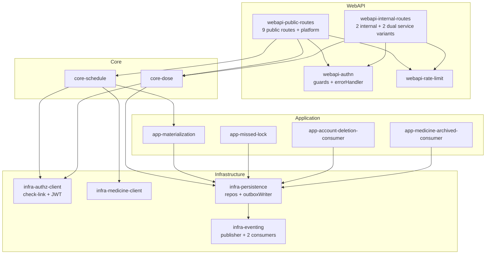
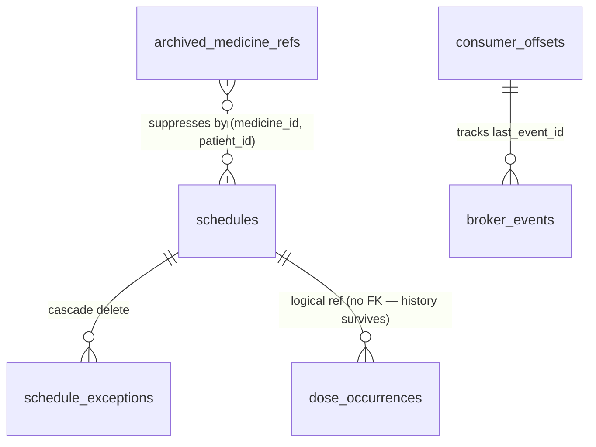
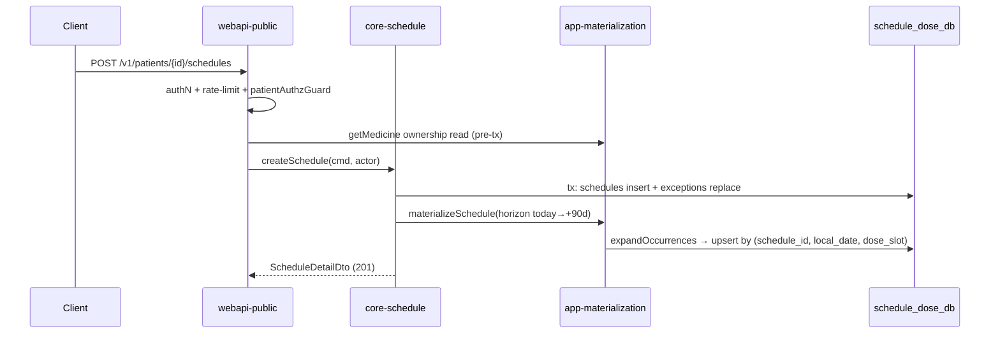

# LLD-MEDO-SCHEDULE-DOSE-001: Schedule & Dose Service — Schedules, materialized Dose rows, and outcome lifecycle

## 1. Document control header

Schedule & Dose | backend-microservice | HLD-MEDO-SCHEDULE-DOSE-001@1.0 | approved

## 2. Design context and scope

### 2.1 Upstream HLD consumed

`HLD-MEDO-SCHEDULE-DOSE-001@1.0` (status: approved, `lld_readiness: pass`). Sections/blocks consumed by reference: §2 goals DG-SCH-1…8; §4 boundary statement + invariants; §5 all thirteen blocks (`webapi-public`, `webapi-internal`, `rate-limit`, `schedule-core`, `dose-core`, `materialization-engine`, `missed-lock-worker`, `account-deletion-consumer`, `medicine-archived-consumer`, `authz-client`, `medicine-client`, `persistence`, `eventing`); §6 data architecture (`schedule_dose_db` ownership, entity inventory, consistency model, retention); §7 external contracts (9 public + 4 internal REST rows incl. dual-authz dose reads); §8 events (1 published, 2 consumed) + workflows FIG-SCH-04-1…6; §9 frontend surface; §10 cross-cutting; §11 security; §12 deployment; §13 scaling; §14 failure/recovery/idempotency; §15 jobs; §16 HD-SCH-01…09; §17 traceability; §18 OQ register (OQ-HLD-SCH-01 carried here).

### 2.2 Component place in system

The Schedule & Dose Service is the `medo-schedule-dose` repository — one autonomous repo under GitHub owner `kiro-ai-bit` (`inherited:.scratch/medo-lld/issues/02-repo-shared-package-layout.md@2026-11-23`), built as the `schedule-dose` container in the shared Docker Compose stack on AWS EC2 `t3.micro` (`inherited:HLD-MEDO-SCHEDULE-DOSE-001@1.0#12.1`). It realizes the HLD's thirteen blocks as modules inside `Infrastructure/`, `Core/`, `Application/`, `WebAPI/` + `planning/` + `tests/` (Architecture Standard lines 169–218). It does NOT design: medicine identity/stock/Doses Remaining (Medicine), reminder composition/delivery/feed/push (Notification), Harmony Points/theme (Gamification), accounts/profiles/timezones (Identity — zero directory calls), Care Link state (Care — `check-link` consumed as caller only), gateway routing (Caddy), or `@kiro-ai-bit/*` package internals.

### 2.3 Implementation goals

- LG-SCH-1: Every catalog contract row (9 public + 4 internal REST) has a route module + handler signature + request/response DTO schema. [`service-catalog.md#schedule-dose-service@2026-11-22`; HLD §7.1]
- LG-SCH-2: `schedule_dose_db` schema fully specified — schedules, exceptions, dose occurrences, archived-medicine refs, consumer offsets — with columns, constraints, indexes, migrations. [HLD §6.1; `inherited:ticket-03`]
- LG-SCH-3: RRULE/date-list recurrence + exceptions + rolling-horizon materialization are implementable without decisions — occurrence identity, protected-row upsert, synchronous create/patch path. [HD-SCH-02/08; FR-SD-001…009]
- LG-SCH-4: Dose-window classification, outcome lifecycle (mark/edit/LWW/`missed` system-only), snooze, and missed-lock eligibility are implementable without decisions in schedule-local time. [HD-SCH-03/04/07; FR-SD-010…015]
- LG-SCH-5: `DoseOutcomeChanged` same-tx emission + `AccountDeleted`/`MedicineArchived` idempotent consumption are implementable without decisions. [`inherited:ticket-07`; HD-SCH-03/05]
- LG-SCH-6: `/v1/doses/due` window enum + per-window DTO realized; `has-dose-records` shape fixed for Medicine's delete guard (Medicine OQ-LLD-MED-01). [OQ-HLD-SCH-01; FR-SD-018/019]
- LG-SCH-7: `authz-client` check-link positive-only cache + `medicine-client` fail-closed ownership read have concrete mechanics. [`inherited:ticket-09`; HD-SCH-09]
- LG-SCH-8: Both owned jobs (`dose-generation`, `missed-lock-tick`) + publisher + two consumer worker loops specified; inventory diff zero. [`scheduled-jobs.md#schedule-dose-service@2026-11-21`]

### 2.4 Implementation non-goals

- Reminder timing/policy, email fallback, feed rows, push subscriptions → Notification LLD.
- Doses Remaining delta application, `DoseOutcomeState` → Medicine LLD (Schedule & Dose emits; Medicine consumes).
- Points/theme recompute, doses DTO consumption → Gamification LLD (field names fixed here §6 — resolves OQ-GAM-01 Schedule&Dose side).
- Guided-builder UI, Today screen, Dexie schedule/dose caches, write-queue → Frontend LLD.
- `ArchivedMedicineRef` consumption on the Medicine side → N/A (this service owns the marker).
- `@kiro-ai-bit/{eventing,rate-limit,contracts}` package internals → `medo-shared` repo.
- Task sequencing/estimates → downstream `tasks` stage.

### 2.5 Inherited decisions

- Runtime/framework Node.js + TypeScript + Fastify + Drizzle (`inherited:.scratch/medo-backend/issues/01-backend-runtime-framework.md@2026-11-20`).
- Deployment: `schedule-dose` container, Docker Compose on EC2, `.env` local / SSM prod (`inherited:…/02-deployment-model-hosting.md@2026-11-20`; `.scratch/medo-hld/issues/02-cicd-deploy-mechanism.md@2026-11-23`).
- DB: self-hosted Postgres, `schedule_dose_db` + own DB user, `drizzle-kit` migrations (`inherited:…/03-database-technology.md@2026-11-21`).
- Object storage: not used — no R2 client in this service (stated for completeness; `inherited:…/04-object-storage-provider.md@2026-11-21`).
- API gateway: Caddy public-route table; internal routes unreachable publicly + service-JWT gated (`inherited:…/05-api-gateway-entry-point.md@2026-11-21`).
- Auth: user JWTs verified locally via Identity JWKS; internal service JWTs `iss=medo-<caller>`, `aud=medo-schedule-dose`, 5-min (`inherited:…/06-auth-token-mechanics.md@2026-11-21`).
- Events: per-service outbox same-tx → `broker_db.events`; sequential in-order consumers, `last_event_id` offsets, `eventId` dedupe, 5 attempts → `dead_letters`; package = `@kiro-ai-bit/eventing` (`inherited:…/07-message-broker-event-transport.md@2026-11-21`; rename per `.scratch/medo-lld/issues/02@2026-11-23`).
- Rate limits: auth'd reads 300/min/userId, auth'd writes 60/min/userId, internal exempt, 429 + `Retry-After`; no public-by-IP class applies (`inherited:…/09-rate-limiting-caching.md@2026-11-21`; HLD §7.1).
- Caller-side caches this service consumes: Care check-link positive-only ~15 s TTL, negatives never cached; `AccountDeleted` invalidates entries for the user; `CareLinkEnded` NOT subscribed (catalog) (`inherited:…/09-rate-limiting-caching.md@2026-11-21`; HLD §10.4).
- HLD `HD-SCH-01…09` — all `accepted`; realized here (HD-SCH-01 → §3 module map + §6 dual-authz, HD-SCH-02 → LD-SCH-04/10, HD-SCH-03 → LD-SCH-09/§9, HD-SCH-04 → LD-SCH-08, HD-SCH-05 → LD-SCH-05/§5.4/§8.11, HD-SCH-06 → §6 `actorId`, HD-SCH-07 → LD-SCH-02/12, HD-SCH-08 → §8.2, HD-SCH-09 → §11 medicine-client).
- Error envelope `{error:{code,message,requestId}}` — sibling convention `LD-ID-12` (`inherited:docs/lld/identity/LLD-MEDO-IDENTITY-001.md@0.1-draft#LD-ID-12`; flagged `OQ-LLD-SYS-01`).
- Baselines: `platform-quality-baseline.md@2026-11-21`, `platform-observability.md@2026-11-21`, `scheduled-jobs.md@2026-11-21`.
- Sibling LLD conventions: `docs/lld/identity/LLD-MEDO-IDENTITY-001.md`, `docs/lld/care/LLD-MEDO-CARE-001.md`, `docs/lld/medicine/LLD-MEDO-MEDICINE-001.md` @1.0.

## 3. Repository structure and module map

### 3.1 Repository declaration (backend profile §4.1)

Repository: `medo-schedule-dose` (public, MIT) under GitHub owner `kiro-ai-bit`; consumes `@kiro-ai-bit/{eventing,rate-limit,contracts,eslint-config,tsconfig,test-utils}` from GitHub Packages, exact-pinned + committed lockfile (`inherited:.scratch/medo-lld/issues/02@2026-11-23`). Logical namespaces: `Medo.ScheduleDose.Infrastructure`, `Medo.ScheduleDose.Core`, `Medo.ScheduleDose.Application`, `Medo.ScheduleDose.WebAPI`. Import convention (LD-SCH-01): path aliases `@core/*`, `@application/*`, `@infrastructure/*`, `@webapi/*` via `@kiro-ai-bit/tsconfig`; layer direction enforced by ESLint boundaries. `planning/` holds pointers to approved PRD/HLD/LLD. Bootstrap unit: `src/bootstrap.ts` → `buildApp()`.

```
medo-schedule-dose/
├── Infrastructure/
│   ├── Persistence/        # schema/, repositories, outbox writes, consumer offsets
│   ├── Eventing/           # ensure-DDL, publisher/consumer worker config
│   ├── AuthzClient/        # Care check-link client + positive-only cache + JWT material
│   └── MedicineClient/     # medicine ownership read client
├── Core/
│   ├── Schedule/           # schedule aggregate rules + guided-builder validation + exceptions
│   └── Dose/               # dose row rules: windows, outcomes, snooze, due-poll queries
├── Application/
│   ├── Materialization/    # occurrence expansion + idempotent upsert engine
│   ├── MissedLock/         # missed-lock-tick orchestration
│   ├── AccountDeletion/    # AccountDeleted reaction orchestration
│   └── MedicineArchived/   # MedicineArchived reaction orchestration
├── WebAPI/
│   ├── Public/             # 9 public Schedule & Dose routes + platform surface
│   ├── Internal/           # internal-only routes + service-token dual-route variants
│   ├── Authn/              # user-JWT + service-JWT guards, error handler
│   └── RateLimit/          # rate-limit binding
├── planning/               # pointers to approved docs
├── tests/{unit,integration,contract,e2e}/
└── src/bootstrap.ts
```

### 3.2 Module map

| Module ID | Responsibility | Physical path | Layer | HLD block | LD-ref |
|---|---|---|---|---|---|
| `webapi-public-routes` | 9 public Schedule & Dose routes + `/health` `/ready` `/metrics` platform surface | `WebAPI/Public/` | WebAPI | `webapi-public` | — |
| `webapi-internal-routes` | 2 internal-only routes + service-token variants of the 2 dual routes | `WebAPI/Internal/` | WebAPI | `webapi-internal` | HD-SCH-01 |
| `webapi-authn` | user-JWT verify (JWKS), service-JWT verify, error handler | `WebAPI/Authn/` | WebAPI | `webapi-public`/`webapi-internal` (shared guard) | LD-SCH-01/13 |
| `webapi-rate-limit` | rate-limit plugin registration + class bindings | `WebAPI/RateLimit/` | WebAPI | `rate-limit` | — |
| `core-schedule` | Schedule aggregate rules: guided-builder validation, RRULE/date-list storage, resolved start/end + past-start clamp, exception rules, `medicineId` immutability, delete→history rules | `Core/Schedule/` | Core | `schedule-core` | LD-SCH-02/03/10 |
| `core-dose` | Dose row rules: window classification, outcome lifecycle (mark/edit/LWW/missed system-only), `skippedByUser`, `snoozedUntil`, due-poll + patient-window reads | `Core/Dose/` | Core | `dose-core` | LD-SCH-05/06/07/09 |
| `app-materialization` | Occurrence expansion + idempotent upsert by occurrence identity; synchronous create/patch path + daily job path; archived-suppression consult | `Application/Materialization/` | Application | `materialization-engine` | LD-SCH-04/10 |
| `app-missed-lock` | `missed-lock-tick` orchestration: local-date advance → guarded lock + per-dose outbox | `Application/MissedLock/` | Application | `missed-lock-worker` | LD-SCH-08 |
| `app-account-deletion-consumer` | `AccountDeleted` reaction: purge Schedules + Dose rows + markers + check-link cache entries | `Application/AccountDeletion/` | Application | `account-deletion-consumer` | — |
| `app-medicine-archived-consumer` | `MedicineArchived` reaction: write (medicineId, patientId) suppression marker | `Application/MedicineArchived/` | Application | `medicine-archived-consumer` | LD-SCH-05 |
| `infra-authz-client` | Care `check-link` calls + positive-only ~15 s cache + invalidation + service-JWT mint + JWKS verify support | `Infrastructure/AuthzClient/` | Infrastructure | `authz-client` | LD-SCH-11 |
| `infra-medicine-client` | Medicine `GET /v1/medicines/{id}` ownership read; fail closed, no cache | `Infrastructure/MedicineClient/` | Infrastructure | `medicine-client` | HD-SCH-09 |
| `infra-persistence` | Drizzle schema, repositories, outbox writes, consumer offsets | `Infrastructure/Persistence/` | Infrastructure | `persistence` | LD-SCH-04/05 |
| `infra-eventing` | `@kiro-ai-bit/eventing` ensure-DDL + publisher + `AccountDeleted`/`MedicineArchived` consumers | `Infrastructure/Eventing/` | Infrastructure | `eventing` | — |

HLD block → module coverage: `webapi-public`→webapi-public-routes/webapi-authn/webapi-rate-limit; `webapi-internal`→webapi-internal-routes/webapi-authn; `rate-limit`→webapi-rate-limit; `schedule-core`→core-schedule; `dose-core`→core-dose; `materialization-engine`→app-materialization; `missed-lock-worker`→app-missed-lock; `account-deletion-consumer`→app-account-deletion-consumer; `medicine-archived-consumer`→app-medicine-archived-consumer; `authz-client`→infra-authz-client; `medicine-client`→infra-medicine-client; `persistence`→infra-persistence; `eventing`→infra-eventing. Zero orphans both directions.

### 3.3 Bootstrap registration order (backend profile §4.1)

`buildApp()` registers: (1) `loadConfig` env validation — fail-fast (§13); (2) Pino logger + `X-Request-Id` hook; (3) error-handler plugin; (4) rate-limit plugin (`@kiro-ai-bit/rate-limit`); (5) authN guards (user-JWT via Identity JWKS, service-JWT via static pubkey config); (6) Zod route registration per module; (7) `node-cron` job registration (`dose-generation`, `missed-lock-tick` — §10); (8) `infra-eventing` ensure-DDL + publisher worker + `AccountDeleted` + `MedicineArchived` consumer workers; (9) platform routes. No peer-client workers — all peer I/O is request-scoped.

## 4. Module and unit detailed design

Signatures use §6.6 notation; DTO/schema type names referenced from §5/§6. Private helpers implied by public signatures are not listed.

### 4.1 `webapi-public-routes`: public Schedule & Dose routes + platform surface

| Unit | Kind | Signature | Responsibility | Depends on | Realizes |
|---|---|---|---|---|---|
| `registerScheduleRoutes` | function | `(app: FastifyInstance, deps: ScheduleRouteDeps): Promise<void>` | Registers `GET/POST /v1/patients/{id}/schedules`, `GET/PATCH/DELETE /v1/schedules/{id}` | `core-schedule`, `app-materialization`, `webapi-authn` | §6 schedule rows |
| `registerDoseRoutes` | function | `(app: FastifyInstance, deps: DoseRouteDeps): Promise<void>` | Registers `GET /v1/patients/{id}/doses`, `GET /v1/doses/{id}`, `POST /v1/doses/{id}/outcome`, `POST /v1/doses/{id}/snooze` | `core-dose`, `webapi-authn` | §6 dose rows |
| `registerPlatformRoutes` | function | `(app: FastifyInstance, deps: PlatformDeps): Promise<void>` | `/health` liveness, `/ready` (schedule_dose_db+broker_db pings), `/metrics` | `infra-persistence`, `infra-eventing` | §6 platform surface |

### 4.2 `webapi-internal-routes`: internal service-token surface

| Unit | Kind | Signature | Responsibility | Depends on | Realizes |
|---|---|---|---|---|---|
| `registerInternalRoutes` | function | `(app: FastifyInstance, deps: InternalRouteDeps): Promise<void>` | Registers `GET /v1/doses/due`, `GET /v1/patients/{id}/has-dose-records` behind `serviceAuthGuard` + service-token variants of `GET /v1/patients/{id}/doses` and `GET /v1/doses/{id}` sharing `core-dose` reads | `core-dose`, `webapi-authn` | §6 internal rows |

### 4.3 `webapi-authn`: guards + error handler

| Unit | Kind | Signature | Responsibility | Depends on | Realizes |
|---|---|---|---|---|---|
| `userAuthGuard` | function | `(request: FastifyRequest) => Promise<UserClaims>` | Verify Bearer user JWT via Identity JWKS (`iss=medo-identity`, `aud` app, `exp`); 401 on failure | `infra-authz-client/verifyUserJwt` | §6 session routes |
| `serviceAuthGuard` | function | `(request: FastifyRequest) => Promise<ServiceClaims>` | Verify service JWT: `iss` known peer, `aud='medo-schedule-dose'`, `exp`, static pubkey config | `infra-authz-client/verifyServiceJwt` | §6 internal rows |
| `patientAuthzGuard` | function | `(patientId: string, actor: UserClaims, deps: AuthzDeps) => Promise<void>` | Patient-self (`sub==patientId`) else `check-link(patientId, sub)`; deny → `FORBIDDEN`; check-link failure → `DEPENDENCY_UNAVAILABLE` (fail closed) | `infra-authz-client/checkLink` | FR-SD-022 |
| `verifyUserJwt` | function | `(token: string, jwks: JSONWebKeySet): Promise<UserClaims>` | Local jose verify; `kid` rotation tolerance via JWKS refetch on unknown kid | `jose` | ticket-06 |
| `errorHandler` | function | `(err: unknown, request: FastifyRequest, reply: FastifyReply) => void` | Single mapping point thrown error → status+code (§14) | — | §14 |

### 4.4 `webapi-rate-limit`: rate-limit binding

| Unit | Kind | Signature | Responsibility | Depends on | Realizes |
|---|---|---|---|---|---|
| `registerRateLimit` | function | `(app: FastifyInstance): Promise<void>` | Registers `@kiro-ai-bit/rate-limit` plugin + per-route class table §12 | plugin | HLD `rate-limit` block |

### 4.5 `core-schedule`: schedule aggregate rules

| Unit | Kind | Signature | Responsibility | Depends on | Realizes |
|---|---|---|---|---|---|
| `listSchedules` | function | `(patientId: string, actor: UserClaims): Promise<ScheduleListDto>` | Authz → patient-scoped schedule list incl. exception summary | `schedulesRepo`, `scheduleExceptionsRepo`, `infra-authz-client` | FR-SD-002 |
| `createSchedule` | function | `(patientId: string, cmd: CreateScheduleCommand, actor: UserClaims): Promise<ScheduleDetailDto>` | Authz → resolve start/end (HD-SCH-08) → validate recurrence/exceptions → tx: schedule + exceptions + synchronous materialization (§8.1/§8.3) | `schedulesRepo`, `scheduleExceptionsRepo`, `infra-authz-client`, `app-materialization` | FR-SD-001/008 |
| `getSchedule` | function | `(scheduleId: string, actor: UserClaims): Promise<ScheduleDetailDto>` | Load → patient authz → full detail incl. exceptions | `schedulesRepo`, `scheduleExceptionsRepo`, `infra-authz-client` | FR-SD-003 |
| `editSchedule` | function | `(scheduleId: string, patch: SchedulePatch, actor: UserClaims): Promise<ScheduleDetailDto>` | Authz → apply fields + replace exception set → tx: update + regeneration of future unmarked rows only (§8.4) | `schedulesRepo`, `scheduleExceptionsRepo`, `infra-authz-client`, `app-materialization` | FR-SD-004 |
| `deleteSchedule` | function | `(scheduleId: string, actor: UserClaims): Promise<void>` | Authz → tx: delete schedule + exceptions + future unmarked dose rows; history rows retained (FR-SD-005) | `schedulesRepo`, `scheduleExceptionsRepo`, `doseOccurrencesRepo`, `infra-authz-client` | FR-SD-005 |
| `resolveStartEnd` | function | `(req: {startDate?: string, endDate?: string \| null, timezone: string}): {startDate: string, endDate: string \| null}` | Resolve defaults + past-start clamp in schedule tz (HD-SCH-08); end-before-start reject | — | FR-SD-001/HD-SCH-08 |
| `validateRecurrence` | function | `(rec: RecurrenceInput): RecurrenceSpec` | Guided-builder payload → canonical recurrence spec (rrule subset or date-list); reject invalid tz/times/end<start | — | FR-SD-001c |

Rationale: one Core module per HLD aggregate (`schedule-core`); materialization invoked by `createSchedule`/`editSchedule` inside their transactions — the HLD places synchronous materialization inside schedule writes (FR-SD-008), so the Application engine is a collaborator, not a route-level step.

### 4.6 `core-dose`: dose row rules + read surface

| Unit | Kind | Signature | Responsibility | Depends on | Realizes |
|---|---|---|---|---|---|
| `listPatientDoses` | function | `(patientId: string, q: {from: string, to: string, outcome?: string}, actor: UserClaims \| ServiceClaims): Promise<DoseListDto>` | Dual-authz read: window rows filtered by outcome/state; excluded states per caller contract (§8.7) | `doseOccurrencesRepo`, `schedulesRepo`, `infra-authz-client` | FR-SD-016 |
| `getDose` | function | `(doseId: string, actor: UserClaims \| ServiceClaims): Promise<DoseDetailDto>` | Dual-authz dose detail incl. actorId + schedule linkage | `doseOccurrencesRepo`, `schedulesRepo`, `infra-authz-client` | FR-SD-017 |
| `markOutcome` | function | `(doseId: string, cmd: MarkOutcomeCommand, actor: UserClaims): Promise<DoseDetailDto>` | Authz → guarded transition: window check + lock guard + LWW + derived on-time/late + outbox `DoseOutcomeChanged` (§8.5/§9) | `doseOccurrencesRepo`, `schedulesRepo`, `infra-authz-client`, `infra-persistence/outboxWriter` | FR-SD-011/012/015/020 |
| `snoozeDose` | function | `(doseId: string, actor: UserClaims): Promise<DoseDetailDto>` | Authz → unmarked-only guard → set `snoozedUntil = now+5min`; no event | `doseOccurrencesRepo`, `schedulesRepo`, `infra-authz-client` | FR-SD-014 |
| `listDueDoses` | function | `(window: DueWindow, now: Date): Promise<DueDoseListDto>` | Internal due-poll: window-class filter + snooze/`skippedByUser`/archived-suppression exclusions (§8.6) | `doseOccurrencesRepo`, `archivedMedicineRefsRepo` | FR-SD-018 |
| `hasDoseRecords` | function | `(patientId: string): Promise<{hasDoseRecords: boolean}>` | Internal existence check — any state counts; current answer, no cache (FR-SD-019) | `doseOccurrencesRepo` | FR-SD-019 |
| `classifyWindow` | function | `(dose: DoseRow, schedule: ScheduleRow, now: Date): DoseWindowClass` | Schedule-tz window classification: `pre-takeable | on-time | late | missed-eligible` (§8.5) | — | FR-SD-010 |

Rationale: one Core module per HLD aggregate (`dose-core`); the internal-only reads (`listDueDoses`, `hasDoseRecords`) live here because they are dose-row queries — `webapi-internal` is presentation only. `classifyWindow` is the shared tz-math unit used by mark/snooze/due-poll/missed-lock paths.

### 4.7 `app-materialization`: occurrence expansion + idempotent upsert

| Unit | Kind | Signature | Responsibility | Depends on | Realizes |
|---|---|---|---|---|---|
| `materializeSchedule` | function | `(scheduleId: string, horizon: {fromDate: string, toDate: string}, tx?: Tx): Promise<MaterializeResult>` | Expand occurrences in horizon → upsert dose rows by occurrence identity honoring protected-row predicate + suppression registry (§8.2/§8.3) | `schedulesRepo`, `scheduleExceptionsRepo`, `doseOccurrencesRepo`, `archivedMedicineRefsRepo` | HD-SCH-02/05 |
| `expandOccurrences` | function | `(schedule: ScheduleRow, exceptions: ExceptionRow[], fromDate: string, toDate: string): OccurrenceSpec[]` | RRULE/date-list → occurrence list `{localDate, doseTime, scheduledAt}` in schedule tz (§8.2) | `core-schedule/validateRecurrence` types | HD-SCH-02/07 |
| `runDoseGeneration` | function | `(now: Date): Promise<JobResult>` | Daily job entry: scan active schedules → per-schedule horizon extend → `materializeSchedule` (§10) | `schedulesRepo`, `materializeSchedule` | FR-SD-007/008 |

### 4.8 `app-missed-lock`: missed-lock orchestration

| Unit | Kind | Signature | Responsibility | Depends on | Realizes |
|---|---|---|---|---|---|
| `runMissedLockTick` | function | `(now: Date): Promise<JobResult>` | Per-minute tick: scan active schedules → local-date advance check → guarded lock of prior-local-day unmarked doses + per-dose outbox rows, one tx per schedule (§8.8) | `schedulesRepo`, `doseOccurrencesRepo`, `infra-persistence/outboxWriter` | HD-SCH-04 |

### 4.9 `app-account-deletion-consumer`: `AccountDeleted` reaction

| Unit | Kind | Signature | Responsibility | Depends on | Realizes |
|---|---|---|---|---|---|
| `handleAccountDeleted` | function | `(event: {userId: string}): Promise<void>` | Single tx: delete schedules + exceptions + dose rows + archived refs for userId; post-commit purge check-link cache entries (§8.10) | `schedulesRepo`, `scheduleExceptionsRepo`, `doseOccurrencesRepo`, `archivedMedicineRefsRepo`, `infra-authz-client` | FR-SD-021 |

### 4.10 `app-medicine-archived-consumer`: `MedicineArchived` reaction

| Unit | Kind | Signature | Responsibility | Depends on | Realizes |
|---|---|---|---|---|---|
| `handleMedicineArchived` | function | `(event: {medicineId: string, patientId: string}): Promise<void>` | Idempotent marker upsert `(medicineId, patientId)` → `archived_medicine_refs` (§8.11) | `archivedMedicineRefsRepo` | FR-SD-009/HD-SCH-05 |

### 4.11 `infra-authz-client`: check-link + JWT material

| Unit | Kind | Signature | Responsibility | Depends on | Realizes |
|---|---|---|---|---|---|
| `checkLink` | function | `(patientId: string, caregiverId: string): Promise<boolean>` | Care `GET /v1/care/check-link` service-JWT call; positive-only ~15 s cache; negatives never cached; failure → throw `DependencyError` (§8.12) | `mintServiceJwt`, cache store | §7.2 consumed row |
| `verifyUserJwt` | function | `(token: string): Promise<UserClaims>` | Identity JWKS verify support for `userAuthGuard` | `jose` | ticket-06 |
| `verifyServiceJwt` | function | `(token: string, expectedAud: string): Promise<ServiceClaims>` | Static-pubkey service-JWT verify for `serviceAuthGuard` | `jose` | ticket-06 |
| `mintServiceJwt` | function | `(aud: string): Promise<string>` | Mint 5-min aud-scoped service JWT per call (`iss=medo-schedule-dose`) | service private key | ticket-06 |
| `checkLinkCache` | object | `{get(key): boolean\|undefined, set(key): void, invalidateForUser(userId): void}` | In-process positive cache; key `patientId:caregiverId`; TTL `CHECK_LINK_CACHE_TTL_MS=15000` (LD-SCH-11) | — | ticket-09 |

### 4.12 `infra-medicine-client`: ownership read

| Unit | Kind | Signature | Responsibility | Depends on | Realizes |
|---|---|---|---|---|---|
| `getMedicine` | function | `(medicineId: string): Promise<MedicineOwnershipDto>` | Medicine `GET /v1/medicines/{id}` service-JWT call; 3 s + 1 retry; never cached; failure → `DependencyError`; returns `{id, patientId, archivedAt}` subset used for ownership validation (HD-SCH-09) | `mintServiceJwt` | §7.2 consumed row |

### 4.13 `infra-persistence`: schema + repositories

| Unit | Kind | Signature | Responsibility | Depends on | Realizes |
|---|---|---|---|---|---|
| `schedulesRepo` | repository | `findById / findByPatient / insert / update / deleteById / deleteFutureUnmarkedDoses(scheduleId, fromDate) / listActive` | Schedule row CRUD + delete-side dose cleanup | drizzle schema | §5.1 |
| `scheduleExceptionsRepo` | repository | `findBySchedule / replaceAll(scheduleId, rows) / deleteBySchedule` | Exception set replace semantics | drizzle schema | §5.2 |
| `doseOccurrencesRepo` | repository | `upsertByOccurrenceIdentity / findById / findByScheduleDateRange / findPatientWindow / findDueInWindow / hasAnyForPatient / deleteFutureUnmarked(scheduleId\|patientId+medicineId, fromDate) / lockPriorDayUnmarked(scheduleId, beforeLocalDate) / deleteByPatientId` | Materialized dose row store — the service's core table | drizzle schema | §5.3 |
| `archivedMedicineRefsRepo` | repository | `upsertMarker / isSuppressed(medicineId, patientId) / deleteByPatientId / listForPatient` | `ArchivedMedicineRef` suppression registry | drizzle schema | §5.4 |
| `consumerOffsetsRepo` | repository | `getOffset(consumer) / advanceOffset(consumer, eventId)` | Per-consumer `last_event_id` offsets | drizzle schema | §5.6 |
| `outboxWriter` | function | `(tx: Tx, eventType: string, payload: object): void` | Append outbox row inside caller's tx | `@kiro-ai-bit/eventing` outbox schema | §5.5/§7 |

### 4.14 `infra-eventing`: publisher + consumer binding

| Unit | Kind | Signature | Responsibility | Depends on | Realizes |
|---|---|---|---|---|---|
| `ensureEventingSchema` | function | `(db: Db): Promise<void>` | Boot ensure-DDL for outbox + `broker_db` access per package contract | `@kiro-ai-bit/eventing` | §7 bindings |
| `startPublisherWorker` | function | `(): Promise<WorkerHandle>` | Outbox publisher → `broker_db.events`, 5 s poll | `@kiro-ai-bit/eventing` | §10 worker loops |
| `startAccountDeletedConsumer` | function | `(dispatch: (e) => Promise<void>): Promise<WorkerHandle>` | Sequential consumer `account-deleted`, offset-after-success | `@kiro-ai-bit/eventing` | §7 consumed |
| `startMedicineArchivedConsumer` | function | `(dispatch: (e) => Promise<void>): Promise<WorkerHandle>` | Sequential consumer `medicine-archived`, offset-after-success | `@kiro-ai-bit/eventing` | §7 consumed |

FIG-SCH-01: module/component diagram



## 5. Data model and persistence design

Owned store: `schedule_dose_db` only (`inherited:ticket-03`). `broker_db` tables owned by `@kiro-ai-bit/eventing` — cited, never redefined. Drizzle schema files under `Infrastructure/Persistence/schema/`: `schedules.ts`, `schedule_exceptions.ts`, `dose_occurrences.ts`, `archived_medicine_refs.ts`, `consumer_offsets.ts`, `outbox.ts`; `snake_case` plural tables; `uuid` PKs (`gen_random_uuid()`), `text`+CHECK enums, `date`/`time`/`timestamptz` columns. Migrations `NNNN-<slug>` via `drizzle-kit` at deploy. Check-link cache is in-process memory only — never persisted (HLD §6.1).

### 5.1 `schedules`

Purpose: Schedule aggregate — recurrence definition, dose times, schedule-owned timezone, resolved start/end (HLD §6.1). Owning unit: `infra-persistence/schedulesRepo` + `core-schedule`.

| Column | Type | Nullable | Default | Constraints | Notes |
|---|---|---|---|---|---|
| `id` | `uuid` | no | `gen_random_uuid()` | PK | `scheduleId` in DTOs |
| `patient_id` | `uuid` | no | — | index | Identity `userId`; opaque reference, no DB FK (cross-service); PII-adjacent |
| `medicine_id` | `uuid` | no | — | index | private Medicine record id; opaque, immutable post-create (HD-SCH-02); PII-adjacent |
| `recurrence_kind` | `text` | no | — | CHECK `recurrence_kind IN ('rrule','date-list')` | guided-builder contract (FR-SD-001) |
| `rrule` | `text` | yes | `NULL` | CHECK `(recurrence_kind='rrule') = (rrule IS NOT NULL)` | RFC 5545 subset string, canonicalized at write (LD-SCH-02); NULL iff date-list |
| `date_list` | `date[]` | yes | `NULL` | CHECK `(recurrence_kind='date-list') = (date_list IS NOT NULL)` | explicit scattered one-off dates, sorted deduped at write |
| `dose_times` | `text[]` | no | — | CHECK `cardinality(dose_times) >= 1` | `HH:MM` 24h schedule-local strings, sorted; fixed set per day |
| `timezone` | `text` | no | — | CHECK `length(timezone) BETWEEN 1 AND 64` | IANA tz captured at build time; validated via tz database (LD-SCH-12) |
| `start_date` | `date` | no | — | — | resolved start = max(requested, schedule-local today) — HD-SCH-08 |
| `end_date` | `date` | yes | `NULL` | CHECK `end_date IS NULL OR end_date >= start_date` | NULL = never ends |
| `created_at` | `timestamptz` | no | `now()` | — | — |
| `updated_at` | `timestamptz` | no | `now()` | — | touched on every edit |

Indexes:

| Index | Columns | Type | Purpose |
|---|---|---|---|
| `idx_schedules_patient` | `(patient_id)` | btree | `GET /v1/patients/{id}/schedules` list + `AccountDeleted` purge scan |
| `idx_schedules_active_scan` | `(id) WHERE true` — full scan acceptable | btree | `dose-generation`/`missed-lock-tick` active-schedule scans (<50 users envelope) |

Relationships: `dose_occurrences.schedule_id` → logical reference only (no FK — dose rows outlive schedule deletes, FR-SD-005); `schedule_exceptions.schedule_id` → FK ON DELETE CASCADE (exceptions die with schedule — history lives on dose rows).

### 5.2 `schedule_exceptions`

Purpose: per-occurrence exceptions — EXDATE-style skips + per-date time overrides stored inside the Schedule aggregate (HLD §6.1). Owning unit: `infra-persistence/scheduleExceptionsRepo` + `core-schedule`.

| Column | Type | Nullable | Default | Constraints | Notes |
|---|---|---|---|---|---|
| `schedule_id` | `uuid` | no | — | PK part, FK→`schedules.id` ON DELETE CASCADE | — |
| `local_date` | `date` | no | — | PK part | schedule-local occurrence date |
| `kind` | `text` | no | — | CHECK `kind IN ('skip','time-override')` | one exception per date |
| `override_time` | `time` | yes | `NULL` | CHECK `(kind='time-override') = (override_time IS NOT NULL)` | `HH:MM` replacement dose time(s) handled at expansion — see §8.2 note |
| `created_at` | `timestamptz` | no | `now()` | — | — |

PK `(schedule_id, local_date)` — at most one exception per occurrence date; `replaceAll` semantics on PATCH (LD-SCH-03). Time-override carries a single `override_time`; multiple dose times on an overridden date use the schedule's `dose_times` count with the override replacing the first slot — see LD-SCH-03.

### 5.3 `dose_occurrences`

Purpose: materialized Dose rows — the service's single dose truth (HLD §6.1). Owning unit: `infra-persistence/doseOccurrencesRepo` + `core-dose`/`app-materialization`.

| Column | Type | Nullable | Default | Constraints | Notes |
|---|---|---|---|---|---|
| `id` | `uuid` | no | `gen_random_uuid()` | PK | `doseId` in DTOs/events |
| `schedule_id` | `uuid` | no | — | index, NO FK | logical ref — survives schedule delete (FR-SD-005); PII-adjacent |
| `patient_id` | `uuid` | no | — | index | denormalized from schedule for patient-scoped reads + purge; PII |
| `medicine_id` | `uuid` | no | — | index | denormalized for suppression join + event payload; PII-adjacent |
| `local_date` | `date` | no | — | — | schedule-local occurrence date — missed-lock + window math key |
| `dose_time` | `text` | no | — | CHECK `dose_time ~ '^([01][0-9]|2[0-3]):[0-5][0-9]$'` | `HH:MM` schedule-local slot time (post-override) |
| `dose_slot` | `integer` | no | — | CHECK `dose_slot >= 0` | ordinal slot index within the date (0..n-1) — occurrence-identity component |
| `scheduled_at` | `timestamptz` | no | — | — | resolved instant of (local_date, dose_time) in schedule tz — DST-resolved per LD-SCH-12 |
| `outcome` | `text` | no | `'unmarked'` | CHECK `outcome IN ('unmarked','taken-on-time','taken-late','skipped','missed')` | verbatim catalog enum + `unmarked` initial; `missed` system-set only |
| `skipped_by_user` | `boolean` | no | `false` | — | plan-skip flag — history only, never an outcome, never emits event (FR-SD-006) |
| `snoozed_until` | `timestamptz` | yes | `NULL` | — | transient field; excluded from due-poll while `now < snoozed_until` |
| `actor_id` | `uuid` | yes | `NULL` | — | opaque userId of last outcome actor (HD-SCH-06); NULL on unmarked/missed/system rows |
| `marked_at` | `timestamptz` | yes | `NULL` | — | instant of last accepted outcome write — window derivation + audit |
| `created_at` | `timestamptz` | no | `now()` | — | materialization instant |
| `updated_at` | `timestamptz` | no | `now()` | — | last mutation |

UNIQUE `(schedule_id, local_date, dose_slot)` — **occurrence identity** (HD-SCH-02/LD-SCH-04): regeneration upserts on this key; `dose_slot` is stable because `dose_times` order is canonicalized sorted at write and time-overrides replace slot 0 only (LD-SCH-03). `medicineId` immutability post-create keeps the key stable (HD-SCH-02).

Indexes:

| Index | Columns | Type | Purpose |
|---|---|---|---|
| `idx_doses_patient_window` | `(patient_id, scheduled_at)` | btree | `GET /v1/patients/{id}/doses?from&to` window reads (public + internal Gamification bootstrap) |
| `idx_doses_schedule_date` | `(schedule_id, local_date)` | btree | materialization upsert lookup + missed-lock per-schedule scan + schedule delete cleanup |
| `idx_doses_due_poll` | `(scheduled_at) WHERE outcome='unmarked' AND skipped_by_user=false` | btree partial | `/v1/doses/due` per-minute poll — only live unmarked rows |
| `idx_doses_patient_exists` | `(patient_id)` | btree | `has-dose-records` existence check + `AccountDeleted` purge scan (covers all states incl. `skipped_by_user`) |
| `idx_doses_medicine_patient` | `(medicine_id, patient_id)` | btree | archived-suppression join in due-poll + generation skip check |

### 5.4 `archived_medicine_refs`

Purpose: `ArchivedMedicineRef` suppression registry keyed (medicineId, patientId) — persisted marker consulted by generation + due-poll (HD-SCH-05). Owning unit: `infra-persistence/archivedMedicineRefsRepo` + `app-medicine-archived-consumer`.

| Column | Type | Nullable | Default | Constraints | Notes |
|---|---|---|---|---|---|
| `medicine_id` | `uuid` | no | — | PK part | opaque Medicine record id |
| `patient_id` | `uuid` | no | — | PK part, index | purge + per-patient listing |
| `archived_at` | `timestamptz` | no | `now()` | — | event `occurredAt` recorded for audit |

PK `(medicine_id, patient_id)` — absorbing: Medicine archive is terminal (HLD §18.2 assumption); marker insert is set-idempotent (redelivery rewrites same row). No FK — cross-service opaque refs.

### 5.5 `outbox` (participation — columns owned by `@kiro-ai-bit/eventing`)

Service outbox table in `schedule_dose_db`, created by package ensure-DDL at boot (`inherited:ticket-07`). One row per published `DoseOutcomeChanged` inside the triggering write tx (§9); payload = envelope `{eventId, occurredAt}` + §7 field list; publisher deletes row after successful `broker_db.events` insert.

### 5.6 `consumer_offsets`

Purpose: per-consumer `last_event_id` offset (ticket-07 mechanics). Owning unit: `infra-persistence/consumerOffsetsRepo`.

| Column | Type | Nullable | Default | Constraints | Notes |
|---|---|---|---|---|---|
| `consumer` | `text` | no | — | PK, CHECK `consumer IN ('account-deleted','medicine-archived')` | Consumer name; extensible by CHECK amendment if subscriptions grow |
| `last_event_id` | `bigint` | no | `0` | — | Advances only after successful processing (offset-after-success) |

Dedupe: `AccountDeleted` = terminal-state purge (redelivery finds nothing); `MedicineArchived` = PK-idempotent marker upsert; plus monotonic offset — no `processed_events` table needed at this event volume.

### 5.7 Migration & seed plan

| Step | Intent | Ordering |
|---|---|---|
| `0001-schedules` | create `schedules` + `schedule_exceptions` + indexes/constraints | first |
| `0002-dose-occurrences` | create `dose_occurrences` + occurrence-identity unique + indexes | after 0001 |
| `0003-archived-refs` | create `archived_medicine_refs` | after 0002 |
| `0004-consumer-offsets` | create `consumer_offsets` | after 0003 |
| `0005-outbox` | `@kiro-ai-bit/eventing` ensure-DDL at boot (not a drizzle migration) | runtime |

Seed data: none — all behavior is request/event/job driven.

FIG-SCH-02: entity relationships



## 6. API endpoint realization

Error envelope (all endpoints): `{ "error": { "code": <code>, "message": <string>, "requestId": <string> } }` — no `details` extension needed by this service (LD-SCH-13). Middleware order (fixed, §4.3 backend profile): `request-id → rate-limit → authN (user-JWT or service-JWT per surface) → DTO validation → handler → error mapping`. Validation split: Fastify JSON-schema/Zod at WebAPI for transport shape; Core re-asserts domain invariants (§8); DB constraints ultimate guard. Dual-authz dose reads: public path = user-JWT + `patientAuthzGuard`; internal path = service-JWT `aud=medo-schedule-dose` — token classes never cross-satisfy (FR-SD-022c).

### GET /v1/patients/{id}/schedules

Auth: patient-self or linked caregiver (`patientAuthzGuard`). Rate class: auth-read 300/min/userId.

Path param `id`: uuid = `patientId`.

Response (200): `{schedules: ScheduleSummaryDto[]}` — `ScheduleSummaryDto` = `{id: uuid, patientId: uuid, medicineId: uuid, recurrence: RecurrenceDto, doseTimes: string[], timezone: string, startDate: 'YYYY-MM-DD', endDate: 'YYYY-MM-DD'|null, exceptionCount: integer, createdAt: ISO-8601, updatedAt: ISO-8601}`.

`RecurrenceDto` = `{kind:'rrule', rrule: string} | {kind:'date-list', dates: string[]}`.

Errors: `FORBIDDEN` 403 authz deny, `UNAUTHORIZED` 401, `VALIDATION_FAILED` 400, `DEPENDENCY_UNAVAILABLE` 503 check-link down, `RATE_LIMITED` 429, `INTERNAL` 500. Idempotency: n-a (read).

### POST /v1/patients/{id}/schedules

Auth: patient-self or linked caregiver. Rate class: auth-write 60/min/userId.

Path param `id`: uuid = `patientId`. Body `CreateScheduleRequest`:

| Field | Type | Req | Constraints/Default | Notes |
|---|---|---|---|---|
| `medicineId` | uuid | yes | must resolve + belong to `patientId` | pre-tx Medicine ownership read (HD-SCH-09); immutable thereafter |
| `recurrence` | object | yes | one of two shapes | guided-builder contract |
| `recurrence.kind` | enum | yes | `'rrule' \| 'date-list'` | — |
| `recurrence.rrule` | string | iff kind=rrule | RFC 5545 subset — `FREQ=WEEKLY\|MONTHLY\|YEARLY` + optional `INTERVAL=n` + `BYDAY` (weekly only); canonicalized (LD-SCH-02) | invalid → 400 |
| `recurrence.dates` | string[] | iff kind=date-list | ≥1 ISO dates `YYYY-MM-DD`, sorted+deduped at write | explicit one-off dates |
| `doseTimes` | string[] | yes | ≥1 `HH:MM` 24h, sorted canonical | fixed slots per day |
| `timezone` | string | yes | valid IANA tz name | validated against tz database |
| `startDate` | string | no | `YYYY-MM-DD`; default = schedule-local today | clamped ≥ today on resolved start (HD-SCH-08) |
| `endDate` | string\|null | no | `YYYY-MM-DD` ≥ resolved start; null = never | — |
| `exceptions` | array | no | `[{date: 'YYYY-MM-DD', kind: 'skip'\|'time-override', time?: 'HH:MM'}]` — time required iff kind=time-override, forbidden iff skip | per-occurrence exceptions (LD-SCH-03) |

Pre-tx (peer I/O outside tx): `patientAuthzGuard`; `infra-medicine-client/getMedicine(medicineId)` — not-found/foreign/`patientId` mismatch → `NOT_FOUND`/`FORBIDDEN` reject; unreachable → `DEPENDENCY_UNAVAILABLE` retryable, fail closed (HD-SCH-09).

Tx (§9): insert `schedules` (resolved start/end) + `schedule_exceptions` replace-set + synchronous `materializeSchedule` over horizon [resolved start … today+90d in schedule tz].

Response (201): `ScheduleDetailDto` = summary fields + `{exceptions: [{date, kind, timeOverride|null}], resolvedStartDate: 'YYYY-MM-DD'}` — clamped start visible (AC-SD-001a).

Errors: `FORBIDDEN` 403 authz/foreign medicine, `NOT_FOUND` 404 unknown medicineId, `VALIDATION_FAILED` 400 payload/rrule/exceptions/end<start, `UNAUTHORIZED` 401, `DEPENDENCY_UNAVAILABLE` 503 check-link or Medicine unreachable, `RATE_LIMITED` 429, `INTERNAL` 500. Idempotency: client retry safe — distinct schedule per create; materialization upsert idempotent within one schedule (baseline rule).

### GET /v1/schedules/{id}

Auth: patient-self or linked caregiver (schedule's `patient_id` drives authz). Rate class: auth-read.

Path param `id`: uuid.

Response (200): `ScheduleDetailDto`.

Errors: `NOT_FOUND` 404, `FORBIDDEN` 403, `UNAUTHORIZED` 401, `VALIDATION_FAILED` 400, `DEPENDENCY_UNAVAILABLE` 503, `RATE_LIMITED` 429, `INTERNAL` 500. Idempotency: n-a.

### PATCH /v1/schedules/{id}

Auth: patient-self or linked caregiver. Rate class: auth-write.

Path param `id`: uuid. Body `SchedulePatch` — all optional: `{recurrence?, doseTimes?, timezone?, startDate?, endDate?, exceptions?}`; `medicineId` immutable (absent-or-equal enforced — different value → `VALIDATION_FAILED`); at least one field required.

Pre-tx: load schedule → authz. If `timezone` or `doseTimes`/`recurrence`/`startDate` change → resolved start/end recomputed via `resolveStartEnd` against stored timezone semantics (LD-SCH-02 note: start clamp applies only at create; edits never move resolved start backwards — see §8.4).

Tx (§9): update schedule fields + `schedule_exceptions.replaceAll` + `materializeSchedule` regeneration — future unmarked rows only; protected rows (outcome/`skippedByUser`/`snoozedUntil`) untouched (HD-SCH-02).

Response (200): `ScheduleDetailDto`.

Errors: `NOT_FOUND` 404, `FORBIDDEN` 403, `VALIDATION_FAILED` 400, `UNAUTHORIZED` 401, `DEPENDENCY_UNAVAILABLE` 503, `RATE_LIMITED` 429, `INTERNAL` 500. Idempotency: natural — regeneration converges to stored state; repeat PATCH = same result.

### DELETE /v1/schedules/{id}

Auth: patient-self or linked caregiver. Rate class: auth-write.

Path param `id`: uuid. Body: none.

Tx (§9): delete `schedule_exceptions` (cascade) + `schedules` row + `dose_occurrences` where `outcome='unmarked' AND skipped_by_user=false AND local_date >= schedule-local today` (future unmarked only); all rows with any state retained as history (FR-SD-005).

Response (200): `{id: uuid, deleted: true}`.

Errors: `NOT_FOUND` 404 (incl. repeat delete), `FORBIDDEN` 403, `UNAUTHORIZED` 401, `DEPENDENCY_UNAVAILABLE` 503, `RATE_LIMITED` 429, `INTERNAL` 500. Idempotency: natural — repeat → not-found; history retained.

### GET /v1/patients/{id}/doses?from=&to=&outcome=

Auth (public): patient-self or linked caregiver. Auth (internal): service-JWT variant — identical query semantics, no `skipped_by_user`-only filter difference (HLD §7.1 dual row). Rate class: auth-read / internal-exempt.

Path param `id`: uuid = `patientId`. Query params:

| Field | Type | Req | Constraints/Default | Notes |
|---|---|---|---|---|
| `from` | string | yes | ISO-8601 instant | window start (inclusive) |
| `to` | string | yes | ISO-8601 instant > from | window end (exclusive) |
| `outcome` | string | no | `'unmarked'\|'taken-on-time'\|'taken-late'\|'skipped'\|'missed'` | exact outcome filter; absent = all |

Response (200): `{doses: DoseSummaryDto[], from: ISO-8601, to: ISO-8601}` — `DoseSummaryDto` = `{id: uuid, scheduleId: uuid, patientId: uuid, medicineId: uuid, localDate: 'YYYY-MM-DD', doseTime: 'HH:MM', scheduledAt: ISO-8601, outcome: enum, skippedByUser: boolean, snoozedUntil: ISO-8601|null, actorId: uuid|null, markedAt: ISO-8601|null}` — ordered `scheduled_at ASC, dose_slot ASC` (OQ-GAM-01 resolved — field names fixed here, §8.7 note).

Errors: `FORBIDDEN` 403, `UNAUTHORIZED` 401, `VALIDATION_FAILED` 400, `DEPENDENCY_UNAVAILABLE` 503, `RATE_LIMITED` 429, `INTERNAL` 500. Idempotency: n-a.

### GET /v1/doses/{id}

Auth (public): patient-self or linked caregiver — dose's `patient_id` drives authz. Auth (internal): service-JWT variant. Rate class: auth-read / internal-exempt.

Path param `id`: uuid.

Response (200): `DoseDetailDto` = `DoseSummaryDto` + `{createdAt: ISO-8601, updatedAt: ISO-8601}` — no internal fields (DTO rule).

Errors: `NOT_FOUND` 404, `FORBIDDEN` 403, `UNAUTHORIZED` 401, `VALIDATION_FAILED` 400, `DEPENDENCY_UNAVAILABLE` 503, `RATE_LIMITED` 429, `INTERNAL` 500. Idempotency: n-a.

### POST /v1/doses/{id}/outcome

Auth: patient-self or linked caregiver (dose's `patient_id`). Rate class: auth-write.

Path param `id`: uuid. Body:

| Field | Type | Req | Constraints/Default | Notes |
|---|---|---|---|---|
| `outcome` | enum | yes | `'taken-on-time' \| 'taken-late' \| 'skipped'` | `missed` rejected — system-set only (FR-SD-011c); class must match server-derived window class (FR-SD-011b) |

Pre-tx: load dose + schedule → authz → `classifyWindow` → guards: dose must be unlocked (schedule-local date not advanced past dose's `local_date` — HD-SCH-04) and window still open (`scheduled_at + 1h` not passed in schedule tz → else `CONFLICT` locked/missed-eligible); contradictory class → `VALIDATION_FAILED`.

Tx (§9): guarded UPDATE — `WHERE id=? AND outcome != 'missed' AND outcome-transition allowed` → set outcome/`actor_id=actor.sub`/`marked_at=now()`/`snoozed_until=NULL` (mark clears snooze) → `outboxWriter` `DoseOutcomeChanged`. LWW: unconditional last committed write wins; no version check (HD-SCH-03).

Response (200): `DoseDetailDto` — new outcome + actor attribution.

Errors: `NOT_FOUND` 404, `CONFLICT` 409 locked/missed-eligible dose (post-midnight), `VALIDATION_FAILED` 400 bad outcome/contradictory class/`missed` from client, `FORBIDDEN` 403, `UNAUTHORIZED` 401, `DEPENDENCY_UNAVAILABLE` 503, `RATE_LIMITED` 429, `INTERNAL` 500. Idempotency: natural last-write-wins; every accepted write emits its event atomically.

### POST /v1/doses/{id}/snooze

Auth: patient-self or linked caregiver. Rate class: auth-write.

Path param `id`: uuid. Body: none (5-min duration fixed — Map 1 t06).

Pre-tx: load dose + schedule → authz → unmarked-only + unlocked guards.

Tx (§9): set `snoozed_until = now() + interval '5 minutes'`; repeat snooze extends (overwrites); NO outbox row, no event (FR-SD-014).

Response (200): `DoseDetailDto`.

Errors: `NOT_FOUND` 404, `CONFLICT` 409 marked/locked dose, `FORBIDDEN` 403, `UNAUTHORIZED` 401, `VALIDATION_FAILED` 400, `DEPENDENCY_UNAVAILABLE` 503, `RATE_LIMITED` 429, `INTERNAL` 500. Idempotency: natural — repeat snooze extends `snoozedUntil`; transient field never blocks missed-lock.

### GET /v1/doses/due?window= — internal

Auth: service-JWT `iss=medo-<caller>` (Notification), `aud=medo-schedule-dose`, `exp` valid (`serviceAuthGuard`). Rate class: internal-exempt. Unreachable via Caddy public table + independently JWT-gated (defense in depth).

Query params:

| Field | Type | Req | Constraints/Default | Notes |
|---|---|---|---|---|
| `window` | enum | yes | `'early' \| 'on-time' \| 'late' \| 'hourly' \| 'missed-lock'` | window-class enum — resolves OQ-HLD-SCH-01 (LD-SCH-06); class→filter mapping §8.6 |

Response (200): `{doses: DueDoseDto[], window: string, evaluatedAt: ISO-8601}` — `DueDoseDto` = `{doseId: uuid, medicineId: uuid, patientId: uuid, scheduleId: uuid, localDate: 'YYYY-MM-DD', doseTime: 'HH:MM', scheduledAt: ISO-8601, outcome: enum, skippedByUser: boolean, snoozedUntil: ISO-8601|null}` — fields Notification needs to compose reminders (FR-SD-018); `actorId` omitted (not needed for delivery).

Empty window → `200 {doses: []}` — never error (FR-SD-018, Notification polls blindly).

Errors: `UNAUTHORIZED` 401/`FORBIDDEN` 403 bad token, `VALIDATION_FAILED` 400 bad window, `INTERNAL` 500. Idempotency: n-a (read-only poll).

### GET /v1/patients/{id}/has-dose-records — internal

Auth: service-JWT `aud=medo-schedule-dose` (Medicine delete guard). Rate class: internal-exempt.

Path param `id`: uuid = `patientId`.

Response (200): `{hasDoseRecords: boolean}` — `true` iff ≥1 `dose_occurrences` row exists for patient in ANY state (incl. `skipped_by_user`, missed, history of deleted schedules). **Confirms Medicine OQ-LLD-MED-01 response shape** — current uncached answer, no staleness (FR-SD-019).

Errors: `UNAUTHORIZED`/`FORBIDDEN` token failures, `VALIDATION_FAILED` 400, `INTERNAL` 500. Idempotency: n-a.

### Platform surface

`GET /health` → 200 `{status:"ok"}` (public). `GET /ready` → 200 `{status:"ready"}` or 503 — deps: `schedule_dose_db` ping + `broker_db` ping (HLD §10.2/§12.5). `GET /metrics` → Prometheus text, service-JWT gated (internal-exempt).

### Backend profile §4.3 bindings

Fastify schema-first registration: zod schemas for all DTOs authored in `@kiro-ai-bit/contracts` (Schedule & Dose DTOs per ticket-03) compiled via `fastify-type-provider-zod`; Core re-validates domain invariants. Error handler = `webapi-authn/errorHandler` single mapping point (§14). `/health` `/ready` `/metrics` are contract surface specified above.

## 7. Event realization

### Published events

Produced by `infra-persistence/outboxWriter` inside the triggering write tx; envelope `{eventId, occurredAt}` added by `@kiro-ai-bit/eventing`. Ordering: publish order follows outcome-commit order; per-patient sequential in-order delivery relied on by Gamification floor-0 recompute (HLD §6.3/§8.1 — guaranteed by consumer offsets, not publisher sequencing).

| Event | Payload fields (verbatim catalog) | Producing unit/tx | Ordering |
|---|---|---|---|
| `DoseOutcomeChanged` | `{doseId: uuid, medicineId: uuid, patientId: uuid, outcome: 'taken-on-time'\|'taken-late'\|'skipped'\|'missed', actorId?: uuid, occurredAt: ISO-8601}` | `core-dose/markOutcome` tx; `app-missed-lock/runMissedLockTick` tx | per-patient commit order relied on by Gamification; `actorId` present on client marks, absent on system `missed` |

### Consumed events

| Event | Consumer unit | Dedupe guard | Offset/retry |
|---|---|---|---|
| `AccountDeleted` | `infra-eventing/startAccountDeletedConsumer` → `app-account-deletion-consumer/handleAccountDeleted` | terminal-state purge + atomic tx + `consumer_offsets.last_event_id` advance-after-success | sequential in-order; 5 attempts → `broker_db.dead_letters`; manual replay |
| `MedicineArchived` | `infra-eventing/startMedicineArchivedConsumer` → `app-medicine-archived-consumer/handleMedicineArchived` | PK-idempotent marker upsert + atomic tx + offset-after-success | sequential in-order; 5 attempts → `dead_letters`; manual replay |

`AccountDeleted` payload: `{eventId, occurredAt}` + `{userId: uuid}`. `MedicineArchived` payload: `{eventId, occurredAt}` + `{medicineId: uuid, patientId: uuid}`.

Consumer dispatch tables: `| AccountDeleted | handleAccountDeleted | already-purged → nothing to delete | offset advances post-commit |`; `| MedicineArchived | handleMedicineArchived | marker exists → upsert no-op | offset advances post-commit |`. Skip-non-subscribed: each consumer filters its own `eventType` only.

### Explicit none-statements

- Publishes exactly one event: `DoseOutcomeChanged`. Snooze writes and `skippedByUser` plan-skips emit NO event (FR-SD-006a/014); schedule CRUD emits no event (HLD §8.3).
- Consumes exactly `AccountDeleted` + `MedicineArchived`; **no `CareLinkEnded`/`ProfileChanged`/`DoseOutcomeChanged` (self-produced) subscription** (catalog + HLD §8.3).
- `AccountDeleted` purge emits NO Schedule & Dose event (HLD §8.3).
- No reminder/due events published — Notification pulls `GET /v1/doses/due` (pull model).

### @kiro-ai-bit/eventing bindings

- `ensureSchema(db)` — boot step 8 (`infra-eventing/ensureEventingSchema`).
- `createPublisherWorker({sourceTable:'outbox', target:'broker_db.events', pollIntervalMs:5000})` — capability-level signature; package owns drain/batch/delete-after-publish.
- `createConsumerWorker({events:'broker_db.events', consumer:'account-deleted', offsetTable:'consumer_offsets', dispatch})` and same for `'medicine-archived'` — sequential poll, offset-after-success, 5 attempts → `dead_letters`.
- Envelope/zod schemas imported for `DoseOutcomeChanged` (published) + `AccountDeleted`/`MedicineArchived` (consumed); event names verbatim PascalCase.

## 8. Algorithms and business-rule logic

Pseudocode dialect: intent-level steps, named §4 units, explicit ordering/error branches. All schedule-local math runs in the Schedule's stored IANA timezone via `luxon` (LD-SCH-12); identical input → identical instants (deterministic-output rule).

### 8.1 Guided-builder payload → canonical schedule spec (`core-schedule/validateRecurrence`, `resolveStartEnd`)

```
input: CreateScheduleRequest/SchedulePatch, now (clock-injected)
validateRecurrence:
  kind='rrule': rrule must match subset grammar (LD-SCH-02) else ValidationError
    canonical = canonicalizeRRule(rrule)         # uppercase keys, sorted params, INTERVAL>=1
  kind='date-list': dates >=1, each valid YYYY-MM-DD, sorted+deduped → store date[]
  doseTimes: >=1 HH:MM valid, sorted lexicographically (canonical slot order = dose_slot)
  timezone: must resolve in IANA tz database else ValidationError
  exceptions: date must be a real date; kind='time-override' requires time HH:MM;
              kind='skip' forbids time; dedupe by date (last wins → reject dupes as 400)
resolveStartEnd(req, tz, now):
  localToday = DateTime.now().setZone(tz).toISODate()
  requestedStart = req.startDate ?? localToday
  start = max(requestedStart, localToday)          # HD-SCH-08 clamp (create only)
  if req.endDate && req.endDate < start: throw ValidationError
  return {startDate: start, endDate: req.endDate ?? null}
```

Invariants: stored `start_date` = effective start (never lies, HD-SCH-08); `end_date >= start_date` enforced app + CHECK; `dose_times` sorted ⇒ `dose_slot` stable across regenerations.

### 8.2 Occurrence expansion (`app-materialization/expandOccurrences`)

```
input: schedule row, exception rows, horizon {fromDate, toDate} (schedule-local dates)
output: OccurrenceSpec[] = {localDate, doseTime, doseSlot, scheduledAt}

candidates = []
if recurrence_kind='date-list':
  candidates = date_list ∩ [fromDate..toDate]
else:  # rrule subset expansion — hand-rolled, deterministic (LD-SCH-02)
  base = anchor date = start_date; freq ∈ {WEEKLY, MONTHLY, YEARLY}; interval n>=1;
         byday ⊆ {MO..SU} (weekly only); step = freq-days * interval
  for each candidate local date d generated by stepping from anchor:
    weekly:  d.weekday ∈ byday (or start_date.weekday if BYDAY absent)
    monthly: d.day == min(start_date.day, daysInMonth(d))   # clamp e.g. 31→28/29
    yearly:  d.month-day == start_date.month-day (Feb-29 → Feb-28 in non-leap)
    d within [max(start_date,fromDate) .. min(end_date ?? toDate, toDate)] → candidate
    skip dates < start_date or > end_date; stop at toDate
for each candidate localDate:
  exc = exceptions.find(localDate)
  if exc?.kind='skip': continue                          # EXDATE-style suppression
  slots = exc?.kind='time-override'
        ? [exc.override_time]                              # LD-SCH-03: override replaces slot set for that date
        : schedule.dose_times
  for i, t in slots:                                      # dose_slot = index in canonical order
    instant = resolveLocalInstant(localDate, t, schedule.timezone)   # LD-SCH-12
    emit {localDate, doseTime: t, doseSlot: i, scheduledAt: instant}
```

`resolveLocalInstant(localDate, 'HH:MM', tz)` (luxon): `DateTime.fromISO(`${date}T${time}`, {zone: tz})` → if invalid (spring-forward gap) luxon shifts forward deterministically → that instant stands (HD-SCH-07 rule a); if ambiguous (fall-back overlap) luxon picks the earlier-offset occurrence by default — verified in tests (HD-SCH-07 rule b). Both are library-fixed semantics, no per-schedule choice.

Complexity: O(horizon days × slots) — horizon ≤ ~92 days per schedule; tens of schedules → trivial at envelope.

### 8.3 Idempotent materialization upsert (`app-materialization/materializeSchedule`) — HD-SCH-02

```
input: scheduleId, horizon {fromDate = schedule-local today, toDate = today+90d}, tx (caller's)
if schedule has (medicine_id, patient_id) in archivedMedicineRefs: return {inserted:0, skipped:'suppressed'}  # HD-SCH-05
specs = expandOccurrences(schedule, exceptions, horizon)
for each spec in chunks:
  existing = doseOccurrencesRepo.findByKeys(tx, scheduleId, specs' (localDate,doseSlot))
  for spec:
    if existing row found:
      # protected-row predicate — touch ONLY rows with no state
      if row.outcome=='unmarked' AND NOT row.skipped_by_user AND row.snoozed_until IS NULL:
        update scheduled_at/dose_time/patient_id/medicine_id if drifted (converge) — never outcome fields
      else: skip entirely                                          # marked/plan-skipped/snoozed immutable
    else:
      insert dose_occurrences row (outcome='unmarked', skipped_by_user=false)
# exception skip dates produce NO rows; time-override dates materialize with override dose_time/dose_slot=0
# rows whose (localDate,doseSlot) no longer generated AND unprotected → delete (regression cleanup)
```

Invariants: occurrence-identity upsert = zero duplicates on re-run (AC-SD-007a); protected rows never mutated by regeneration (FR-SD-004); `skippedByUser` rows are written by exception application inside the same pass — a `skip` exception that later becomes `time-override`/removed flips `skipped_by_user` only on unprotected rows (plan-skip is itself protected state — once set by an applied skip it is retained until schedule delete/account purge; see LD-SCH-10 note: skip-flag set/clear is part of protected evaluation, cleared only when the generating pass removes the exception AND row still unmarked+unsnoozed).

### 8.4 Schedule edit → regeneration (`core-schedule/editSchedule`)

```
pre-tx: load schedule → patientAuthzGuard(patient_id)
apply patch: recurrence/doseTimes/timezone/startDate/endDate → validateRecurrence+resolveStartEnd
  NOTE: resolved start is NOT re-clamped on edit — start may only move via explicit startDate >= current
        resolved start semantics: if patch.startDate < stored start_date → ValidationError (no backward move)
exceptions: replaceAll(scheduleId, patch.exceptions ?? existing) — full-set replace semantics (LD-SCH-03)
tx: schedulesRepo.update + scheduleExceptionsRepo.replaceAll + materializeSchedule(scheduleId, horizon)
commit → ScheduleDetailDto
```

Marked/`skippedByUser`/snoozed rows untouched by the regeneration pass (§8.3 predicate) — FR-SD-004/AC-SD-004b.

### 8.5 Dose window classification (`core-dose/classifyWindow`) — FR-SD-010/011

```
input: dose row, schedule row (timezone), now (instant)
localNow = now.inZone(schedule.timezone)
doseLocalDateTime = combine(dose.local_date, dose.dose_time) in schedule.timezone → instant T
Tminus30 = T - 30min; Tplus60 = T + 60min; localMidnight = end of dose.local_date in schedule tz
if now < Tminus30:                       class = 'before-window'   # not yet takeable
elif now <= Tplus60:                     class = 'on-time-window'  # covers takeable+on-time
elif now < localMidnight(next day start):# T+1h < now < local midnight
    class = 'late-window'                # markable as taken-late until lock
else:                                    class = 'missed-locked'   # local date advanced → locked (HD-SCH-04)
```

Boundary rules verbatim PRD §8: `now == T+60min` → still on-time-window boundary inclusive at T+1hr per FR-SD-010 (≤T+1hr on-time; `>` T+1hr late) — implemented as `now <= Tplus60 → on-time class`, `Tplus60 < now < localMidnight → late`; client-supplied class contradicting this derivation → `VALIDATION_FAILED` (FR-SD-011b). Mark accepted iff class ∈ {on-time-window, late-window} AND `outcome != 'missed'` AND row unlocked — else `CONFLICT`/`VALIDATION_FAILED`.

### 8.6 `/v1/doses/due` window-class filter (`core-dose/listDueDoses`) — resolves OQ-HLD-SCH-01, LD-SCH-06

```
input: window ∈ {early, on-time, late, hourly, missed-lock}, now
base = doseOccurrencesRepo rows WHERE outcome='unmarked' AND skipped_by_user=false
       AND NOT EXISTS archivedMedicineRefs(medicine_id, patient_id)   # HD-SCH-05 suppression
       AND (snoozed_until IS NULL OR snoozed_until <= now)
per window:
  'early'       → scheduled_at ∈ [now-?, T-30min reminder horizon]: doses whose scheduled_at-30min <= now < scheduled_at
                  AND scheduled_at > now  (Notification decides exact ping timing; we return the T-30 takeable set)
  'on-time'     → scheduled_at <= now < scheduled_at+60min  (T .. T+1hr reminder window)
  'late'        → scheduled_at+60min <= now < local-midnight boundary of local_date
  'hourly'      → unmarked doses still inside their day (scheduled_at <= now, not missed-locked) — repeat reminder set
  'missed-lock' → outcome='unmarked' AND local_date < schedule-local today AND not yet locked —
                  returned for Notification's midnight-missed email evaluation BEFORE missed-lock-tick may have run;
                  excluded once outcome='missed' (the lock writes it)
order: scheduled_at ASC, dose_slot ASC
```

Window enum rationale: five classes mirror PRD FR-SD-018's five reminder windows (T−30 / T / T+1hr / hourly / midnight missed) verbatim-by-meaning; `'missed-lock'` is a *query* class — it returns about-to-lock rows, distinct from the stored `missed` outcome. `DueDoseDto` carries no `actorId` (delivery doesn't need attribution).

### 8.7 Patient dose-window read (`core-dose/listPatientDoses`)

```
input: patientId, {from,to ISO instants, outcome?}, actor
rows = doseOccurrencesRepo.findPatientWindow(patientId, from, to, outcome?)
  WHERE scheduled_at >= from AND scheduled_at < to [AND outcome=?]
order scheduled_at ASC, dose_slot ASC
map → DoseSummaryDto (all state fields incl. skippedByUser, snoozedUntil, actorId, markedAt)
```

Returns ALL rows incl. `skipped_by_user` and missed — history is fully queryable (FR-SD-016; archived-medicine rows remain readable — FR-SD-009). No suppression filter on reads — suppression applies only to generation + due-poll (HD-SCH-05).

### 8.8 Missed-lock eligibility + tick (`app-missed-lock/runMissedLockTick`) — HD-SCH-04

```
input: now
for each schedule in schedulesRepo.listActive():           # small set, envelope-bounded
  scheduleLocalToday = now.inZone(schedule.timezone).toISODate()
  lastLockableLocalDate = dateBefore(scheduleLocalToday)   # prior local day
  # eligibility is a pure function of stored data — no cursor (HD-SCH-04)
  tx (per schedule):
    candidates = doseOccurrencesRepo.lockPriorDayUnmarked(tx, scheduleId,
                    predicate: outcome='unmarked' AND skipped_by_user=false
                               AND local_date < scheduleLocalToday)
    # skipped_by_user rows NEVER lock as missed — they are plan history, not outcomes (FR-SD-006)
    for each candidate row:
      UPDATE dose_occurrences SET outcome='missed', actor_id=NULL, marked_at=now(), updated_at=now()
        WHERE id=row.id AND outcome='unmarked'              # guarded transition
      if updated: outboxWriter.appendOutbox(tx, DoseOutcomeChanged{doseId, medicineId, patientId,
                          outcome:'missed', occurredAt: now})   # actorId absent — system event
  commit per schedule — partial tick failure retries next minute; already-missed rows excluded by guard
```

Invariants: ≤60 s precision after schedule-local midnight (per-minute tick, `scheduled-jobs.md`); exactly one event per locked dose; re-run/overlap/restart safe — locked rows never re-scanned; mark-vs-lock race resolved deterministically: once `local_date < scheduleLocalToday` the guarded outcome UPDATE in §8.5 rejects new marks → lock wins after local midnight (FR-SD-013c). Downtime catch-up: doses whose local date passed during downtime lock on first tick after restart — no cursor needed.

### 8.9 Outcome mark — guarded transition + LWW (`core-dose/markOutcome`) — HD-SCH-03

```
input: doseId, {outcome ∈ taken-on-time|taken-late|skipped}, actor (UserClaims)
pre-tx:
  dose = doseOccurrencesRepo.findById(doseId) ?? NotFound
  schedule = schedulesRepo.findById(dose.schedule_id)      # schedule may be deleted → dose still markable?
    # schedule deleted → dose row retained as history; markability rule: deleted-schedule rows are NOT markable
    # (no recurrence context) → if schedule missing: NotFound on outcome/snooze writes (reads still work)
  patientAuthzGuard(dose.patient_id, actor)
  window = classifyWindow(dose, schedule, now)
  if dose.outcome == 'missed' or window == 'missed-locked' or window == 'before-window': throw Conflict
  expectedClass = outcome ∈ {taken-on-time} ? 'on-time-window' : outcome=='taken-late' ? 'late-window' : either
    # taken-on-time valid only in on-time-window; taken-late valid in late-window (and on-time-window per FR-SD-011
    #   — late mark allowed any time after T until lock? NO: FR-SD-011b — class must match window:
    #   taken-on-time only while window='on-time-window'; taken-late only while 'late-window';
    #   'skipped' valid in either open window)
  if contradiction: throw ValidationError
  actorId = actor.sub                                          # never client-supplied (FR-SD-011d)
tx:
  UPDATE dose_occurrences SET outcome=?, actor_id=?, marked_at=now(), snoozed_until=NULL, updated_at=now()
    WHERE id=? AND outcome != 'missed'                          # guarded — lock always wins
  if 0 rows: throw Conflict                                     # raced with missed-lock mid-request
  outboxWriter.appendOutbox(tx, DoseOutcomeChanged{doseId, medicineId, patientId, outcome, actorId, occurredAt: now})
commit → DoseDetailDto
```

LWW: two concurrent marks serialize on the row's tx; last commit wins; its event reflects final state — no merge/reject (HD-SCH-03, baseline idempotency). Edits until missed-lock = same path — any non-`missed` outcome may be overwritten by a new valid mark while window open (FR-SD-012); every accepted write emits `DoseOutcomeChanged` (FR-SD-020). `skipped` outcome is a real dose outcome (−10 pts downstream) — distinct from `skipped_by_user` plan flag which never reaches this path.

### 8.10 `AccountDeleted` reaction (`app-account-deletion-consumer/handleAccountDeleted`) — FIG-SCH-04-6 realization

```
event: {userId}
tx:
  doseOccurrencesRepo.deleteByPatientId(tx, userId)
  scheduleExceptionsRepo.deleteByPatientIdsOfDeletedSchedules  -- via schedules first:
  schedulesRepo.deleteByPatientId(tx, userId)                  # cascades schedule_exceptions
  archivedMedicineRefsRepo.deleteByPatientId(tx, userId)
commit
post-commit: infra-authz-client/checkLinkCache.invalidateForUser(userId)   # in-process purge
```

Order inside tx: dose rows first (they hold no FK but are the bulk), then schedules (cascade exceptions), then markers. No outbox writes — no Schedule & Dose event on purge (HLD §8.3). Idempotent: redelivery finds nothing → no-op (FR-SD-021b). Late writes for deleted patient: no session exists → auth rejects; in-flight job scans see no rows.

### 8.11 `MedicineArchived` reaction (`app-medicine-archived-consumer/handleMedicineArchived`) — FIG-SCH-04-5 realization

```
event: {medicineId, patientId}
tx: archivedMedicineRefsRepo.upsertMarker(tx, medicineId, patientId, archivedAt=event.occurredAt)
commit
```

Set-idempotent: PK `(medicine_id, patient_id)` — redelivery rewrites same marker, no-op (FR-SD-009c/d). Effects are read-side: `materializeSchedule` early-returns suppressed (§8.3) — covers schedules created AFTER the event (key is medicine+patient, not per-schedule — HD-SCH-05); `listDueDoses` excludes unmarked non-locked rows of suppressed medicines (§8.6). Already-materialized rows retained as history, still queryable via §8.7. Unknown medicineId/patientId → marker still written (harmless — no schedules will match or it's forward-suppression for a later create).

### 8.12 Check-link caller cache (`infra-authz-client/checkLink`) — ticket-09 binding

```
key = `${patientId}:${caregiverId}`
hit = checkLinkCache.get(key)  → if fresh (<15000ms) return true         # positives only
miss: call Care GET /v1/care/check-link?patientId=&caregiverId= (service JWT aud=medo-care,
      3s timeout + 1 retry/200ms — baseline internal-REST row)
  active=true  → checkLinkCache.set(key); return true
  active=false → return false WITHOUT caching                          # negatives never cached
  error/timeout → throw DependencyError → caller maps 503 fail-closed    # FR-SD-022b
```

Invalidation: `AccountDeleted` consume → `invalidateForUser(userId)` purges all keys containing userId (both sides). `CareLinkEnded` NOT subscribed (catalog — Notification sole consumer) → ended-link answers possible ≤15 s — documented instant-revoke bound (HLD §10.4/§18.3). In-process only — single-instance assumption (HLD §12.4).

### 8.13 Schedule delete (`core-schedule/deleteSchedule`) — FR-SD-005

```
tx:
  schedulesRepo.deleteById(scheduleId)                    # cascades schedule_exceptions
  doseOccurrencesRepo.deleteFutureUnmarked(scheduleId,
      predicate: outcome='unmarked' AND skipped_by_user=false
              AND local_date >= scheduleLocalToday)        # future unmarked only
commit → {deleted:true}
```

Retained: all rows with outcome, `skipped_by_user`, `snoozed_until`, or past-dated unmarked rows (local_date < today) — full history queryable via §8.7; `has-dose-records` still true (FR-SD-019 counts history). Repeat delete → `NOT_FOUND`.

### 8.14 Invariants → enforcement-point list

| Invariant | Enforcement |
|---|---|
| Materialized rows bounded to rolling today→+90d horizon per schedule tz | `materializeSchedule` horizon arg + daily `dose-generation` (§8.2/§10) |
| Occurrence identity stable; regeneration never duplicates | UNIQUE `(schedule_id, local_date, dose_slot)` + upsert (§5.3/§8.3) |
| Protected rows immutable to regeneration | protected-state predicate in upsert + delete paths (§8.3/§8.13) |
| `missed` system-set only; never client-writable | outcome CHECK allows value but `markOutcome` rejects it; only `runMissedLockTick` writes it (§8.5/§8.8/§8.9) |
| Outcome + event atomic — no outcome without `DoseOutcomeChanged` | same-tx outboxWriter (§9) |
| Missed-lock exactly-once per dose, ≤60 s, restart-safe | guarded UPDATE `outcome='unmarked'` + no cursor (§8.8) |
| Mark-vs-lock race deterministic — lock wins after local midnight | `classifyWindow` missed-locked class + guarded UPDATE (§8.5/§8.9) |
| `skippedByUser` ≠ dose `skipped` — never outcome/event/points | separate boolean column; excluded from outcome paths; no event (§5.3/§8.6/§8.8) |
| Snooze transient; never blocks missed-lock; repeat extends | `snoozed_until` cleared on mark; excluded only from due-poll while future (§6/§8.6) |
| Archived medicine: generation stops AND due-poll suppresses unmarked future rows; history retained | `archived_medicine_refs` marker + §8.3 early-return + §8.6 NOT EXISTS (§5.4/§8.11) |
| `has-dose-records` current, uncached | direct existence query, no cache (§6/§4.6) |
| Patient-scoped authz server-side per request; caregiver via check-link; fail closed | `patientAuthzGuard` + positive-only cache (§4.3/§8.12) |
| Internal/public token classes never cross-satisfy | `userAuthGuard` vs `serviceAuthGuard` per surface (FR-SD-022c) |
| `actorId` from verified `sub`, never client field | `markOutcome` sets `actor_id=actor.sub` (§8.9) |
| Peer calls never inside tx | §9 — check-link/medicine-read all pre-tx (HD-SCH-09) |
| `medicineId` immutable post-create | PATCH rejects differing value; occurrence identity stable (§6/§5.1) |
| Schedule tz authoritative for all local math | `classifyWindow`/`expandOccurrences`/missed-lock all use `schedule.timezone` (DG-SCH-1) |
| Deterministic output — identical input → identical instants/rows | fixed tz-resolution rules (HD-SCH-07/LD-SCH-12), canonical sorting, clock-injected units |

FIG-SCH-03: dose outcome state machine

```mermaid
stateDiagram-v2
    [*] --> unmarked: materializeSchedule
    unmarked --> taken-on-time: markOutcome (on-time-window)
    unmarked --> taken-late: markOutcome (late-window)
    unmarked --> skipped: markOutcome (either open window)
    unmarked --> missed: missed-lock-tick (local date advanced)
    taken-on-time --> taken-late: markOutcome edit (still open)
    taken-late --> taken-on-time: markOutcome edit (still open)
    taken-on-time --> skipped: markOutcome edit
    taken-late --> skipped: markOutcome edit
    skipped --> taken-on-time: markOutcome edit
    skipped --> taken-late: markOutcome edit
    unmarked --> unmarked: snoozeDose (snoozed_until set, transient)
    missed --> [*]: immutable — locked, no further transitions
    note right of missed: all marked states editable until missed-lock;<br/>every transition emits DoseOutcomeChanged
```

FIG-SCH-04: schedule → dose materialization flow



## 9. Transaction boundaries and consistency

| Write path | Tx boundary contents | Outbox rows same-tx | Peer calls (outside tx) | Commit/rollback | Idempotency guard |
|---|---|---|---|---|---|
| `POST /v1/patients/{id}/schedules` | schedules insert + exceptions replace-set + materialization upserts (one tx — partial failure rolls back whole create, HLD §8.4) | none | check-link + `getMedicine` ownership read pre-tx | rollback → no schedule/dose rows | upsert occurrence-identity; retry creates distinct schedule |
| `PATCH /v1/schedules/{id}` | schedule update + exceptions replace + regeneration upserts | none | check-link pre-tx | rollback → prior state | regeneration converges; protected rows untouched |
| `DELETE /v1/schedules/{id}` | schedule+exceptions delete + future-unmarked dose delete | none | check-link pre-tx | rollback → intact | repeat → not-found; history retained |
| `POST /v1/doses/{id}/outcome` | guarded dose UPDATE + outbox row | `DoseOutcomeChanged` ×1 | check-link pre-tx | rollback → outcome+event both absent | LWW; guarded `outcome != 'missed'` |
| `POST /v1/doses/{id}/snooze` | `snoozed_until` update only | none | check-link pre-tx | rollback → unchanged | repeat extends; transient |
| `dose-generation` job | per-schedule: horizon upserts | none | none | per-schedule commit; failed schedule retried next run | occurrence-identity upsert |
| `missed-lock-tick` job | per-schedule: guarded locks + per-dose outbox rows | `DoseOutcomeChanged` ×N (one per locked dose) | none | per-schedule commit; partial tick retries next minute | `outcome='unmarked'` guard — no double-emit |
| `handleAccountDeleted` | delete dose rows + schedules(+cascade exceptions) + markers | none | none (cache purge post-commit) | rollback → offset not advanced | set-deletion idempotent |
| `handleMedicineArchived` | marker upsert | none | none | rollback → offset not advanced | PK-idempotent upsert |

Isolation/locking: outcome-mark races serialize on the dose row's single-row UPDATE inside tx — last commit wins (LWW, HD-SCH-03); missed-lock vs mark race closed by the guarded `outcome='unmarked'` predicate + `classifyWindow` pre-check (HD-SCH-04); schedule create/edit races are user-infrequent — last committed schedule state wins, regeneration converges (no version column needed at envelope); concurrent `MedicineArchived` + generation tolerated — marker read inside same tx as upsert pass (suppression check §8.3 runs per schedule inside its tx). No `SELECT … FOR UPDATE` anywhere — conditional single-row writes suffice (sibling convention, HLD §14.3).

## 10. Scheduled jobs and background processing

| Job | Cadence | Unit | Reads | Writes | Events | Failure | Metric |
|---|---|---|---|---|---|---|---|
| `dose-generation` | Daily `03:00 UTC` (`0 3 * * *`) | `app-materialization/runDoseGeneration` | `schedules`, `schedule_exceptions`, `dose_occurrences`, `archived_medicine_refs` | `dose_occurrences` upserts | none | stateless tick — log + Sentry + next-run retry; per-schedule tx | `schedule_dose_job_runs_total{job="dose-generation",result}` |
| `missed-lock-tick` | Every minute (`* * * * *`) | `app-missed-lock/runMissedLockTick` | `schedules`, `dose_occurrences` | `dose_occurrences` locks + outbox rows | `DoseOutcomeChanged` ×N | stateless tick — log + Sentry + next-tick retry; per-schedule tx; ≤60 s bound | `schedule_dose_job_runs_total{job="missed-lock-tick",result}` + `schedule_dose_doses_locked_total` |

Both rows verbatim from `scheduled-jobs.md#schedule-dose-service@2026-11-21` — zero invented, zero omitted. `node-cron` registration in bootstrap step 7; single instance — no job lock needed (`inherited:ticket-02`; HLD §12.4 documented scaling exception). Synchronous materialization on schedule writes lives in §9, not here (scheduled-jobs.md note).

### Worker loops

- **Publisher** (`infra-eventing/startPublisherWorker`): drains `outbox` → `broker_db.events`, 5 s poll, batch drain, delete-after-publish, bigserial ordering (ticket-07); shutdown drains in-flight batch.
- **Consumers** (`startAccountDeletedConsumer`, `startMedicineArchivedConsumer`): sequential poll of `broker_db.events`, `last_event_id` offset advances only after successful processing, 5 attempts → `broker_db.dead_letters`, skip-non-subscribed by `eventType` filter, manual replay via dead-letter tooling (watchdog owned by Notification `broker-watchdog` — not this service).
- Job tick bodies at pseudocode level: §8.3 (`materializeSchedule` per schedule), §8.8 (`runMissedLockTick` per schedule) — both clock-injected (`now` param) for deterministic tests.

## 11. Integration clients and cross-service calls

| Contract | Client unit | Auth | Timeout/retry (cite) | Cache | Failure binding |
|---|---|---|---|---|---|
| `GET /v1/care/check-link?patientId=&caregiverId=` | `infra-authz-client/checkLink` | service-JWT `aud=medo-care` minted per call | baseline internal-REST row: 3 s + 1 retry/200 ms | positive-only ~15 s in-process cache; negatives never cached; `AccountDeleted` invalidates (LD-SCH-11) | §14 row CARE-CHECKLINK — error → `DEPENDENCY_UNAVAILABLE` fail-closed deny |
| `GET /v1/medicines/{id}` | `infra-medicine-client/getMedicine` | service-JWT `aud=medo-medicine` minted per call | baseline internal-REST row: 3 s + 1 retry/200 ms | none — must be current; create-path only | §14 row MED-OWNERSHIP — error → `DEPENDENCY_UNAVAILABLE` retryable refuse; not-found/foreign → reject |

Base-URL bindings: `CARE_BASE_URL` / `MEDICINE_BASE_URL` = Docker-network service names (`http://care:3000`, `http://medicine:3000` shape — exact ports per compose, `inherited:ticket-02`). Service-JWT minting: `mintServiceJwt(aud)` — `iss=medo-schedule-dose`, `aud=<target>`, 5-min, per call, never cached (`inherited:ticket-06`). Response handling: Zod DTO parse at client boundary; error → typed `DependencyError`/`NotFoundError`.

### Internal surface verification spec

Inbound internal routes (`/v1/doses/due`, `/v1/patients/{id}/has-dose-records`, service-token variants of `GET /v1/patients/{id}/doses` + `GET /v1/doses/{id}`) verify service JWT via `serviceAuthGuard`: `iss` ∈ known peer set (`medo-notification`, `medo-medicine`, `medo-gamification`), `aud='medo-schedule-dose'`, `exp` valid, static pubkey config (no JWKS fetch for service tokens — `inherited:ticket-06`). Defense in depth: unreachable via Caddy public route table AND independently JWT-gated (`inherited:ticket-05` Q4). Caller expectations documented in §6 per route. User JWTs on internal paths → rejected; service JWTs on public paths → rejected (FR-SD-022c).

### JWKS verification unit

`verifyUserJwt` — verifies Bearer user JWTs locally via Identity JWKS (`iss=medo-identity`, app `aud`, `exp`); JWKS fetched at boot + cached, refetched on unknown `kid` (rotation tolerance, `inherited:ticket-06`). No per-request Identity call — stateless verify only.

Prohibitions restated: no peer DB access, no shared domain models, no internal routes on the public table, no Identity directory calls (`/v1/users/{id}` never consumed — PRD §11.1).

## 12. Shared packages and platform bindings

| Package/mechanism | API surface used | Init point | Config keys |
|---|---|---|---|
| `@kiro-ai-bit/eventing` | `ensureSchema`, `createPublisherWorker`, `createConsumerWorker`, envelope + zod event schemas | `infra-eventing` boot step 8 | `DATABASE_URL`, `BROKER_DATABASE_URL` |
| `@kiro-ai-bit/rate-limit` | Fastify plugin + per-route class registration | `webapi-rate-limit` bootstrap step 4 | in-memory window (single instance) |
| `@kiro-ai-bit/contracts` | Schedule & Dose DTO zod schemas + event payload schemas (authored in this LLD §5/§6/§7) | WebAPI route registration + eventing | — |
| `@kiro-ai-bit/tsconfig`, `@kiro-ai-bit/eslint-config`, `@kiro-ai-bit/test-utils` | path aliases, layer boundaries, test harness | repo-wide | — |
| Fastify + `fastify-type-provider-zod` + Zod | schema-first routes, DTO validation | `webapi-*` | — |
| Drizzle + `drizzle-kit` | schema/repositories/migrations | `infra-persistence` | `DATABASE_URL` |
| `node-cron` | job scheduling | bootstrap step 7 | cron strings §10 |
| Pino + `@sentry/node` | JSON logs, `X-Request-Id`, error capture | bootstrap steps 2/3 | `SENTRY_DSN` |
| `jose` | JWT sign/verify (user JWKS + service tokens) | `webapi-authn`, `infra-authz-client` | JWKS URL + static pubkeys + private key |
| `luxon` | IANA tz math — local-date/instant resolution, DST gap/overlap (LD-SCH-12) | `core-dose`, `app-materialization`, `app-missed-lock`, `core-schedule` | — |

Pinning discipline: exact version pins + committed lockfile for all packages (`inherited:.scratch/medo-lld/issues/02@2026-11-23`); `luxon` is the single new runtime lib — chosen over `date-fns-tz` for built-in invalid/ambiguous-time semantics matching HD-SCH-07 (LD-SCH-12).

### Rate-limit route-class table

| Route group | Class | Override? |
|---|---|---|
| All public GET routes (schedules/doses lists + details) | auth-read 300/min/userId | — |
| All public writes (schedule CRUD, outcome, snooze) | auth-write 60/min/userId | — |
| Internal routes (`/v1/doses/due`, `has-dose-records`, dual service variants) | internal-exempt | — |
| `/health` | public-by-IP class (liveness, unauthenticated) | platform convention |
| `/ready`, `/metrics` | internal-exempt (service-JWT where applicable) | platform convention |

### Observability binding

Pino JSON `service=schedule-dose`, `requestId` propagation; never log `actorId` outside attribution context or dose payloads beyond request need (HLD §10.2). `/metrics` custom counters: `schedule_dose_schedules_total{op=create|edit|delete}`, `schedule_dose_doses_generated_total`, `schedule_dose_doses_locked_total`, `schedule_dose_outcome_marks_total{outcome}`, `schedule_dose_snoozes_total`, `schedule_dose_events_published_total{event}`, `schedule_dose_events_consumed_total{event,result}`, `schedule_dose_due_polls_total` + latency histogram, `schedule_dose_job_runs_total{job,result}` (§10), broker_db lag counter. Sentry project `medo-schedule-dose`. `/ready` deps: `schedule_dose_db` + `broker_db` pings — deltas per HLD §10.2, cited.

## 13. Configuration, secrets and environment

| Var | Consumer unit | Purpose | Local source | Prod source | Required? |
|---|---|---|---|---|---|
| `PORT` | bootstrap | listen port | `.env` | SSM | yes |
| `NODE_ENV` | bootstrap/config | env mode | `.env` | SSM | yes |
| `DATABASE_URL` | `infra-persistence` | `schedule_dose_db` DSN (own user) | `.env` | SSM | yes |
| `BROKER_DATABASE_URL` | `infra-eventing` | `broker_db` access | `.env` | SSM | yes |
| `SERVICE_PRIVATE_KEY` | `infra-authz-client/mintServiceJwt` | mint `aud=medo-care`/`aud=medo-medicine` calls | `.env` | SSM | yes |
| `SERVICE_PUBLIC_KEYS` | `webapi-authn/serviceAuthGuard` | static pubkey config verifying inbound `aud=medo-schedule-dose` callers | `.env` | SSM | yes |
| `IDENTITY_JWKS_URL` | `webapi-authn/verifyUserJwt` | Identity JWKS endpoint for user-JWT verify | `.env` | SSM | yes |
| `CARE_BASE_URL` | `infra-authz-client` | Care service base URL | `.env` | SSM/compose | yes |
| `MEDICINE_BASE_URL` | `infra-medicine-client` | Medicine service base URL | `.env` | SSM/compose | yes |
| `SENTRY_DSN` | bootstrap | Sentry project `medo-schedule-dose` | `.env` | SSM | no |
| `CHECK_LINK_CACHE_TTL_MS` | `infra-authz-client` | positive-cache TTL constant | `.env` (default 15000) | SSM | no |
| `MATERIALIZATION_HORIZON_DAYS` | `app-materialization` | rolling horizon = 90 (locked value exposed as constant) | `.env` (default 90) | SSM | no |
| `SNOOZE_DURATION_MINUTES` | `core-dose/snoozeDose` | 5 (Map 1 t06 locked) | `.env` (default 5) | SSM | no |

Env validation unit: `loadConfig` in bootstrap step 1 — fail-fast on missing required vars (LD-SCH-14 pattern, sibling LD-MED-12). Per-env deltas: local compose service names/ports vs AWS prod hostnames — only base-URL values differ; cookie/CORS concerns are gateway-owned, none here. No secret values in this document — names/paths only.

## 14. Error handling, idempotency and failure paths

### Error taxonomy

Envelope `{error:{code,message,requestId}}` platform-wide (LD-SCH-13). Code registry emitted by this service: `VALIDATION_FAILED` 400, `UNAUTHORIZED` 401, `FORBIDDEN` 403, `NOT_FOUND` 404, `CONFLICT` 409, `DEPENDENCY_UNAVAILABLE` 503, `RATE_LIMITED` 429, `INTERNAL` 500. Mapping rule: WebAPI Zod failures → `VALIDATION_FAILED`; guard throws → `UNAUTHORIZED`/`FORBIDDEN`; Core domain rejections → `NOT_FOUND`/`CONFLICT`/`VALIDATION_FAILED`; infra `DependencyError` → `DEPENDENCY_UNAVAILABLE`; unknown → `INTERNAL` + Sentry.

### Failure rows (baseline citations)

| Unit/Route/Job | Failure mode | Response/behavior | Retry? | Observability |
|---|---|---|---|---|
| Any route | `schedule_dose_db` timeout/unavailable | 503 JSON; jobs+consumers pause (offset not advanced) | client retry | error log + `DEPENDENCY_UNAVAILABLE` metric |
| Patient-scoped routes (caregiver) | Care `check-link` timeout/error | `DEPENDENCY_UNAVAILABLE` 503 deny — fail closed; patient-self unaffected; ≤15 s positive cache absorbs blips | 1 retry inside client (baseline) | warn log + counter |
| `POST /v1/patients/{id}/schedules` | Medicine `GET /v1/medicines/{id}` timeout/error | `DEPENDENCY_UNAVAILABLE` 503 retryable refuse — create only affected | client retry | warn log + counter |
| `POST /v1/patients/{id}/schedules` | medicine not-found / other-patient | `NOT_FOUND`/`FORBIDDEN` reject | n-a | info log |
| `POST /v1/doses/{id}/outcome` | concurrent marks | LWW — last commit wins + its event | n-a | counter by outcome |
| `POST /v1/doses/{id}/outcome` | mark racing missed-lock | guarded UPDATE → `CONFLICT` if lock won | n-a | counter |
| `POST /v1/doses/{id}/outcome` | post-lock edit / client `missed` / contradictory class | `CONFLICT`/`VALIDATION_FAILED` reject | n-a | counter |
| `POST /v1/doses/{id}/snooze` | snooze on marked/locked dose | `CONFLICT` reject; repeat extends | n-a | counter |
| `dose-generation` | partial failure mid-batch | failed schedules retried next run; upsert idempotent | next tick | job fail counter + Sentry |
| `missed-lock-tick` | crash mid-tick / overlap | stateless retry; locked rows excluded → no double-emit | next tick | job fail counter + Sentry |
| Outbox → `broker_db.events` | broker_db unavailable | outcome write commits; outbox row persists; publisher retries → `dead_letters` after 5 | publisher retry | lag counter + dead-letter metric |
| `handleAccountDeleted` | duplicate/redelivery | already-purged → no-op | n-a | consumer counter |
| `handleMedicineArchived` | duplicate/unknown refs | marker upsert no-op / harmless write | n-a | consumer counter |
| `GET /v1/doses/due` | empty window | `200 {doses:[]}` — never error | n-a | poll counter + latency |
| Any route | malformed input | 4xx JSON; never crash | n-a | validation counter |

### Idempotency mechanics (concrete)

| Command group | Mechanism |
|---|---|
| `POST /v1/patients/{id}/schedules` | client retry safe — distinct schedule; materialization upsert idempotent per schedule |
| `PATCH /v1/schedules/{id}` | natural — regeneration converges to stored state |
| `DELETE /v1/schedules/{id}` | natural — repeat → not-found |
| `POST /v1/doses/{id}/outcome` | natural LWW — guarded UPDATE `outcome != 'missed'`; every accepted write emits event |
| `POST /v1/doses/{id}/snooze` | natural — repeat extends `snoozedUntil` |
| `dose-generation` | natural — UNIQUE `(schedule_id, local_date, dose_slot)` upsert |
| `missed-lock-tick` | natural — `outcome='unmarked'` guard; exactly one event per lock |
| `handleMedicineArchived` | natural — PK `(medicine_id, patient_id)` upsert |
| `handleAccountDeleted` | natural — set-deletion |
| `DoseOutcomeChanged` emission | natural — same-tx outbox; one event per committed transition |

### Consumer failure path

Poison event: consumer throws → offset NOT advanced → package retry ×5 → row to `broker_db.dead_letters`; manual replay; watchdog + 30-day purge owned by Notification `broker-watchdog` (not this service). `AccountDeleted`/`MedicineArchived` handlers are total functions over their payload — domain errors impossible by construction (purge/upsert cannot fail on content).

## 15. Test strategy

| Module/unit | Test scope | Cases (invariant → cases) | Fixtures |
|---|---|---|---|
| `core-schedule/validateRecurrence`, `resolveStartEnd` | unit | rrule subset accept/reject; date-list normalize; clamp past-start; end<start reject; bad tz reject; exception shape rules | clock-injected `now` |
| `app-materialization/expandOccurrences` | unit | weekly/monthly/yearly + INTERVAL + BYDAY; month-length clamp; Feb-29; skip exceptions; time-override slots; horizon bounds; DST gap/overlap instants (LD-SCH-12) | fixed tz cases (Asia/Karachi, America/New_York DST dates) |
| `app-materialization/materializeSchedule` | integration | upsert idempotent re-run zero-diff; protected rows untouched; suppressed medicine early-return; regression delete of ungenerated unprotected rows | test DB + seed schedules |
| `core-dose/classifyWindow` | unit | boundary matrix: T−30/T/T+1h/local-midnight edges; DST-shifted days; deleted-schedule n/a | tz matrix fixtures |
| `core-dose/markOutcome` | integration | each outcome×window accept/reject; `missed` client reject; contradictory class reject; edit-until-lock transitions; LWW concurrent marks; lock-race `CONFLICT`; outbox row same-tx | test DB + fake clock |
| `core-dose/snoozeDose` | integration | set/extend; marked/locked reject; snooze cleared on mark; no event emitted | test DB |
| `core-dose/listDueDoses`, `listPatientDoses`, `hasDoseRecords`, `getDose` | integration | five window classes; snooze/skip/archived exclusions; outcome filter; ordering; has-records counts all states | test DB |
| `app-missed-lock/runMissedLockTick` | integration | local-date advance per tz; prior-day unmarked → missed + event; skipped_by_user never locks; re-run no double-emit; downtime catch-up; per-schedule tx isolation | fake clock + test DB |
| `app-account-deletion-consumer`, `app-medicine-archived-consumer` | integration | purge completeness (schedules+doses+markers+cache); redelivery no-op; marker suppresses generation+due-poll; post-event-created schedule suppressed | test DB + event fixtures |
| All §6 routes | contract | authz matrix (self/caregiver-deny/service-vs-user token cross-reject); DTO schema conformance; error codes; 429 rate-limit; `/doses/due` empty-window 200 | stubbed Care/Medicine peers |
| e2e | e2e | schedule create → doses materialized → mark outcome → outbox row → missed-lock on fake clock → AccountDeleted purge | full local stack |

Test-double policy: Care `check-link` + Medicine `getMedicine` stubbed at HTTP contract boundary (never internals); `broker_db` real in integration tests; time via injected `now` param on all job/classify units (no global clock mocking); luxon verified against IANA tz database — no tz mocks. Invariant coverage: every §8.14 row maps to ≥1 case above; every §6 route → contract test; every §14 failure row → failure test.

## 16. Design decisions register

### LD-SCH-01: TypeScript import conventions

- Status: accepted
- Context: §3.1 namespace rule needs a concrete import mechanism matching sibling LLDs.
- Options: (a) relative imports — rejected: deep paths fragile, diverges from siblings; (b) path aliases `@core/*` `@application/*` `@infrastructure/*` `@webapi/*` via `@kiro-ai-bit/tsconfig` — chosen, identical to `LD-MED-01`.
- Decision: aliases per sibling convention; layer direction enforced by ESLint boundaries.
- Rationale: consistency across the seven service repos; package already provides the tsconfig.
- Consequences: task generator emits alias-based imports; boundary lint fails on violations.
- Inherited: yes — sibling convention `LD-MED-01`/`LD-ID` equivalents.
- Links: §3.1, Architecture Standard layer rules.

### LD-SCH-02: RRULE subset storage + hand-rolled expansion

- Status: accepted
- Context: HD-SCH-07 fixes the DST *rule*; PRD §13 leaves "exact RRULE string generation/expansion library" to LLD. Guided builder emits RFC 5545 subset.
- Options: (a) `rrule` npm package — rejected: pulls full RFC 5545 surface we don't support (BYHOUR/BYMINUTE conflicts with dose_times model, COUNT/UNTIL semantics we'd have to constrain anyway) + its own tz handling fights the schedule-owned-tz invariant; (b) hand-rolled subset expander + `luxon` for tz math — chosen: the supported grammar is tiny (FREQ + INTERVAL + weekly BYDAY), fully specified in §8.2 pseudocode, deterministic by construction, zero new recurrence dependency.
- Decision: store canonicalized rrule string verbatim (subset grammar enforced at write); expand via `expandOccurrences` pseudocode §8.2; `luxon` resolves all local↔instant conversions.
- Rationale: deterministic-output rule — hand-rolled expansion over a closed grammar cannot drift with library upgrades; subset surface matches guided-builder contract exactly.
- Consequences: unsupported RRULE parts rejected at validation (never silently ignored); expansion correctness proven by §15 tz-matrix unit tests.
- Inherited: partial — RRULE choice `inherited:PRD@1.0` + Map 1 t05; subset grammar + expander are new.
- Links: HD-SCH-07, FR-SD-001, §8.2, OQ-SD-04→resolved.

### LD-SCH-03: Exceptions storage + time-override semantics

- Status: accepted
- Context: HLD §6.1 stores exceptions "inside the aggregate"; FR-SD-001c/006b require skip + time-override with write-time validation; regeneration must apply them deterministically.
- Options: (a) JSONB column on schedules — rejected: unqueryable per-date, harder constraint enforcement, diverges from relational style of siblings; (b) `schedule_exceptions` table PK `(schedule_id, local_date)` — chosen: one exception per date, FK cascade, replace-set semantics on PATCH.
- Decision: table per §5.2; `time-override` replaces the dose-time *set* for that date with a single override time materialized as `dose_slot=0` (multi-time overrides unsupported in v1 — guided builder emits one override per date; flagged non-blocking, revisit if product needs per-slot overrides).
- Rationale: relational, constraint-enforced, trivially diffable on PATCH; single-override covers the PRD's per-date time-override requirement.
- Consequences: `expandOccurrences` §8.2 implements slot replacement; LLD non-goal recorded §2.4 implicitly via LD note.
- Inherited: partial — EXDATE exceptions `inherited:PRD@1.0#FR-SD-001c` + Map 1 t05; storage shape new.
- Links: FR-SD-001c/006b/004, HD-SCH-02.

### LD-SCH-04: Dose occurrence identity encoding

- Status: accepted
- Context: HD-SCH-02 requires idempotent upsert "by occurrence identity" without fixing the encoding.
- Options: (a) natural key `(schedule_id, scheduled_at)` — rejected: `scheduled_at` shifts under tz/DST edits and time-overrides, breaking identity; (b) `(schedule_id, local_date, dose_time)` — rejected: time-override changes `dose_time` → new identity → duplicate rows; (c) `(schedule_id, local_date, dose_slot)` — chosen: slot ordinal is stable because `dose_times` canonical sort + override→slot-0 rule (LD-SCH-03) keep indices deterministic.
- Decision: UNIQUE `(schedule_id, local_date, dose_slot)` per §5.3; `scheduled_at`/`dose_time` are mutable attributes converged by upsert, not identity.
- Rationale: identity survives edits that regeneration must absorb; doseId (uuid PK) stays stable for consumers/frontend write-queue.
- Consequences: `dose_slot` must remain ordinal-stable — enforced by canonical sorting at write (§8.1) and override-replaces-slot-0 (§8.2).
- Inherited: partial — idempotent-upsert requirement `inherited:HLD-MEDO-SCHEDULE-DOSE-001@1.0#HD-SCH-02`; encoding new.
- Links: HD-SCH-02, §5.3, §8.2/§8.3.

### LD-SCH-05: `ArchivedMedicineRef` marker shape + suppression read-points

- Status: accepted
- Context: HD-SCH-05 fixes the registry approach; LLD fixes columns + the two consult points.
- Options: (a) marker per schedule — rejected at HLD (misses post-event creates); (b) marker keyed `(medicine_id, patient_id)` consulted by generation upsert + due-poll query — chosen per HD-SCH-05(c).
- Decision: table §5.4; consult points exactly two: `materializeSchedule` early-return (§8.3) and `listDueDoses` NOT EXISTS filter (§8.6). Patient dose reads (§8.7) deliberately unfiltered — history stays queryable.
- Rationale: zero peer calls on hot paths; single source of truth in own DB; absorbing semantics match terminal archive.
- Consequences: un-archive would need marker reversal — HLD §18.2 assumption covers.
- Inherited: partial — Option A semantics `inherited:PRD@1.0#FR-SD-009/018` + HD-SCH-05; schema new.
- Links: HD-SCH-05, FR-SD-009/018, §5.4/§8.6/§8.11.

### LD-SCH-06: `/v1/doses/due` window enum (resolves OQ-HLD-SCH-01)

- Status: accepted
- Context: OQ-HLD-SCH-01 — exact `window` parameter values + per-window DTO fields; FR-SD-018 bounds five classes.
- Options: (a) reuse outcome names — rejected: windows are query-time classes, not stored outcomes; (b) terse codes (`w1..w5`) — rejected: illegible contract; (c) descriptive enum `early|on-time|late|hourly|missed-lock` mapping 1:1 to PRD's five reminder windows — chosen.
- Decision: enum §6; class→predicate mapping §8.6; `DueDoseDto` field list §6 (no `actorId`).
- Rationale: names mirror PRD window language; `missed-lock` as query class returns about-to-lock rows for Notification's midnight email evaluation without leaking internal lock mechanics.
- Consequences: Notification LLD binds these exact values; additive-only evolution protected by `/v1` rule.
- Inherited: partial — five classes `inherited:PRD@1.0#FR-SD-018`; names new.
- Links: OQ-HLD-SCH-01 → resolved-by LD-SCH-06; FR-SD-018.

### LD-SCH-07: Dose DTO field names (resolves OQ-GAM-01 Schedule&Dose side)

- Status: accepted
- Context: OQ-GAM-01 carried — Gamification needs the doses pull-bootstrap DTO shape; field names must be fixed on the producing side.
- Options: (a) minimal outcome-only DTO — rejected: Gamification recompute needs full ordered history fields; (b) full `DoseSummaryDto`/`DoseDetailDto` §6 — chosen: single boundary DTO serves frontend Today screen AND internal Gamification pull identically.
- Decision: `DoseSummaryDto`/`DoseDetailDto` field lists §6 verbatim — camelCase, ISO-8601 instants, `localDate`/`doseTime` schedule-local fields included for tz-correct rendering.
- Rationale: one DTO shape for public+internal reads (HLD §7.1 dual rows share `dose-core`); `actorId` opaque per HD-SCH-06.
- Consequences: Gamification LLD consumes these names verbatim; frontend LLD consumes same.
- Inherited: partial — dual-read sharing `inherited:HLD@1.0#HD-SCH-01`; field list new.
- Links: OQ-GAM-01, HD-SCH-06, FR-SD-016/017.

### LD-SCH-08: Missed-lock eligibility mechanism detail

- Status: accepted
- Context: HD-SCH-04 fixes "derive from stored local dates + guarded transition, no cursor"; LLD fixes the per-schedule tx + exact predicate.
- Options: (a) per-dose tx — rejected: N transactions per schedule per minute, more outbox interleaving; (b) per-schedule tx containing all that schedule's locks + outbox rows — chosen: matches HD-SCH-04 "one tx per schedule", bounds tx size (few doses/day/schedule).
- Decision: §8.8 — `lockPriorDayUnmarked` guarded UPDATE per row inside one tx per schedule; `skipped_by_user` rows excluded from locking entirely (plan history, not outcomes).
- Rationale: atomic per schedule — a schedule's lock set is all-or-nothing; event order within tx follows dose order.
- Consequences: tick duration bounded by largest schedule's daily dose count — trivial at envelope.
- Inherited: partial — mechanism class `inherited:HLD@1.0#HD-SCH-04`; tx granularity new.
- Links: HD-SCH-04, FR-SD-013, §8.8/§9/§10.

### LD-SCH-09: Outcome mark algorithm — window derivation + edit rules

- Status: accepted
- Context: FR-SD-011/012/015 require server-derived class, edit-until-lock, LWW; exact accept matrix needs pinning.
- Options: (a) client supplies class, server trusts — rejected (FR-SD-011b); (b) server derives window class and enforces outcome↔window compatibility matrix — chosen.
- Decision: accept matrix §8.9: `taken-on-time` only in on-time-window; `taken-late` only in late-window; `skipped` in either open window; any prior non-`missed` outcome editable while window open (LWW overwrite); mark clears `snoozed_until`.
- RationaleDeterministic, minimal API surface (client sends intent, server derives truth); matches PRD §8 boundary table exactly.
- Consequences: `DoseOutcomeChanged` fires on every accepted transition incl. edits (FR-SD-020).
- Inherited: partial — LWW `inherited:platform-quality-baseline.md#idempotency`; matrix new.
- Links: FR-SD-010/011/012/015/020, HD-SCH-03.

### LD-SCH-10: Regeneration protected-row predicate + `skippedByUser` lifecycle

- Status: accepted
- Context: HD-SCH-02 fixes "protected = any outcome/mark/snooze/skippedByUser state"; LLD fixes exact predicate + how plan-skip flag is set/cleared by exception application.
- Options: (a) `skipped_by_user` recomputed from current exceptions each pass — chosen: flag = materialized projection of skip exceptions; cleared when exception removed AND row still fully unprotected; (b) once-set-always-set — rejected: removing a skip exception would never restore future doses.
- Decision: upsert pass §8.3 — protected predicate `outcome='unmarked' AND NOT skipped_by_user AND snoozed_until IS NULL`; on unprotected rows the pass also syncs `skipped_by_user` = whether a `skip` exception covers that local_date (set true) — a removed skip exception clears the flag only while row remains otherwise unprotected. Rows already carrying outcome/snooze keep `skipped_by_user` untouched (it's plan history alongside them).
- Rationale: convergent — schedule state fully determines unprotected rows; user-acted rows freeze all plan-derived fields.
- Consequences: skip-then-unskip before any dose action restores generation; after action, history stands.
- Inherited: partial — protected-row rule `inherited:HLD@1.0#HD-SCH-02` + FR-SD-006; flag-sync detail new.
- Links: HD-SCH-02, FR-SD-004/006, §5.3/§8.3.

### LD-SCH-11: Check-link caller cache mechanics

- Status: accepted
- Context: ticket-09 mandates positive-only ~15 s cache + invalidation; LLD fixes key shape/TTL/invalidation points.
- Options: (a) cache negatives too — rejected by ticket-09 (instant deny propagation); (b) positive-only in-process Map — chosen, identical to `LD-MED-11` sibling.
- Decision: `checkLinkCache` object §4.11 — key `patientId:caregiverId`, TTL `CHECK_LINK_CACHE_TTL_MS=15000`, positives only; `invalidateForUser(userId)` on `AccountDeleted` consumer post-commit purges both-side keys; `CareLinkEnded` not subscribed → ≤15 s staleness bound documented.
- Rationale: absorbs Care blips on caregiver reads without weakening fail-closed deny; matches sibling + HLD §10.4.
- Consequences: single-instance only (HLD §12.4 assumption); cache resets on deploy — self-heals.
- Inherited: yes — `inherited:.scratch/medo-backend/issues/09-rate-limiting-caching.md@2026-11-21` + sibling `LD-MED-11`.
- Links: FR-SD-022, HLD §10.4, §8.12.

### LD-SCH-12: Timezone library + DST resolution realization

- Status: accepted
- Context: HD-SCH-07 fixes the deterministic rule (gap→library instant, overlap→earlier offset); LLD picks the library.
- Options: (a) `date-fns-tz` + manual offset math — rejected: gap/overlap handling is caller-burden, error-prone across DST edges; (b) `luxon` — chosen: `DateTime.fromISO(iso, {zone})` gives deterministic invalid-time shifting and earlier-offset ambiguity resolution natively; IANA tz database bundled; single-purpose API surface.
- Decision: `luxon` for ALL schedule-local math (§8.2 `resolveLocalInstant`, §8.5 `classifyWindow`, §8.8 local-date advance, §8.1 `localToday`); rules verified by §15 DST unit tests (America/New_York spring-forward/fall-back fixtures).
- Rationale: HD-SCH-07 requires fixed library semantics — luxon's documented behavior satisfies both rules without custom code; smallest correct dependency.
- Consequences: DST edge correctness is test-pinned; library upgrade risk minimal (stable 3.x line).
- Inherited: partial — rule `inherited:HLD@1.0#HD-SCH-07`; library choice new.
- Links: HD-SCH-07, OQ-SD-04→resolved, §8.2/§8.5/§8.8.

### LD-SCH-13: Error envelope + code registry

- Status: accepted
- Context: platform error shape is sibling convention (`LD-ID-12`); this service emits a fixed code set.
- Options: (a) free-form error strings — rejected: contract tests need stable codes; (b) fixed registry §14 — chosen, no `details` extension needed (no conflict payloads like Medicine's `existingEntryId`).
- Decision: `{error:{code,message,requestId}}`; codes §14; single `errorHandler` mapping point.
- Rationale: sibling consistency (`OQ-LLD-SYS-01` flagged upstream); minimal surface.
- Consequences: contract tests assert exact codes per endpoint.
- Inherited: yes — sibling convention, flagged `OQ-LLD-SYS-01`.
- Links: §6/§14, sibling LLDs.

### LD-SCH-14: Env validation unit + constants exposure

- Status: accepted
- Context: §13 needs a fail-fast boot validator; several locked constants (horizon 90d, snooze 5min, cache 15s) need named homes.
- Options: (a) scattered `process.env` reads — rejected: sibling convention is `loadConfig`; (b) single `loadConfig` returning typed config + named constants module — chosen (`LD-MED-12` pattern).
- Decision: `loadConfig` bootstrap step 1; constants `MATERIALIZATION_HORIZON_DAYS=90`, `SNOOZE_DURATION_MINUTES=5`, `CHECK_LINK_CACHE_TTL_MS=15000` overridable via env with locked defaults.
- Rationale: fail-fast config, deterministic constants, sibling parity.
- Consequences: tasks emit one config module + constants file.
- Inherited: yes — sibling `LD-MED-12` pattern.
- Links: §13, scheduled-jobs.md, Map 1 t06, ticket-09.

## 17. Traceability matrix

| Upstream element | LLD element | Verification surface |
|---|---|---|
| HLD block `webapi-public` | §3 `webapi-public-routes`/`webapi-authn`/`webapi-rate-limit`; §4.1–4.4; §6 public routes | contract tests |
| HLD block `webapi-internal` | §3 `webapi-internal-routes`/`webapi-authn`; §4.2; §6 internal rows | contract tests (token matrix) |
| HLD block `rate-limit` | §4.4; §12 rate-limit table | contract 429 tests |
| HLD block `schedule-core` | §3 `core-schedule`; §4.5; §8.1/§8.4/§8.13 | unit + integration |
| HLD block `dose-core` | §3 `core-dose`; §4.6; §8.5–§8.7/§8.9 | unit + integration |
| HLD block `materialization-engine` | §3 `app-materialization`; §4.7; §8.2/§8.3; §10 job | integration (fake clock) |
| HLD block `missed-lock-worker` | §3 `app-missed-lock`; §4.8; §8.8; §10 job | integration (fake clock) |
| HLD block `account-deletion-consumer` | §3 `app-account-deletion-consumer`; §4.9; §8.10 | integration |
| HLD block `medicine-archived-consumer` | §3 `app-medicine-archived-consumer`; §4.10; §8.11 | integration |
| HLD block `authz-client` | §3 `infra-authz-client`; §4.11; §8.12; §11 | contract (Care stubbed) |
| HLD block `medicine-client` | §3 `infra-medicine-client`; §4.12; §11 | contract (Medicine stubbed) |
| HLD block `persistence` | §3 `infra-persistence`; §4.13; §5 | integration (test DB) |
| HLD block `eventing` | §3 `infra-eventing`; §4.14; §7; §10 workers | integration (broker_db real) |
| Contract `GET /v1/patients/{id}/schedules` | §6 | contract test |
| Contract `POST /v1/patients/{id}/schedules` | §6 + §8.1/§8.3 + §9 | contract + integration |
| Contract `GET /v1/schedules/{id}` | §6 | contract test |
| Contract `PATCH /v1/schedules/{id}` | §6 + §8.4 + §9 | contract + integration |
| Contract `DELETE /v1/schedules/{id}` | §6 + §8.13 + §9 | contract + integration |
| Contract `GET /v1/patients/{id}/doses` (public+internal) | §6 + §8.7 | contract + integration |
| Contract `GET /v1/doses/{id}` (public+internal) | §6 | contract + integration |
| Contract `POST /v1/doses/{id}/outcome` | §6 + §8.5/§8.9 + §9 | contract + integration |
| Contract `POST /v1/doses/{id}/snooze` | §6 + §9 | contract + integration |
| Contract `GET /v1/doses/due` | §6 + §8.6 | contract + integration |
| Contract `GET /v1/patients/{id}/has-dose-records` | §6 + §4.6 | contract + integration (Medicine OQ-LLD-MED-01 confirmed) |
| Consumed `GET /v1/care/check-link` | §11 + §8.12 | contract (Care stub) |
| Consumed `GET /v1/medicines/{id}` | §11 | contract (Medicine stub) |
| Event `DoseOutcomeChanged` published | §7 + §9 outbox rows | integration (outbox same-tx) |
| Event `AccountDeleted` consumed | §7 + §8.10 + §9 | integration |
| Event `MedicineArchived` consumed | §7 + §8.11 + §9 | integration |
| Job `dose-generation` | §10 + §8.3 | integration + job counter |
| Job `missed-lock-tick` | §10 + §8.8 | integration + job counter |
| HD-SCH-01…09 | §2.5 mapping; realized throughout | — |
| FR-SD-001…022 groups (PRD §15 trace) | §6 routes + §8 algorithms + §9 tx | per §15 mapping |
| NFR-SD-01…06 | §6 latency classes, §10 counters, §12 observability, §14 failure rows | metrics + smoke |

## 18. Glossary, assumptions, risks and open questions

### 18.1 Glossary deltas

Terms → `GLOSSARY.md` anchors: **Patient**, **Caregiver**, **Care Link**, **Medicine**, **Schedule**, **Dose**, **Doses Remaining**, **Refill alert**, **Reminder**, **Harmony Points**, **Theme state**. Technical terms carried: **Materialized Dose row**, **Dose window**, **Missed-lock**, **`skippedByUser`**, **`snoozedUntil`**, **Guided-builder payload**, **Rolling horizon**, **ArchivedMedicineRef suppression marker** — all `proposed-glossary-entry` per HLD §18.1. New LLD terms flagged `proposed-glossary-entry`: **occurrence identity** (`(schedule_id, local_date, dose_slot)`), **protected-row predicate**, **dose_slot**. Avoid-list compliance: no "reminder/alarm/alert/notification" for Schedule/Dose in normative text (Reminder = the notification itself); no "plan" for Schedule; "account" only for Identity aggregate; no "medication/drug" for Medicine.

### 18.2 Assumptions

| Assumption | Owner | Revisit trigger |
|---|---|---|
| `@kiro-ai-bit/eventing` exports `ensureSchema`/`createPublisherWorker`/`createConsumerWorker` with cited signatures | implementer | package API drift — verify at implementation |
| `@kiro-ai-bit/contracts` accepts new Schedule & Dose DTO/event zod schemas authored per ticket-03 | implementer | contracts package structure |
| `luxon` 3.x gap/overlap semantics match HD-SCH-07 rules as documented | implementer | §15 DST tests fail |
| Single instance per service holds (job exclusivity + in-memory caches) | user/ops | first horizontal-scaling need (HLD §12.4) |
| `schedule_dose_db` + DB user provisioned by compose/migration tooling | ops | deploy |
| Care + Medicine reachable on Docker network; contract shapes stable | ops / sibling LLDs | contract change |
| Time-override = single time per date (LD-SCH-03); multi-slot overrides unneeded in v1 | user | product request |
| `missed` outcome rows keep `actor_id=NULL` — system attribution implicit | user | audit requirement for system actor |

### 18.3 Risks

| Risk | Mitigation / accepted-risk citation |
|---|---|
| luxon upgrade changes gap/overlap resolution | pinned version + §15 DST fixtures pin behavior; deviation = LLD bug not design fork (HD-SCH-07) |
| RRULE subset grammar too narrow for real-world schedules | guided-builder contract bounds input; unsupported parts rejected loudly at write (never silently dropped) |
| `dose_slot` drift if dose_times reorder semantics change | canonical sort enforced at write; override→slot-0 fixed (LD-SCH-03/04) |
| Check-link ≤15 s staleness after link end | documented instant-revoke bound (HLD §18.3); `AccountDeleted` purges |
| Missed-lock precision depends on host clock/NTP | ≤60 s bound per scheduled-jobs.md; EC2 NTP assumed (HLD §18.3) |
| Large schedule × 90d horizon upsert volume on create | bounded ~92 days × slots; single tx acceptable at envelope; batch chunking in upsert loop |
| No backups v1 — schedule/dose history loss on host failure | accepted risk — platform-quality-baseline.md |

### 18.4 Open questions

- OQ-HLD-SCH-01 (carried from HLD): `/v1/doses/due?window=` enum + DTO — **resolved-by: LD-SCH-06** (§6/§8.6).
- OQ-GAM-01 (carried): dose DTO field names — **resolved-by: LD-SCH-07** on the producing side; Gamification LLD consumes §6 verbatim.
- OQ-GAM-03: already resolved upstream (plan-skip emits no event) — restated §7 none-statements.
- OQ-LLD-MED-01 (Medicine-carried): `has-dose-records` response shape — **resolved-by: §6** `{hasDoseRecords: boolean}`; Medicine LLD may cite this LLD.
- OQ-SD-02/04 (PRD-carried): resolved upstream by HD-SCH-08/HD-SCH-07 (+LD-SCH-12 library).
- OQ-LLD-SCH-01: none blocking — **zero open `blocks-tasks` items**.

### 18.5 TBD register

None — `TBD-lld:` items: zero.

## Appendix A. Task-readiness checklist result

- Result: **pass**
- Date: 24-11-26 15-48-05 UTC (approved same timestamp)
- Checker: Devin (self-check vs `lld-standard.md` §7 + `lld.schema.json` via `shared/scripts/validate_lld.py`)
- Conditions: none — §7 verified: header complete; zero open `blocks-tasks`; all `LD-*` accepted; 100% catalog coverage (9 public + 4 internal rows + 3 event rows); every HLD block → module → unit; every table fully specified; both jobs + workers internals; every retryable command has concrete idempotency; zero code bodies (§6.5 scan); §17 covers all HLD elements.

## Appendix B. Revision history

None — initial version

